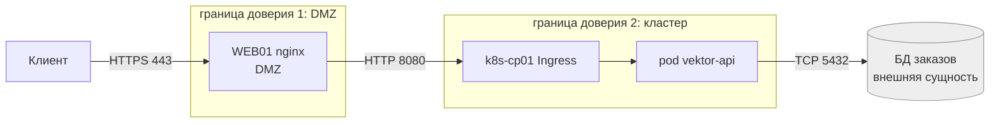

# Безопасность в жизненном цикле разработки: threat modeling, security by design, shift-left

## 1. Введение (зачем это нужно в реальной работе)

Тикет #4712 в поддержку «Вектора»:

> **Пользователь:** sidorov (склад)
> **Что написал:** «Клиенты звонят по 20 раз в день и спрашивают, где их груз. Сделайте страницу, где по номеру заказа видно статус, чтобы не звонили.»
> **Срочность:** средняя

Задача уходит в разработку, и через две недели кто-то предлагает: «вынесем API отслеживания в DMZ на WEB01, наружу, по номеру заказа — без авторизации, так же проще». Номер заказа — это последовательный идентификатор. То есть через месяц кто-то скриптом переберёт номера и выкачает все заказы компании: клиентов, адреса, суммы, маршруты. Это уже не «баг», это утечка персональных данных со всеми вытекающими по 152-ФЗ.

Именно поэтому безопасность нельзя «прикрутить» в конце, перед релизом. Дешевле всего поймать такие вещи на салфетке, когда фича ещё обсуждается, — а не после инцидента. В этой главе разберём три связанные вещи: **threat modeling** (моделирование угроз — систематический поиск того, что может пойти не так в конкретной системе), **security by design** (безопасность, заложенная в архитектуру, а не приделанная сверху) и **shift-left** (перенос проверок «влево» по конвейеру — ближе к разработке). После главы ты должен уметь: за час собрать модель угроз для сервиса, превратить угрозы в требования и тесты, завести threat model как код в Git, поставить первый осмысленный security-гейт в пайплайн и объяснить команде, почему это не «бюрократия от безопасников».

Дальше по модулю мы будем разбирать конкретные инструменты (сканеры в уроке 98, секреты в 96, supply chain в 97, Kubernetes в 99) — эта глава про **процесс и мышление**, которые эти инструменты обслуживают. Инструмент без процесса — просто ещё одна красная лампочка, которую через месяц отключат.

## 2. Теория «под капотом» (как это работает: архитектура, протоколы)

### Где безопасность живёт в SDLC

SDLC (Software Development Life Cycle — жизненный цикл разработки ПО) — это путь от идеи до эксплуатации. Контроли безопасности можно ставить на любом этапе, но цена ошибки растёт с каждым шагом вправо: переделывать схему данных в проде дороже, чем на этапе проектирования, на порядки (конкретные множители из старых исследований вроде IBM/SSI гуляют по интернету с разными цифрами — `[ПРОВЕРИТЬ]`, если тебе нужна точная ссылка).

```text
  ТРЕБОВАНИЯ      ДИЗАЙН         КОД          СБОРКА        ТЕСТ        ЭКСПЛУАТАЦИЯ
       |             |             |             |            |              |
  security    threat model   code review   SCA/SBOM     DAST/ZAP      WAF, SIEM
  requirements  STRIDE       pre-commit    подпись      fuzz          runtime-защита
  abuse cases   DFD          линтеры       Trivy        pentest       инциденты
       |             |             |             |            |              |
       <---------- shift-left: сюда ------------------>|<---- и так было --->
                                                        (стоимость фикса растёт -->)
```

**Shift-left** — это не «переложить безопасность на разработчиков». Это осознанный перенос части контролей влево плюс автоматизация, чтобы разработчик получал быстрый и понятный ответ у себя локально, а не через три недели от службы ИБ письмом «в your коде уязвимость, номер 47». Ключевое слово — **быстрый и понятный**: гейт, который висит 40 минут и падает на 200 ложных срабатываний, отключают. Всегда.

### Threat modeling: четыре вопроса и STRIDE

Моделирование угроз — структурированный разговор «а что если» до того, как написан код. Классическая рамка — четыре вопроса (Адам Шостак, «Threat Modeling: Designing for Security»):

1. Что мы строим? → **DFD** (Data Flow Diagram, диаграмма потоков данных) с границами доверия.
2. Что может пойти не так? → перебор угроз по **STRIDE**.
3. Что мы с этим сделаем? → митигация / принятие / передача / устранение.
4. Хорошо ли мы справились? → ревью модели, проверка, что митигации попали в код и тесты.

**STRIDE** — мнемоника из шести категорий угроз (придумана в Microsoft):

| Категория | Что нарушает | Пример для API отслеживания заказов |
|---|---|---|
| **S**poofing (подмена) | аутентификацию | запрос от имени чужого клиента |
| **T**ampering (изменение) | целостность | подмена статуса заказа в БД |
| **R**epudiation (отказ) | неотказуемость | «это не я менял статус», нет логов |
| **I**nformation disclosure | конфиденциальность | перебор номеров → выгрузка всех заказов |
| **D**enial of service | доступность | 10 000 rps на публичный endpoint |
| **E**levation of privilege | авторизацию | обычный клиент вызывает админский метод API |

Для приватности есть отдельная мнемоника **LINDDUN** — она пригодится, когда сервис обрабатывает ПДн (а у «Вектора» это почти всё; нормативка — в уроке 101).

### Security by design: принципы

Это не продукт, а набор принципов проектирования. Рабочий минимум, который стоит держать в голове:

- **Least privilege** — минимально необходимые права (сервисный аккаунт в k8s не должен уметь читать все секреты кластера).
- **Defense in depth** — несколько независимых слоёв: авторизация в приложении + сетевые политики + WAF.
- **Secure by default** — «из коробки безопасно», а небезопасное требует явного действия (не наоборот: по умолчанию открыто, а закрывать надо вручную).
- **Fail secure** — при ошибке система закрывается, а не открывается.
- **Minimize attack surface** — каждый лишний открытый порт, эндпоинт, отладочный маршрут — это подарок атакующему.
- **Complete mediation** — каждая проверка прав на каждом запросе, а не «один раз на входе».
- **Economy of mechanism** — чем проще механизм, тем меньше в нём дырок.
- **Kerckhoffs's principle / open design** — стойкость не должна держаться на секретности схемы; секреты — только ключи и пароли.

Стандарты-ориентиры: **NIST SSDF (SP 800-218)** — набор практик безопасной разработки, **OWASP SAMM** — модель зрелости, **Microsoft SDL** — исторический прародитель, **OWASP ASVS** — проверяемые требования к веб-приложениям, **OWASP Top 10** и **CWE Top 25** — списки типовых ошибок.

### Как это выглядит в репозитории

Ключевая идея DevOps-версии: **артефакты безопасности — это код в Git, а не документ в SharePoint**. Модель угроз живёт рядом с сервисом, ревьюится через merge request, версионируется тегами, а её требования автоматизируются политиками (policy-as-code, например OPA/Rego) и тестами.

```text
threat-models/
├── threat-models/vektor-api.md      # сама модель: DFD, STRIDE, риски, митигации
├── policy/deny_latest_tag.rego      # требования как код (OPA/Rego)
├── scripts/check-threat-model.sh    # гейт: есть ли модель и обязательные разделы
├── k8s/vektor-api.yaml              # манифест, к которому применяются политики
├── .pre-commit-config.yaml          # то же самое локально у разработчика
└── .gitlab-ci.yml                   # то же самое в пайплайне
```

Порты в этой теме — почти не про сеть, а про **поверхность атаки**: 80/443 на WEB01 (nginx), 6443 (API Kubernetes на k8s-cp01), 22 (SSH на UBU01/GIT01). Инвентаризация этих портов — первый практический шаг любой модели угроз: «что у нас вообще торчит наружу».

## 3. Аналогия из жизни

Представь, что ты строишь дом. **Security by design** — это когда на этапе проекта ты решил: вот здесь будет щиток с УЗО, вот здесь проводка в металлической трубе, вот здесь датчик дыма, а входная дверь — с замком, а не с защёлкой. **Threat modeling** — это разговор с прорабом до заливки фундамента: «с этой стороны улица, тут будут лезть через забор; тут подвал, туда может затечь вода; тут хранятся инструменты, надо запереть». **Shift-left** — это когда электрик проверяет каждую линию тестером по ходу работы, а не когда дом уже оштукатурен и надо вскрывать стены. А безопасник, который приходит в конце и говорит «переделайте всё» — это инспектор, который приехал после новоселья.

Аналогия ломается в одном: дом нельзя перепроектировать, а софт можно и часто нужно — в легаси-системах «сдвигать влево» нечего, там работают справа:WAF, мониторинг, сегментация. Модель угроз не даёт гарантии, что дырок нет; она даёт гарантию, что вы о них подумали.

## 4. Практика и команды

Все действия — на стенде «Вектор»: GIT01 (GitLab + runner, 10.10.10.50), UBU01 (10.10.10.30, там же ставим инструменты), WEB01 (nginx в DMZ, 10.10.20.10), k8s-cp01 (10.10.10.61).

**1. Создать проект и склонировать его.** В веб-интерфейсе GitLab (`http://10.10.10.50`) создаёшь проект `security/threat-models`, затем:

```bash
git clone http://10.10.10.50/security/threat-models.git
cd threat-models
mkdir -p threat-models policy scripts k8s
tree -a -L 2
```

`tree -a` показывает скрытые файлы (`.gitlab-ci.yml`, `.pre-commit-config.yaml`), `-L 2` — глубину. Ожидаемо: пять пустых каталогов. Дальше всё наполняем.

**2. Ветка под задачу — часть процесса, а не формальность.**

```bash
git switch -c sec/tm-vektor-api
```

`switch -c` создаёт ветку и сразу переключается. Правило команды: любое изменение модели угроз идёт через MR, чтобы её кто-то прочитал. Модель, которую никто не ревьюил, — это личный дневник.

**3. Нарисовать DFD прямо в Markdown.** В GitLab Mermaid рендерится в веб-интерфейсе:



Что важно: **границы доверия** — линии, где данные переходят из менее доверенной зоны в более доверенную (Интернет → DMZ, DMZ → кластер, кластер → данные). Все интересные угрозы живут именно на этих переходах.

**4. Каркас модели угроз одним heredoc'ом.**

```bash
cat > threat-models/vektor-api.md <<'EOF'
# Threat model: vektor-api (отслеживание заказов)
Владелец: adm.student | Версия: 0.1 | Дата: 2026-XX-XX | Ссылка на MR: !1

## 1. Что строим
Публичный endpoint GET /api/orders/{id}/status. Без аутентификации (по номеру заказа).

## 2. Границы доверия
1. Интернет -> nginx (WEB01, DMZ)
2. nginx -> Ingress (кластер)
3. vektor-api -> БД заказов

## 3. STRIDE

## 4. Риски и митигации

## 5. Что осталось принято как риск (с подписью владельца)
EOF
```

`<<'EOF'` в кавычках — чтобы `$` и бэктики внутри не подставлялись шеллом. Пустые разделы — намеренно: это скелет, который заполняется на сессии.

**5. Заполнить STRIDE-таблицу (фрагмент — остальное сам).**

```markdown
## 3. STRIDE

| # | Категория | Угроза | Риск (L×I) | Митигация | Требование / тест |
|---|-----------|--------|-----------|-----------|-------------------|
| 1 | Information disclosure | перебор `id` -> выгрузка всех заказов | 5×5=25 | непредсказуемый public_id (ULID), rate limit | тест: 404 на чужой id; k6: 429 после N rps |
| 2 | DoS | флуд на публичный endpoint | 4×4=16 | rate limit в nginx + кэш статуса | нагрузочный тест (урок 90) |
| 3 | Spoofing | нет аутентификации клиента | 3×3=9 | Telegram/e-mail уведомления вместо «личного кабинета» | проверка на ревью дизайна |
```

Риск считаем грубо как вероятность × ущерб по шкале 1–5. Главное — **каждая строка заканчивается конкретным требованием или тестом**, иначе это не модель угроз, а литературное творчество.

**6. Инвентаризация поверхности атаки на самом сервере.**

```bash
ssh adm.student@10.10.20.10
sudo ss -tulpn
```

`-t` TCP, `-u` UDP, `-l` только слушающие, `-p` показать процесс (нужен root), `-n` без резолва имён. Вывод:

```text
Netid State  Local Address:Port  Process
tcp   LISTEN 0.0.0.0:22          users:(("sshd",pid=812,fd=3))
tcp   LISTEN 0.0.0.0:80          users:(("nginx",pid=1201,fd=6))
```

Смотрим: всё ли из списка должно быть видно в DMZ? SSH из DMZ наружу — уже вопрос к модели.

**7. Проверить поверхность атаки снаружи.**

```bash
nmap -sT -Pn -p- --min-rate 2000 10.10.20.10
```

`-sT` — TCP connect scan (работает без root), `-Pn` — не проверять доступность хоста пингом, `-p-` — все 65535 портов, `--min-rate 2000` — не менее 2000 пакетов/с. Ожидаемо: `22/tcp open ssh`, `80/tcp open http`. Всё остальное в отчёте — повод разбираться. **Сканировать можно только свои системы и только с письменного разрешения** — на стенде это твои ВМ, в бою это уголовно наказуемо без согласования.

**8. Security by design, который стал конфигом.** Результат строки 2 из STRIDE — не «внедрить WAF», а конкретные заголовки в nginx на WEB01:

```bash
sudo cp /etc/nginx/sites-available/default /etc/nginx/sites-available/default.bak-095
sudo nano /etc/nginx/sites-available/default
```

```nginx
server {
    listen 80 default_server;
    server_name _;

    add_header X-Content-Type-Options nosniff always;
    add_header X-Frame-Options DENY always;
    add_header Referrer-Policy no-referrer always;
    add_header Content-Security-Policy "default-src 'self'" always;

    location /api/orders/ {
        limit_req zone=api_limit burst=20 nodelay;
        proxy_pass http://10.10.10.61:8080;
    }
}
```

`add_header ... always` — заголовок добавляется и к ошибочным ответам (иначе на 4xx/5xx защиты не будет). Проверка: `sudo nginx -t && sudo systemctl reload nginx`, затем с UBU01 `curl -sI http://10.10.20.10/` — в ответе должны быть все четыре заголовка. Обрати внимание: HSTS (`Strict-Transport-Security`) здесь **не** ставим, потому что стенд работает по HTTP; заголовок имеет смысл только с HTTPS.

**9. Требование как политика (policy-as-code).** Ставим conftest (обёртка над OPA, движком политик; ставится бинарником с релизов или `go install github.com/open-policy-agent/conftest@latest` — версию `[ПРОВЕРИТЬ]`; если GitHub из вашей сети нестабилен, зеркало во внутреннем Nexus/Harbor — тема урока 102):

```bash
conftest --version
mkdir -p policy
cat > policy/deny_latest_tag.rego <<'EOF'
package main

deny contains msg if {
  input.kind == "Deployment"
  not input.spec.template.spec.securityContext.runAsNonRoot
  msg := "securityContext.runAsNonRoot должен быть true"
}

deny contains msg if {
  input.kind == "Deployment"
  some c in input.spec.template.spec.containers
  endswith(c.image, ":latest")
  msg := sprintf("контейнер %s использует :latest — нужен пин по версии или digest", [c.name])
}
EOF
```

Это синтаксис Rego v1 (OPA 1.x, `if` и `contains`). В старых 0.x-версиях писалось `deny[msg] { ... }` — если политика не парсится, посмотри версию `[ПРОВЕРИТЬ]`.

**10. Прогнать политику по манифесту.**

```bash
cat > k8s/vektor-api.yaml <<'EOF'
apiVersion: apps/v1
kind: Deployment
metadata:
  name: vektor-api
  namespace: vektor
spec:
  replicas: 2
  selector:
    matchLabels: { app: vektor-api }
  template:
    metadata:
      labels: { app: vektor-api }
    spec:
      securityContext:
        runAsNonRoot: true
      containers:
        - name: api
          image: harbor.vektor.lab/vektor/api:1.4.2
          ports: [{ containerPort: 8080 }]
EOF

conftest test --policy policy k8s/vektor-api.yaml
```

Ожидаемый вывод при `:latest` и без `runAsNonRoot`:

```text
FAIL - k8s/vektor-api.yaml - main - securityContext.runAsNonRoot должен быть true
FAIL - k8s/vektor-api.yaml - main - контейнер api использует :latest — нужен пин по версии или digest
2 tests, 0 passed, 2 failures
```

Код возврата 1 — именно на нём и строится гейт. Исправленный манифест даёт `2 tests, 0 passed, 0 warnings, 0 failures` и код 0.

**11. Гейт «а модель вообще есть?»**

```bash
cat > scripts/check-threat-model.sh <<'EOF'
#!/usr/bin/env bash
set -euo pipefail
svc="${1:?укажите имя сервиса}"
tm="threat-models/${svc}.md"
test -f "$tm" || { echo "НЕТ threat model для ${svc}"; exit 1; }
grep -q "^## 3. STRIDE" "$tm" || { echo "в ${tm} не заполнен раздел STRIDE"; exit 1; }
grep -q "принято как риск" "$tm" || { echo "в ${tm} нет раздела принятых рисков"; exit 1; }
echo "OK: ${tm}"
EOF
chmod +x scripts/check-threat-model.sh
./scripts/check-threat-model.sh vektor-api
```

`set -euo pipefail` — скрипт падает на любой ошибке, необъявленной переменной и в середине пайпа. Без этого гейт «зеленеет» молча.

**12. То же самое локально, до коммита.**

```bash
cat > .pre-commit-config.yaml <<'EOF'
repos:
  - repo: local
    hooks:
      - id: conftest
        name: conftest policy check
        entry: conftest test --policy policy
        language: system
        files: ^k8s/.*\.ya?ml$
      - id: threat-model
        name: threat model present
        entry: ./scripts/check-threat-model.sh vektor-api
        language: system
        pass_filenames: false
EOF
pip install pre-commit   # или apt/pipx, версия [ПРОВЕРИТЬ]
pre-commit install
pre-commit run --all-files
```

`files:` — регулярка, к каким файлам применять хук; `pass_filenames: false` — не подсовывать хуку имена файлов (наш скрипт сам знает путь).

**13. Пайплайн в GitLab.**

```yaml
stages: [design, policy]

threat-model-check:
  stage: design
  image: alpine:3.20
  script:
    - apk add --no-cache bash grep
    - ./scripts/check-threat-model.sh vektor-api
  rules:
    - if: '$CI_PIPELINE_SOURCE == "merge_request_event"'

policy-check:
  stage: policy
  image: openpolicyagent/conftest:latest
  script:
    - conftest test --policy policy k8s/
  rules:
    - if: '$CI_PIPELINE_SOURCE == "merge_request_event"'
```

Оба джоба имеют смысл только на MR — гонять их на каждый пуш в ветку бессмысленно и дорого. Тег образа `latest` в собственном пайплайне — отдельная ирония, которая снимется в уроке 97; тег образа runner'а и доступность образов из вашей сети — `[ПРОВЕРИТЬ]`.

**14. Зафиксировать версию модели как артефакт.**

```bash
git add . && git commit -m "sec: threat model vektor-api + policy gate"
git push -u origin sec/tm-vektor-api
git tag -a tm-vektor-api-v1 -m "Модель угроз vektor-api, ревью !1"
git push origin tm-vektor-api-v1
```

Тег нужен не для красоты: при аудите (внутреннем или внешнем, см. урок 101) спрашивают «покажите модель угроз на момент релиза 1.4.2». Ответ «вот тег» звучит сильно лучше, чем «кажется, было в Confluence».

## 5. Лабораторная работа (пошаговый сценарий на виртуалке)

### Предусловия

- **GIT01** (10.10.10.50) — GitLab CE и runner работают, у тебя есть учётная запись и права создавать проекты.
- **UBU01** (10.10.10.30) — SSH-доступ под `adm.student`, установлены `git`, `curl`, `nmap`, `python3`/`pip`.
- **WEB01** (10.10.20.10) — nginx работает, отдаёт страницу-заглушку, есть sudo.
- **k8s-cp01** (10.10.10.61) — кластер из предыдущих глав поднят; для этой лабы apply не обязателен, достаточно `kubectl apply --dry-run=server` или вовсе без кластера.
- Windows-часть стенда не нужна — весь урок на Linux.
- Если проект `security/threat-models` ещё не создан — создаёшь (шаг 1).

### Снапшот

На **GIT01**, **UBU01** и **WEB01**:

```text
VMware Workstation → выбрать ВМ → меню VM → Snapshot → Take Snapshot…
Имя: before-devops-095
```

То же из PowerShell на хосте (путь к `.vmx` подставь свой, `[ПРОВЕРИТЬ]` установку):

```powershell
& "C:\Program Files (x86)\VMware\VMware Workstation\vmrun.exe" snapshot "C:\VMs\GIT01\GIT01.vmx" before-devops-095
& "C:\Program Files (x86)\VMware\VMware Workstation\vmrun.exe" snapshot "C:\VMs\UBU01\UBU01.vmx" before-devops-095
& "C:\Program Files (x86)\VMware\VMware Workstation\vmrun.exe" snapshot "C:\VMs\WEB01\WEB01.vmx" before-devops-095
```

### Шаги

1. **GIT01, веб-интерфейс.** Создать проект `security/threat-models` (private). Ожидаемо: пустой репозиторий, видна команда клонирования.
2. **UBU01.** Склонировать проект, создать структуру каталогов (`threat-models`, `policy`, `scripts`, `k8s`), проверить через `tree -a -L 2`. Ожидаемо: 4 каталога + `.git`.
3. **UBU01.** Создать ветку `sec/tm-vektor-api` (`git switch -c`). Ожидаемо: `git branch` показывает звёздочку на новой ветке.
4. **UBU01.** Написать DFD для `vektor-api` в Mermaid внутри `threat-models/vektor-api.md`, отметить три границы доверия. Ожидаемо: после пуша в GitLab файл рендерится схемой (если Mermaid не отрендерился — проверь, что блок размечен как ```mermaid).
5. **UBU01.** Создать каркас модели heredoc'ом и заполнить раздел STRIDE минимум пятью строками, у каждой — риск L×I и митигация. Ожидаемо: таблица заполнена, ни одна строка не заканчивается словом «WAF».
6. **WEB01.** Снять инвентаризацию: `sudo ss -tulpn`, затем с UBU01 — `nmap -sT -Pn -p- 10.10.20.10`. Ожидаемо: в отчёте 22 и 80; всё лишнее — записать в модель как «незапланированная поверхность атаки».
7. **WEB01.** Добавить security-заголовки и `limit_req` в конфиг nginx, сделать бэкап `default.bak-095`, `nginx -t`, `systemctl reload nginx`. Ожидаемо: `curl -sI http://10.10.20.10/` показывает `X-Content-Type-Options`, `X-Frame-Options`, `Referrer-Policy`, `Content-Security-Policy`.
8. **UBU01.** Установить conftest, написать `policy/deny_latest_tag.rego`, создать `k8s/vektor-api.yaml` с `:latest` и без `runAsNonRoot`. Ожидаемо: `conftest test` даёт 2 FAIL и код возврата 1 (`echo $?`).
9. **UBU01.** Исправить манифест (пин версии образа, `runAsNonRoot: true`), прогнать conftest снова. Ожидаемо: 0 failures, код 0.
10. **UBU01.** Написать `scripts/check-threat-model.sh`, сделать исполняемым, прогнать. Ожидаемо: `OK: threat-models/vektor-api.md`.
11. **UBU01.** Настроить `.pre-commit-config.yaml`, `pre-commit install`, `pre-commit run --all-files`. Ожидаемо: оба хука Passed; затем намеренно убрать `runAsNonRoot` и убедиться, что коммит блокируется.
12. **UBU01.** Добавить `.gitlab-ci.yml` с двумя джобами, закоммитить, запушить, открыть MR в GitLab. Ожидаемо: пайплайн MR зелёный, в логах видно `OK: threat-models/vektor-api.md` и `0 failures`.
13. **GIT01/GitLab.** Попросить кого-то (или самому во второй вкладке) сделать ревью MR: проверить, что каждая угроза имеет митигацию. Смержить, поставить тег `tm-vektor-api-v1`, запушить его. Ожидаемо: тег виден в `Repository → Tags`.

### Проверка

- [ ] Проект `security/threat-models` существует, ветка `main` содержит все файлы.
- [ ] В `threat-models/vektor-api.md` есть разделы «Что строим», «Границы доверия», «STRIDE», «Риски и митигации», «Принятые риски».
- [ ] В STRIDE ≥5 строк, у каждой есть числовая оценка риска и конкретная митигация/тест.
- [ ] `nmap` с UBU01 по 10.10.20.10 показывает только 22 и 80.
- [ ] `curl -sI http://10.10.20.10/` возвращает 4 security-заголовка.
- [ ] `conftest test --policy policy k8s/` на исправленном манифесте возвращает код 0.
- [ ] `pre-commit run --all-files` проходит; при возврате `:latest` — падает.
- [ ] Пайплайн MR зелёный, тег `tm-vektor-api-v1` создан.
- [ ] Запись в `stand-log.md` сделана.

### Сломай и почини

> **Пользователь:** ivanov
> **ВМ:** GIT01 (веб-интерфейс GitLab), рабочая станция — WIN11-CL01
> **Что написал:** «Не могу смержить MR !2 — пайплайн красный на `policy-check`, а я всего лишь поправил `replicas` с 2 на 3. Ничего криминального не менял. Отключите эту проверку, релиз горит.»
> **Срочность:** высокая, релиз сегодня

**Как воспроизвести поломку.** В ветке MR заменить образ на `harbor.vektor.lab/vektor/api:latest` (или убрать блок `securityContext`), запушить. `policy-check` падает.

**Диагностика по шагам.**

1. Открыть лог джоба `policy-check` в GitLab: там должен быть точный FAIL-текст от conftest. Читаем его, а не догадываемся.
2. Локально воспроизвести: `git fetch && git switch <ветка> && conftest test --policy policy k8s/`. Если локально зелено, а в CI красно — вопрос к версии conftest/OPA в образе, а не к манифесту `[ПРОВЕРИТЬ]`.
3. Посмотреть `git diff main...<ветка> -- k8s/` — что реально изменилось. Классика: разработчик «поправил только replicas», но его IDE или `kubectl set image` затащили `:latest`.
4. Проверить, не изменена ли сама политика: `git log -p policy/`. Если политику правили в том же MR — это красный флаг, обсудить отдельно.
5. Проверить, что в реестре есть нужный тег: `curl -s http://harbor.vektor.lab/api/v2.0/projects/vektor/repositories/api/artifacts?page_size=5` `[ПРОВЕРИТЬ]` точный путь API Harbor.

**Решение.** Вернуть в манифест конкретную версию образа (`api:1.4.2`) или digest, добавить `runAsNonRoot: true`, запушить. Пайплайн зелёный, MR мержится.

**Что написать пользователю.**

> Иван, привет. Пайплайн не «сломался» — он поймал в твоём MR смену образа на `:latest`. Это не про твои `replicas`: тег `latest` означает, что при следующем рестарте пода может приехать другой код, и мы не сможем сказать, что именно у нас в проде. Поставь, пожалуйста, конкретную версию (`api:1.4.2`) — и мерж пройдёт. Заодно локально поставь pre-commit (`pre-commit install`), тогда такие вещи видны до пуша. Правило и обоснование — в `threat-models/vektor-api.md`, раздел STRIDE.

**Как закрыть заявку.** Категория — «не инцидент, а срабатывание контроля». В ответе зафиксировать причину, ссылку на правило и что сделано, чтобы не повторялось (pre-commit у разработчика). Отключение проверки — не вариант; если правило реально мешает, оно меняется через MR к политике с обоснованием, а не через «уберите гейт».

### Что изменилось на стенде

- **GIT01:** новый проект `security/threat-models` (ветка `main`, тег `tm-vektor-api-v1`), два CI-джоба, MR !1 и !2 в истории.
- **UBU01:** установлен `conftest`, `pre-commit`; локальный клон `~/threat-models`; настроены git-хуки.
- **WEB01:** изменён `/etc/nginx/sites-available/default` — добавлены 4 security-заголовка и зона `limit_req` для `/api/orders/`; бэкап `default.bak-095`; в модели зафиксирована текущая поверхность атаки (22, 80).
- **Документы:** `threat-models/vektor-api.md` — действующая модель угроз сервиса отслеживания заказов (используется как пример в уроках 98, 99, 101).
- **Не разворачивали:** `vektor-api` в кластере не запускался, БД заказов — внешняя сущность, на стенде отсутствует.

### Откат

VMware Workstation → нужная ВМ → `VM → Snapshot → Snapshot Manager` → выбрать `before-devops-095` → **Revert To Snapshot**. Или из PowerShell:

```powershell
& "C:\Program Files (x86)\VMware\VMware Workstation\vmrun.exe" revertToSnapshot "C:\VMs\WEB01\WEB01.vmx" before-devops-095
```

Локально на WEB01 без отката всей ВМ: `sudo cp /etc/nginx/sites-available/default.bak-095 /etc/nginx/sites-available/default && sudo nginx -t && sudo systemctl reload nginx`. Репозиторий в GitLab откатывать не нужно — история и тег остаются, это нормальное состояние стенда.

## 6. Ошибки новичков и безопасность

1. **«Модель угроз = документ на 40 страниц».** → Никто не читает, документ умирает через месяц. → Модель на 1–2 страницы, 5–10 угроз, у каждой митигация и тест, ревью через MR.
2. **Threat modeling один раз, на старте проекта.** → Архитектура меняется, модель врёт. → Обновлять модель при каждом изменении границ доверия (новый внешний API, новая БД, новый сервис), хранить в Git рядом с кодом, тегировать по релизам.
3. **Гейт, который блокирует всё.** → Через две недели его отключают, и вместе с ним умирают все остальные проверки. → Блокировать только на критичном (например, `:latest`, `runAsNonRoot`), остальное — warning; гейт не дольше пары минут; сообщение об ошибке содержит, что именно сделать.
4. **Сваливать безопасность на разработчиков и уходить.** → «Shift-left» превращается в «shift-away». → Модель угроз делается **вместе** с командой (30–60 минут сессии), безопасник остаётся консультантом, в команде появляется security champion.
5. **Политики пишутся без версионирования и ревью.** → Один человек тихо ослабляет правило, никто не замечает. → Все политики в Git, изменения только через MR, `git log -p policy/` в разборе любого спорного срабатывания.
6. **Путать threat modeling со сканированием.** → Сканеры находят известные классы багов в коде; модель угроз находит **логические** дыры (например, IDOR — доступ к чужому заказу по номеру), которых в шаблонах сканеров нет. → Одно не заменяет другое.
7. **Оценки риска «на глаз» без обоснования.** → Спор «я считаю, это не критично» на ревью. → Фиксировать, что именно оценивали (вероятность × ущерб), и кто владелец принятого риска.

**Безопасность.** В этой главе мы намеренно отключали часть защиты ради наглядности — например, оставили публичный endpoint без аутентификации как учебный кейс. В боевой среде публичный API с данными заказов без аутентификации и rate limit — это не «упрощение», а инцидент. Сканирование (`nmap`) допустимо **только** по своим системам с письменным согласованием: в РФ несанкционированное сканирование чужих ресурсов квалифицируется как неправомерный доступ (ст. 272 УК РФ). Security-заголовки без HTTPS дают ложное чувство защиты: HSTS, `Secure`-куки и `SameSite` работают только в связке с TLS. Пароли и токены в репозиторий не коммитим никогда — этой теме целиком посвящён урок 96.

## 7. Вопросы на собеседовании

**1. Что такое threat modeling и как вы его проводите на практике?**

Ответ: это структурированный разбор «что может пойти не так» на этапе дизайна. Провожу по четырём вопросам: что строим (рисуем DFD с границами доверия), что может пойти не так (перебираем по STRIDE, для ПДн добавляю LINDDUN), что делаем (митигация/принятие/передача, с оценкой вероятность × ущерб), хорошо ли справились (ревью и проверка, что митигации попали в код и тесты). Формат — сессия на 45–60 минут с командой и владельцем продукта, результат — файл в Git рядом с сервисом, обновляется при изменении границ доверия.

*Что хочет услышать:* что это процесс с артефактом в репозитории, а не разовое мероприятие; что каждая угроза превращается в требование или тест.
*Красный флаг:* «это делает служба ИБ, мы им отдаём схему» — значит, в команде этого не будет.

**2. Что значит shift-left и какие у него ограничения?**

Ответ: перенос части контролей безопасности ближе к разработке — security-требования в бэклоге, threat model на дизайне, pre-commit-хуки, SCA/SAST в MR-пайплайне. Смысл — ранний фидбэк дешевле и быстрее. Ограничения: контроли не отменяют правые (runtime-защита, WAF, мониторинг нужны всё равно); гейты должны быть быстрыми и точными, иначе их отключат; легаси без пайплайна «влево» не сдвинешь; нельзя перекладывать ответственность на разработчиков без обучения и поддержки.

*Что хочет услышать:* понимание, что shift-left — это про DX (developer experience) и автоматизацию, и что правые контроли остаются.
*Красный флаг:* «shift-left = безопасники больше не нужны» или «всё должно блокироваться на любом уровне».

**3. Расскажите про STRIDE, приведите примеры.**

Ответ: шесть категорий — Spoofing (подмена идентичности), Tampering (изменение данных), Repudiation (отказ от действия, отсутствие неотказуемых логов), Information disclosure (утечка), Denial of service (отказ в обслуживании), Elevation of privilege (повышение прав). Пример для публичного API заказов: S — запрос от имени чужого клиента; T — подмена статуса; R — нет аудит-лога изменений; I — перебор ID и выгрузка всех заказов (IDOR); D — флуд на endpoint; E — обычный клиент вызывает админский метод. Каждой категории — минимум одна митигация.

*Что хочет услышать:* что категории привязаны к конкретным примерам из своего опыта, а не зачитаны с вики.
*Красный флаг:* путает STRIDE с OWASP Top 10 или не может назвать ни одного примера.

**4. Чем security by design отличается от security by default и defense in depth?**

Ответ: by design — принципы, заложенные в архитектуру (least privilege, минимизация поверхности атаки, fail secure, complete mediation); by default — безопасная конфигурация «из коробки», когда небезопасное требует явного действия; defense in depth — несколько независимых слоёв защиты, чтобы отказ одного не открывал всё. Пример: by design — непредсказуемые публичные ID заказов; by default — контейнер запускается не от root и с read-only FS, если явно не разрешено иное; depth — авторизация в приложении + NetworkPolicy + rate limit на nginx.

*Что хочет услышать:* различает уровни и приводит примеры из своей практики.
*Красный флаг:* «это одно и то же, просто маркетинг».

**5. Как встроить security-гейт в CI так, чтобы его не отключили через месяц?**

Ответ: гейт должен быть быстрым (до минуты-двух на MR), точным (низкий false-positive) и **действенным** — сообщение говорит, что сделать, а не «нарушение политики №7». Блокирую только критичное, остальное — warning'и и отчёт. Политики лежат в Git и меняются через MR с обоснованием, а не в настройках джобы. Плюс baseline/ratchet: новые нарушения блокируются, старый долг не растёт, но и не блокирует релиз целиком. Плюс метрики: сколько срабатываний, сколько принято, сколько ложных — иначе через квартал никто не помнит, зачем гейт.

*Что хочет услышать:* ориентацию на developer experience, постепенность и управление исключениями.
*Красный флаг:* «включаем всё и на максимальном уровне, пусть разбираются».

## 8. Источники (официальная документация)

- **NIST** — `csrc.nist.gov`, документ «SP 800-218: Secure Software Development Framework (SSDF) Version 1.1» (поиск: `NIST SP 800-218 SSDF`).
- **OWASP** — `owasp.org`, проект «Threat Modeling» и инструмент OWASP Threat Dragon (поиск: `OWASP Threat Dragon documentation`); там же «OWASP SAMM» (`owaspsamm.org`) и «OWASP ASVS».
- **Microsoft** — `learn.microsoft.com`, раздел «Security Development Lifecycle» и статьи по STRIDE (поиск: `Microsoft SDL STRIDE threat modeling`).
- **MITRE** — `cwe.mitre.org`, список «CWE Top 25 Most Dangerous Software Weaknesses».
- **Open Policy Agent** — `openpolicyagent.org`, раздел «Policy Language» (Rego); **Conftest** — `conftest.dev` (поиск: `conftest test policy rego`).
- **pre-commit** — `pre-commit.com`, раздел «pre-commit config».
- **GitLab** — `docs.gitlab.com`, раздел «CI/CD pipelines» и «Merge request pipelines».
- Книга: Adam Shostack, «Threat Modeling: Designing for Security» — первоисточник четырёх вопросов и STRIDE-практики (издательство Wiley; наличие в РФ `[ПРОВЕРИТЬ]`).
- Точные версии conftest/OPA, тег образа `alpine` и путь API Harbor — `[ПРОВЕРИТЬ]` на момент выполнения лабы.
