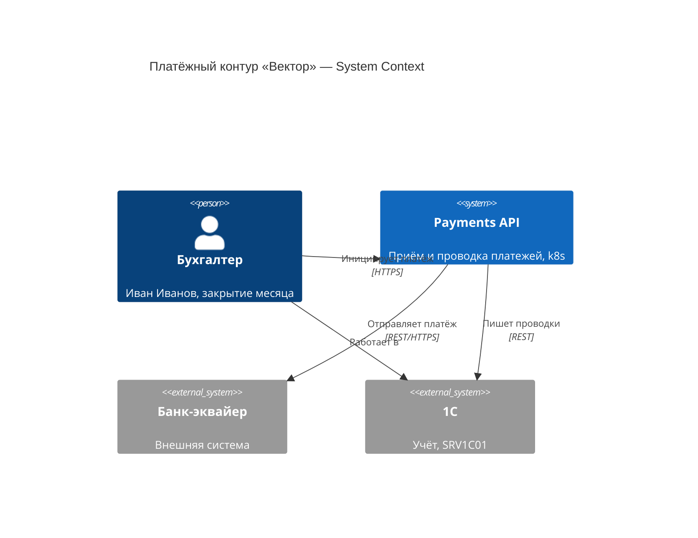
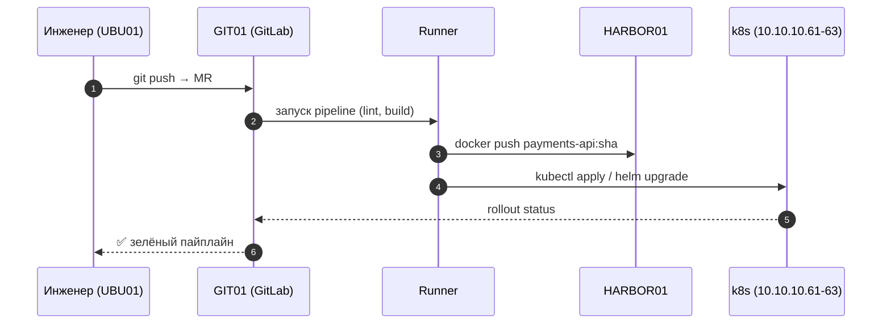

# Документирование: ADR, runbook'и, диаграммы (C4, Mermaid), онбординг-гайды

## 1. Введение (зачем это нужно в реальной работе)

**Заявка в GitLab (issue #214, проект `vektor/support`):**

> Пользователь: ivanov (Иван Иванов, бухгалтерия)
> ВМ: WIN11-CL01
> Что написал: «Платёж из 1С не проходит, отдаёт 502. Ваш дежурный по инструкции перезапустил `payments-api`, но стало хуже — теперь платежи не уходят вообще. И ещё: почему в инструкции написано `payments-legacy`, а в кластере такого namespace нет?»
> Срочность: высокая, закрытие месяца.

Разбор такой заявки почти всегда упирается не в `kubectl`, а в бумажки. Runbook (пошаговая инструкция «что делать, когда сломалось») устарел полгода назад: сервис переехал в другой namespace, команду поправили в чате, а в репозитории осталась старая версия. Дежурный инженер сделал ровно то, что написано, — и усугубил. Никто не виноват, кроме отсутствия процесса: решения не записываются (ADR), процедуры не версионируются (runbook в Git), архитектуру никто не может объяснить на одной картинке (C4), а новый человек учится по слухам (онбординг-гайд).

Документация — это не «писанина для галочки», а способ масштабировать себя. В DevOps-команде из пяти человек без документов любое дежурство превращается в звонок «а как это чинится?» самому опытному, а он в это время на созвоне. После главы ты будешь уметь: вести ADR в Git с шаблоном и статусами, писать runbook'и, которые реально спасают в 3 часа ночи, рисовать диаграммы как код в Mermaid (C4-уровни), собирать сайт документации через mkdocs и ставить линтеры документации в CI, чтобы «устаревшее» ловилось пайплайном, а не инцидентом.

## 2. Теория «под капотом» (как это работает: архитектура, протоколы)

Ключевая идея — **docs-as-code** (документация как код). Markdown-файлы лежат в том же Git-репозитории, что и код или конфиги, проходят через merge request, ревью и CI, версионируются тегами и откатываются `git revert`. Никаких «версия_final_новый(2).docx» на файловом сервере.

Четыре типа документации (классификация Divio) — их нельзя смешивать в одном файле, иначе получается нечитаемая каша:

| Тип | Отвечает на вопрос | Пример на стенде |
|-----|--------------------|------------------|
| Tutorial (обучение) | «Проведи меня за руку» | онбординг-гайд |
| How-to (инструкция) | «Как сделать X» | runbook дежурного |
| Reference (справочник) | «Что означает параметр Y» | описание переменных Helm-чарта |
| Explanation (объяснение) | «Почему так устроено» | ADR, C4-диаграммы |

**ADR (Architecture Decision Record)** — короткая запись об одном значимом решении: контекст, варианты, что выбрали, последствия. Формат предложил Майкл Нигейрд (Michael Nygard) в 2011 году; шаблон — примерно 1 страница. Главные свойства: ADR **иммутабелен** (не переписываем задним числом — выпускаем новый со статусом `superseded by ADR-0012`), у него есть **статус** (`proposed`, `accepted`, `rejected`, `deprecated`, `superseded`) и **номер по порядку**. Нумерация — четыре цифры (`0001`), чтобы сортировка в файловой системе не ломалась.

**Runbook** — процедура для дежурного: симптом → проверки → действия → проверка успеха → откат → эскалация. Отличие от playbook: playbook чаще про организационную реакцию на инцидент (кто созывает, кто пишет статус), runbook — про конкретные технические шаги.

**C4 model** (Саймон Браун) — четыре уровня абстракции архитектуры. Руками рисуем только первые два, остальные — по необходимости:

```text
Уровень 1  System Context  — система, люди, внешние системы        (для бизнеса и новичков)
Уровень 2  Container       — сервисы, БД, брокеры, реестр образов  (для команды и DevOps)
Уровень 3  Component       — модули внутри контейнера              (для разработчиков)
Уровень 4  Code            — классы/функции                        (генерится из кода, руками не рисуем)
```

**Mermaid** — язык описания диаграмм текстом (flowchart, sequence, state, C4). Рендерится в GitLab/GitHub прямо из блока ```` ```mermaid ````, в mkdocs — через расширение `pymdownx.superfences`. Плюс: диаграмма в диффе MR, ревьюится как код, не «уезжает» от версии документа.

Как это всё лежит в общей картине стенда:

```text
        UBU01 (рабочее место инженера, 10.10.10.30)
                    │  git push (SSH, TCP 22)
                    ▼
        GIT01 (10.10.10.50) — GitLab CE + runner
        репозиторий vektor/docs
        ├── adr/          0001-..., 0002-...   почему так сделано
        ├── runbooks/     payments-502.md      что делать, когда сломалось
        ├── diagrams/     c4-context.md        как устроено (Mermaid)
        └── onboarding/   first-week.md        как включиться
                    │  CI: markdownlint + vale + lychee
                    ▼
        Артефакт: mkdocs site (public/) ──► (опционально) WEB01 в DMZ, 10.10.20.10
```

## 3. Аналогия из жизни

Представь больницу. Когда пациент поступает, врач открывает **историю болезни** — это ADR: там записано, что кололи, почему выбрали этот антибиотик и что было противопоказано. Задним числом историю не переписывают — если лечение поменяли, добавляют новую запись «предыдущая схема отменена». Есть **протокол неотложной помощи** на стене реанимации: «при падении давления — шаг 1, шаг 2, если не помогло — зови заведующего». Это runbook: он не объясняет фармакологию, он экономит минуты. Есть **схема больницы** — общий план корпусов (system context) и поэтажный план отделения (container): на общий план не наносят каждую дверь, иначе им нельзя пользоваться. И есть **инструктаж нового ординатора** в первый день: где ключи, где журнал, к кому идти, что можно трогать, а что нет, — онбординг-гайд.

Аналогия перестаёт работать в одном месте: в медицине документы имеют юридическую силу и проверяются внешними органами, а в ИТ устаревший runbook никто не оштрафует — он просто тихо подставит дежурного в 3 часа ночи.

## 4. Практика и команды

**1. Скелет репозитория документации (UBU01).**

```bash
mkdir -p docs/{adr,runbooks,diagrams,onboarding}
touch docs/README.md docs/adr/index.md docs/runbooks/index.md
printf '# Инженерная документация «Вектор»\n\n| Раздел | Что внутри |\n|---|---|\n| adr/ | почему принято решение |\n| runbooks/ | что делать при инциденте |\n| diagrams/ | архитектура (C4 + Mermaid) |\n| onboarding/ | первый день / неделя / месяц |\n' > docs/README.md
tree -L 2 docs/
```

`tree` покажет структуру. Смотреть: нет ли лишних уровней вложенности — глубже двух папок искать перестают.

**2. Git: ветка, коммит, push, MR.**

```bash
git switch -c docs/adr-0002-registry
git add docs/adr/0002-registry.md
git commit -m "docs(adr): ADR-0002 — Harbor как единый реестр образов"
git push -u origin docs/adr-0002-registry
```

После push GitLab печатает ссылку «create merge request». Конвенция коммитов `docs(adr): ...` (Conventional Commits) позволяет потом фильтровать `git log --grep="docs("`.

**3. Шаблон ADR (MADR, сокращённый) — `docs/adr/template.md`.**

```markdown
# ADR-0002: Единый реестр образов — Harbor на HARBOR01

- Статус: proposed | accepted | rejected | deprecated | superseded by ADR-00XX
- Дата: 2026-02-10
- Владелец: adm.student
- Затрагивает: HARBOR01 (10.10.10.55), k8s-cp01/w01/w02, GIT01

## Контекст
Что происходило, какие ограничения (лицензии, РФ-специфика, сроки).

## Рассмотренные варианты
1. Docker Hub + CI-кеш — просто, но внешняя зависимость и лимиты pull.
2. Harbor на HARBOR01 — свой реестр, скан уязвимостей, прокси-кеш.

## Решение
Выбрали вариант 2, потому что ...

## Последствия
+ ...  − ...  Риски: ...

## Ссылки
issue #..., MR !..., связанный runbook
```

**4. adr-tools — генерация и линковка ADR (опционально).**

```bash
adr new "Harbor как единый реестр образов"
adr list
adr link 3 "Amends" 2
```

`adr new` создаёт `docs/adr/0003-....md` и обновляет индекс; `adr link` проставляет связи между решениями. Инструмент ставится из репозитория `npryce/adr-tools` [ПРОВЕРИТЬ актуальность и способ установки под Ubuntu 24.04]. Если не хочешь зависимость — правь Markdown руками, шаблон выше рабочий.

**5. C4-диаграмма в Mermaid — `docs/diagrams/c4-context.md`.**

````markdown

````

Смотреть: на контексте **нет** Kubernetes, Redis и Kafka — там только люди, системы и внешние сервисы. Если диаграмма пестрит подами — это уже container, не context. C4-синтаксис в Mermaid появился примерно с версии 9.1 [ПРОВЕРИТЬ, какая версия Mermaid встроена в твой GitLab: `Help → About` / `/-/help`].

**6. Sequence-диаграмма CI/CD (проверка, что схема совпадает с `.gitlab-ci.yml`).**

````markdown

````

**7. Шаблон runbook — `docs/runbooks/payments-502.md`.**

```markdown
# Runbook: payments-api отдаёт 502

- Владелец: adm.student · Last verified: 2026-02-10 · Namespace: payments
- Когда применять: на MON01 (10.10.10.40) алерт 5xx > 5% по payments-api, или жалоба из 1С.

## 0. Предусловия
kubectl с kubeconfig от k8s-cp01; доступ к GitLab-репозиторию vektor/payments.

## 1. Проверки (в этом порядке)
kubectl -n payments get pods -o wide
kubectl -n payments describe pod <pod>   # смотрим Events и Last State
kubectl -n payments logs deploy/payments-api --tail=100

## 2. Действия
- Если CrashLoopBackOff после деплоя → откат: helm -n payments rollback payments-api
- Если Ready 0/1 и Events "connection refused" → проверь postgres: kubectl -n data get pods

## 3. Проверка успеха
kubectl -n payments rollout status deploy/payments-api
5xx в MON01 вернулись к норме в течение 10 минут

## 4. Откат
helm -n payments history payments-api && helm -n payments rollback payments-api <REV>

## 5. Эскалация
Нет прогресса 20 минут → дежурный по платформе, issue в vektor/support с меткой incident
```

**8. Поиск по документации и проверка «свежести».**

```bash
rg -n "payments-legacy" docs/            # или: grep -rn "payments-legacy" docs/
for f in docs/runbooks/*.md; do printf "%-40s %s\n" "$f" "$(git log -1 --format=%cs -- "$f")"; done
```

Пример вывода:

```text
docs/runbooks/payments-502.md            2026-02-10
docs/runbooks/cert-web01.md              2025-07-03   ← кандидат на ревью
```

`git log -1 --format=%cs -- <path>` — дата последнего коммита, трогавшего файл. Всё старше 90 дней — на ревью владельцу.

**9. Линтер Markdown — `.markdownlint-cli2.yaml`.**

```yaml
config:
  MD013: false      # длина строки — для таблиц и Mermaid не работает
  MD033: false      # разрешаем инлайн-HTML (details, kbd)
globs:
  - "docs/**/*.md"
  - "*.md"
ignores:
  - "public/**"
```

Запуск: `npx --yes markdownlint-cli2` — вывод вида `docs/runbooks/x.md:12:1 MD022 blanks-around-headings` означает «нет пустой строки вокруг заголовка».

**10. Vale — линтер стиля (терминология, канцелярит), `.vale.ini`.**

```ini
StylesPath = .vale/styles
MinAlertLevel = suggestion
Packages = Google, write-good

[*.md]
BasedOnStyles = Vale, Google
```

Запуск в контейнере: `docker run --rm -v "$PWD":/docs -w /docs jdkato/vale docs/` [ПРОВЕРИТЬ актуальный тег образа и набор пакетов]. Смысл для русскоязычной команды — свой словарь терминов (`kubectl`, а не «куб-контрол»), единое написание `Harbor`, `GitLab`, `namespace`.

**11. CI-пайплайн документации — `.gitlab-ci.yml`.**

```yaml
stages: [lint, build]

default:
  tags: [docker]

markdownlint:
  stage: lint
  image: node:20-alpine
  script:
    - npx --yes markdownlint-cli2 "docs/**/*.md" "*.md"

vale:
  stage: lint
  image: jdkato/vale:latest
  script:
    - vale sync
    - vale --minAlertLevel=error docs/

links:
  stage: lint
  image: lycheeverse/lychee:latest
  script:
    - lychee --no-progress --offline "docs/**/*.md"

pages:
  stage: build
  image: python:3.12-slim
  script:
    - pip install --no-cache-dir mkdocs-material
    - mkdocs build --strict --site-dir public
  artifacts:
    paths: [public]
  rules:
    - if: $CI_COMMIT_BRANCH == $CI_DEFAULT_BRANCH
```

`--strict` в mkdocs превращает битые внутренние ссылки в ошибку сборки. `--offline` у lychee проверяет только локальные ссылки [ПРОВЕРИТЬ флаг в текущей версии]. Если Docker Hub из РФ недоступен или упирается в лимиты — настрой в HARBOR01 прокси-кэш и указывай образы как `harbor01.vektor.lab/library/node:20-alpine`.

**12. Сайт документации — `mkdocs.yml`.**

```yaml
site_name: Вектор — инженерная документация
theme:
  name: material
  language: ru
  features: [navigation.sections, content.code.copy]
nav:
  - Главная: README.md
  - ADR: adr/index.md
  - Runbooks: runbooks/index.md
markdown_extensions:
  - admonition
  - pymdownx.superfences:
      custom_fences:
        - name: mermaid
          class: mermaid
          format: !!python/name:pymdownx.superfences.fence_code_format
```

Локально: `pip install mkdocs-material && mkdocs serve -a 0.0.0.0:8000` → открыть `http://10.10.10.30:8000`. Без блока `custom_fences` Mermaid-код отрендерится как обычный текст — это самая частая причина «диаграмма не работает на сайте, а в GitLab работает».

## 5. Лабораторная работа (пошаговый сценарий на виртуалке)

### Предусловия
- **GIT01** (10.10.10.50) — GitLab CE + runner, доступ `adm.student`, вход по паролю стенда `Lab#2026-vektor` (только учебный стенд!).
- **UBU01** (10.10.10.30) — рабочее место инженера, есть `git`, SSH-доступ по ключу к GIT01.
- **k8s-cp01/w01/w02** (10.10.10.61–63) — кластер из предыдущих уроков, namespace `payments` существует (если нет — создай `kubectl create ns payments` и запусти туда любой учебный Deployment).
- **HARBOR01** (10.10.10.55), **MON01** (10.10.10.40) — используются только как объекты на диаграммах, заходить не обязательно.
- Windows-часть стенда не нужна; заявки приходят через GitLab issue.

### Снапшот
В VMware Workstation: выделить ВМ → `VM → Snapshot → Take Snapshot` → имя `before-devops-112`.
Сделать на **GIT01** и **UBU01**. Если GitLab-данные лежат на отдельном диске ВМ — снапшот GIT01 обязателен, иначе репозиторий и настройки runner'а не откатятся.

### Шаги

1. **UBU01.** Настрой Git и ключ:
   `git config --global user.name "adm.student"`, `git config --global user.email "adm.student@corp.vektor.lab"`, `ssh-keygen -t ed25519 -C "adm.student@corp.vektor.lab"`.
   Ожидаемо: в `~/.ssh/` появились `id_ed25519` и `id_ed25519.pub`.

2. **GIT01 (веб-интерфейс).** Создай группу `vektor` и проект `docs` (Private). В `Settings → Repository` включи `Default branch = main`. В `Preferences → SSH Keys` вставь публичный ключ с UBU01.
   Ожидаемо: `ssh -T git@10.10.10.50` отвечает приветствием GitLab.

3. **UBU01.** `git clone git@10.10.10.50:vektor/docs.git && cd docs` — затем создай структуру из пункта 4.1 (`docs/adr`, `docs/runbooks`, `docs/diagrams`, `docs/onboarding`).
   Ожидаемо: `tree -L 2 docs/` показывает четыре каталога и `README.md` с картой документации.

4. **UBU01.** Скопируй шаблон ADR (пункт 4.3) в `docs/adr/template.md`, затем создай `docs/adr/0001-docs-as-code.md` — решение «документация живёт в Git рядом с кодом, статус accepted».
   Ожидаемо: у ADR заполнены контекст, варианты, решение, последствия.

5. **UBU01.** Создай `docs/adr/0002-registry-harbor.md` по тому же шаблону: контекст — лимиты Docker Hub и доступность из РФ, решение — прокси-кэш в HARBOR01, последствия — зависимость от HARBOR01 и его бэкапа.
   Ожидаемо: в `docs/adr/index.md` появились ссылки на 0001 и 0002.

6. **UBU01.** Нарисуй `docs/diagrams/c4-context.md` — C4Context из пункта 4.5 (люди: бухгалтер; системы: Payments API, 1С, банк-эквайер). Добавь `docs/diagrams/c4-container.md` — второй уровень: `payments-api` в k8s, PostgreSQL, Kafka, Redis, Harbor как реестр, GitLab как CI.
   Ожидаемо: в GitLab (вкладка `Preview` у файла) диаграммы рендерятся; на контексте нет подов и баз.

7. **UBU01.** Напиши `docs/runbooks/payments-502.md` по шаблону из 4.7 с **реальным** namespace `payments`, реальными командами `kubectl`, обязательными полями «Last verified», «Откат», «Эскалация».
   Ожидаемо: любой пункт можно выполнить копипастом без правок.

8. **UBU01.** Создай `docs/onboarding/first-week.md`: первый день (доступы, ключи, где репозитории), первая неделя (пройти runbook'и, поднять локально стенд), первый месяц (свой первый MR в docs, дежурство в паре). Оформи как чек-лист `- [ ]`.
   Ожидаемо: гайд отвечает, «кто я, где что лежит, что можно трогать, к кому идти».

9. **UBU01.** Добавь `.markdownlint-cli2.yaml`, `.vale.ini`, `.gitlab-ci.yml` из пунктов 4.9–4.11 и `mkdocs.yml` из 4.12. Коммит в ветку `docs/bootstrap`, push, merge request.
   Ожидаемо: pipeline запустился, стадия `lint` зелёная (или падает с понятными замечаниями — исправь их).

10. **GIT01.** Проверь MR: раздел `Changes` → `Preview`, убедись, что Mermaid рендерится, а пайплайн зелёный. Смержи в `main`.
    Ожидаемо: `pages`-job собрал `public/`, артефакт скачивается из пайплайна (если GitLab Pages на GIT01 не настроен — это нормально, сайт смотрим локально через `mkdocs serve`).

11. **UBU01.** Проверь свежесть: запусти цикл `for f in docs/runbooks/*.md; ...` из 4.8. Поставь тег `git tag -a docs-v1.0 -m "первый релиз документации" && git push --tags`.
    Ожидаемо: все runbook'и с датой сегодняшнего дня, тег виден в GitLab.

12. **UBU01.** Запиши изменения в `stand-log.md` (см. раздел ниже).

### Проверка
- [ ] `git clone` репозитория `vektor/docs` работает по SSH с UBU01 без пароля.
- [ ] Существуют `docs/adr/0001-*`, `docs/adr/0002-*`, и у каждого заполнены «Контекст», «Решение», «Последствия», «Статус».
- [ ] `docs/diagrams/c4-context.md` рендерится в GitLab; на диаграмме нет подов, есть люди и внешние системы.
- [ ] Runbook `payments-502.md` содержит реальный namespace `payments` и команду отката `helm rollback`.
- [ ] Онбординг-гайд содержит чек-листы на день/неделю/месяц.
- [ ] Pipeline на MR прошёл: стадии `lint` и `build` зелёные.
- [ ] `mkdocs serve` на UBU01 открывает сайт на `http://10.10.10.30:8000`, Mermaid на сайте — картинкой, не текстом.
- [ ] `git tag` содержит `docs-v1.0`.

### Сломай и почини

> **Пользователь:** ivanov (Иван Иванов, бухгалтерия) — заявка пришла через GitLab issue в `vektor/support`
> **ВМ:** WIN11-CL01 (в этом треке Windows-часть может отсутствовать — заявка пришла текстом, его машину не трогаем)
> **Что написал:** «Платёж из 1С отдаёт 502 второй час. Ваш дежурный по инструкции перезапустил `payments-api`, но стало хуже — теперь платежи не уходят вообще. В инструкции написано `payments-legacy`, а в кластере такого namespace нет.»
> **Срочность:** высокая, закрытие месяца.

**Как воспроизвести поломку.** В `docs/runbooks/payments-502.md` замени все `-n payments` на `-n payments-legacy` и добавь шаг «перед проверкой удалить старые поды: `kubectl -n payments-legacy delete pod --all`». Сделай коммит прямо в `main` (в реальной работе так нельзя — только через MR и ревью; для лабораторной это и есть модель «правка в обход процесса»).

**Диагностика по шагам.**
1. Смотрим, что реально сделал дежурный: `git log -p -- docs/runbooks/payments-502.md` — видим коммит с `payments-legacy`.
2. Проверяем фактическое состояние: `kubectl get ns` — namespace `payments-legacy` отсутствует, есть `payments`. Отсюда команда дежурного ушла в никуда (`No resources found`), а реальные поды он не тронул — «стало хуже» это не от его действий, а развивающийся инцидент.
3. `kubectl -n payments get pods` и `kubectl -n payments describe pod <pod>` → смотрим `Last State` и `Events` (OOMKilled / ImagePullBackOff / connection refused).
4. `kubectl -n payments logs deploy/payments-api --tail=100` — ищем ключевую ошибку подключения к PostgreSQL.
5. Проверяем зависимости: `kubectl -n data get pods` (PostgreSQL/Patroni), затем `kubectl -n payments rollout status deploy/payments-api`.
6. Восстанавливаем сервис: `helm -n payments rollback payments-api` (или фикс конфига), проверяем 5xx в MON01.
7. Только **после** восстановления правим документацию: revert ошибочного коммита `git revert <sha>`, затем MR с правильным namespace и с новым обязательным полем в шаблоне runbook — «namespace проверен: `kubectl get ns`».

**Ответ пользователю:** «Иван, платёж восстановлен в 15:40. Причина — неверный namespace в нашей дежурной инструкции: инженер применил команду к несуществующему окружению, поэтому «перезапуск» не сработал. Сервис поднят откатом релиза, 502 больше нет — проверьте, пожалуйста, что платёж прошёл, и подтвердите. Отдельно: инструкцию исправили и добавили проверку в пайплайн, чтобы такое не повторилось.»

**Закрытие заявки:** в issue — комментарий с таймлайном, ссылкой на revert-MR и на issue «обновить шаблон runbook». Метка `postmortem` (если инцидент был > 30 минут), в `stand-log.md` — запись. Виноватых нет: фиксируем процесс, а не человека.

### Что изменилось на стенде
- **GIT01 (10.10.10.50):** создана группа `vektor`, проект `vektor/docs` (Private), ветка `main`, тег `docs-v1.0`; SSH-ключ `adm.student` добавлен в профиль.
- **UBU01 (10.10.10.30):** `~/.ssh/id_ed25519`, локальный клон `~/docs`, установлен `mkdocs-material` (опционально — `node`, `docker`).
- **Структура документации:** `docs/adr/` (0001, 0002, template), `docs/runbooks/payments-502.md`, `docs/diagrams/c4-context.md`, `c4-container.md`, `docs/onboarding/first-week.md`, `.gitlab-ci.yml`, `.markdownlint-cli2.yaml`, `.vale.ini`, `mkdocs.yml`.
- **Артефакты:** pipeline `docs` (lint + build), артефакт `public/`.
- **K8s (10.10.10.61–63):** без изменений (namespace `payments` мог быть создан на шаге «Предусловия»).

### Откат
- Мягкий: `git revert <sha>` для ошибочного коммита, MR в `main`.
- Полный: в VMware Workstation → `VM → Snapshot Manager` → выбрать `before-devops-112` на **GIT01** и **UBU01** → `Go To`. Внимание: откат GIT01 вернёт GitLab к состоянию до лабораторной — все проекты, созданные в этой главе, исчезнут, а проекты из предыдущих уроков останутся такими, какими были на момент снапшота. Запись в `stand-log.md` после отката нужно поправить руками.

## 6. Ошибки новичков и безопасность

1. **«Документация в Confluence/вики, потому что так принято» → дрейф версий.** → Код и доки живут в разных местах, доки отстают на месяцы. → Правильно: docs-as-code в том же репозитории, MR-ревью, CI.
2. **Runbook, написанный «по памяти», без проверки.** → В момент инцидента дежурный выполняет неизвестно что и усугубляет. → Правильно: каждый runbook проверен минимум раз на стенде, поле `Last verified` заполнено датой.
3. **Один файл на всё: обучение + инструкция + справочник.** → Ни один читатель не находит нужное. → Правильно: разделять по четырём типам (tutorial / how-to / reference / explanation).
4. **ADR переписывают задним числом.** → Теряется история: невозможно понять, почему отказались от прошлого подхода. → Правильно: новый ADR со статусом `superseded by ADR-00XX`.
5. **Диаграмма на 60 квадратов в Visio.** → Устаревает за неделю, никто не открывает. → Правильно: C4-контекст на одном экране + Mermaid в Git, диффится как код.
6. **Документация без владельца.** → «Это всеобщее, значит ничьё». → Правильно: у каждого ADR и runbook есть `Владелец`, в CODEOWNERS прописан ревьюер на `docs/`.
7. **Секреты в примерах.** → Токены, пароли БД и `kubeconfig` утекают в Git-историю навсегда. → Правильно: только плейсхолдеры `<TOKEN>`, пароль стенда `Lab#2026-vektor` допустим исключительно внутри учебного стенда.

### Безопасность
- В боевой среде **никогда** не пиши в документацию реальные пароли, ключи, внутренние IP админ-контуров и токены — даже «временно, в приватном репозитории». Git помнит всё: удалённый в новом коммите секрет остаётся в истории и в форках. Ротация такого секрета обязательна.
- Не публикуй `mkdocs`-сайт с внутренними схемами в открытый интернет: диаграмма C4 уровня container — подарок для атакующего (имена сервисов, порты, версии). Сайт — либо за SSO/VPN, либо только для внутренней сети.
- Права на `main` в `vektor/docs`: прямой push запрещён, только MR. Иначе один человек «быстро поправит» runbook — и дежурный ночью пойдёт по непроверенной инструкции (ровно наш сценарий из лабораторной).
- Отключение проверок линтера «потому что мешает» — это тоже риск: без линтера битые ссылки и невалидный Mermaid доживают до инцидента.

## 7. Вопросы на собеседовании

**1. Что такое ADR и чем он отличается от дизайн-документа или RFC?**
ADR — короткая (≈1 страница) запись об **одном уже принятом** решении: контекст, варианты, выбор, последствия, статус; он иммутабелен и нумеруется, старые помечаются `superseded`. Дизайн-док/RFC — более длинный документ **до** принятия решения, там прорабатывается дизайн, он живёт как обсуждение и часто потом «схлопывается» в ADR. RFC отвечает «как мы это спроектируем», ADR — «почему в итоге сделали так и что теперь обязаны терпеть».
*Что хочет услышать интервьюер:* что ты понимаешь иммутабельность и статусы, и что ADR — про «почему», а не про «как».
*Красный флаг:* «ADR — это техзадание» или «мы переписываем ADR, когда решение меняется».

**2. Что обязательно должно быть в runbook, чтобы им можно было пользоваться в 3 часа ночи?**
Симптом и условие применения (по какому алерту), предусловия и доступы, проверки **в определённом порядке**, конкретные команды с параметрами (namespace, имя deployment), критерий успеха, процедура отката, эскалация с таймаутом, владелец и дата последней проверки, ссылки на связанные ADR/дашборды. Язык — императивный, без «следует рассмотреть».
*Что хочет услышать интервьюер:* наличие **отката** и **эскалации**, понимание, что runbook проверяется, а не пишется один раз.
*Красный флаг:* runbook без шага отката или «там всё интуитивно понятно».

**3. Какие уровни C4 вы используете и когда останавливаетесь?**
System Context (люди + система + внешние системы), Container (сервисы, БД, брокеры, реестр), Component (модули внутри контейнера), Code (генерируется из кода). На практике в 90% случаев хватает Context + Container: контекст — для бизнеса и новичков, контейнер — для команды и дежурств. Component рисуем точечно для сложного сервиса, Code руками не рисуем вообще.
*Что хочет услышать интервьюер:* что ты не рисуешь «всё в одном» и понимаешь аудиторию диаграммы.
*Красный флаг:* «рисуем UML классов на всё» или путаница контекста с инфраструктурной схемой подов.

**4. Как вы удерживаете документацию актуальной?**
Docs-as-code: Markdown в Git рядом с кодом, изменения только через MR с ревьюером из CODEOWNERS на `docs/`, CI-проверки (markdownlint, vale, проверка ссылок, `mkdocs build --strict`), поле «Last verified» + скрипт поиска файлов старше N дней, привязка к процессу: инцидент закрывается только с обновлённым runbook или issue на него; ADR обязателен при изменении архитектуры. Плюс «docs or it didn't happen» в Definition of Done.
*Что хочет услышать интервьюер:* автоматика + социальный контракт, а не «мы стараемся».
*Красный флаг:* «актуальность — ответственность тимлида» (значит, ничья).

**5. Как документировать инцидент после разбора?**
Blameless-постмортем: таймлайн (по данным мониторинга и issue), влияние на бизнес, корневая причина, что помогло/что мешало, action items с владельцами и сроками — и обязательная связка: если причина организационная/архитектурная → ADR; если процедурная → правка runbook; если «не заметили» → правка алертов на MON01. Сам постмортем хранится в том же репозитории, action items становятся issue, а не абзацем текста.
*Что хочет услышать интервьюер:* отсутствие поиска виноватого + превращение выводов в задачи и документы.
*Красный флаг:* «пишем постмортем, чтобы руководство успокоилось» или action items без владельцев и сроков.

## 8. Источники (официальная документация)

- **adr.github.io** — проект Architecture Decision Records: раздел про шаблон Нигейрда, MADR и статусы. Поиск: `architecture decision records template status superseded`.
- **c4model.com** — сайт Саймона Брауна: разделы «System Context», «Container», «Component», «Code», «Diagrams». Поиск: `c4 model system context container diagram notation`.
- **mermaid.js.org** — официальная документация Mermaid: разделы «C4 diagrams» (`C4Context`, `C4Container`, `Rel`), «Sequence diagram», «Flowchart». Поиск: `mermaid c4 diagram syntax`.
- **docs.gitlab.com** — GitLab Docs: статьи «Mermaid diagrams», «GitLab Pages», «Merge request approvals», «CODEOWNERS». Поиск: `gitlab mermaid diagrams markdown`, `gitlab pages mkdocs`. Проверить, какая версия Mermaid встроена в вашу версию GitLab `[ПРОВЕРИТЬ]`.
- **mkdocs.org** и **squidfunk.github.io** (тема Material for MkDocs) — разделы «Configuration», «Mermaid diagrams», «Admonitions». Поиск: `mkdocs material mermaid superfences custom_fences`. `[ПРОВЕРИТЬ актуальный синтаксис custom_fences для вашей версии]`
- **vale.sh** — документация Vale (prose linter): разделы «Configuration» (`.vale.ini`), «Styles and packages» (`vale sync`). Поиск: `vale linter configuration ini packages`.
- **github.com/DavidAnson/markdownlint** — правила markdownlint и CLI `markdownlint-cli2`, список кодов `MD0xx`. Поиск: `markdownlint rules MD013 markdownlint-cli2 config`.
- **lychee.cli.rs** (либо репозиторий `lycheeverse/lychee`) — проверка ссылок в Markdown, флаги `--offline`, `--no-progress`. `[ПРОВЕРИТЬ домен и набор флагов актуальной версии]`
- **sre.google** — Google SRE Book / Workbook: главы «Postmortem Culture: Learning from Failure», «Being On-Call», «Managing Incidents» — эталон структуры постмортема и дежурных процедур. Поиск: `google sre book postmortem culture chapter`.
- **writethedocs.org** — Write the Docs: «Docs as Code» guide, «Documentation Guide». Поиск: `write the docs docs as code guide`.
