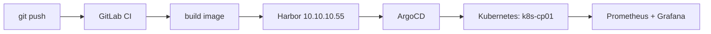

# Резюме и портфолио DevOps: GitHub/GitLab, README проектов, схемы, метрики, кейсы

## 1. Введение (зачем это нужно в реальной работе)

Тикет в очереди:

> **Пользователь:** petrova (Мария Петрова, HR) / **ВМ:** WIN10-CL02
> **Что написала:** «Алексей, привет. К нам обратились из дочерней компании — ищут DevOps-инженера, и я тебя порекомендовала. Пришли ссылку на профиль и 2–3 проекта, желательно с описанием, что там внутри. Нужно до пятницы.»
> **Срочность:** средняя, дедлайн — пятница.

У тебя за спиной семь проектов из уроков 116–122: полный CI/CD, IaC-платформа, HA-кластер Kubernetes, наблюдаемость, DevSecOps, миграция монолита, disaster recovery. Лежат они в GitLab на GIT01, в репозиториях с названиями вида `ci-cd-demo` и коммитами «fix», «fix2», «final_v3». Рекрутер откроет ссылку, увидит три файла без описания — и закроет через двадцать секунд.

Портфолио — это не «мои репозитории». Это упакованная история о том, какие задачи ты решаешь, какими инструментами, с каким результатом в цифрах и как ты думаешь. В DevOps это особенно важно: у тебя нет «продукта, который можно потрогать», есть инфраструктура, пайплайны и конфиги. Их надо показать так, чтобы человек без доступа к твоему стенду понял, что ты умеешь.

После этой главы ты будешь уметь: собрать репозиторий-портфолио с README и схемами; писать кейсы проектов по шаблону «контекст → задача → что сделал → результат в метриках»; посчитать деплой-метрики по своим пайплайнам и Grafana; оформить профиль в GitLab так, чтобы ссылку не стыдно было отправить HR; и вычистить из публичного репозитория то, что туда попасть не должно (секреты, внутренние адреса, данные клиентов).

## 2. Теория «под капотом» (как это работает: архитектура, протоколы)

Портфолио живёт на трёх уровнях, и у каждого своя «техническая» механика.

**Уровень 1 — система контроля версий.** Всё лежит в Git: репозиторий — это DAG коммитов в каталоге `.git`, история неизменяема (меняется только добавлением). Хостинг — GitLab CE на GIT01 (`10.10.10.50`): веб на 80/443, git по SSH на 22. Ты уже поднимал его в уроке 116 и знаешь, что проект = репозиторий + issues + CI/CD + wiki.

**Уровень 2 — рендеринг.** Файл `README.md` на диске — просто текст. Браузер получает HTML, который GitLab сгенерировал из Markdown (диалект GitLab Flavored Markdown, GFM). Схемы в блоках ```` ```mermaid ```` рендерятся на стороне браузера JavaScript-библиотекой Mermaid: сервер отдаёт текст, картинку собирает клиент. Отсюда два следствия: (а) ошибка в синтаксисе Mermaid видна только в браузере, `git` её не заметит; (б) картинки-файлы должны лежать в репозитории по относительному пути.

**Уровень 3 — воронка найма.** Дальше работает человек и, часто, автоматика:

```text
hh.ru / Хабр Карьера / телеграм-канал
        │  (7–30 секунд)
        ▼
Резюме (ATS-фильтр + глаза рекрутера)
        │  клик по ссылке
        ▼
Профиль GitLab: аватар, bio, ссылки, закреплённые проекты (10 сек)
        │
        ▼
README проекта: что это, зачем, схема, стек, результат (~2 мин)
        │
        ▼
Кейс в docs/cases/: контекст, ограничения, решения, цифры (5 мин)
        │
        ▼
Техническое интервью: «покажи экран, расскажи, как это работает»
```

ATS (Applicant Tracking System) — система, через которую крупные компании прогоняют резюме: она ищет ключевые слова. Поэтому «настраивал сервера» проигрывает «Ansible, Terraform, Kubernetes, GitLab CI, Prometheus, Docker».

**Про метрики.** В DevOps де-факто стандарт — четыре метрики DORA: **deployment frequency** (как часто выкатываете), **lead time for changes** (время от коммита до прода), **change failure rate** (доля выкаток, вызвавших инцидент), **MTTR** (время восстановления после сбоя). На стенде ты можешь честно измерить первые две по пайплайнам GitLab и по времени деплоя ArgoCD, а MTTR — по своим же лабораторным «сломал и починил». Метрики превращают «я сделал CI/CD» в «сократил время выкатки с 40 минут до 7, потому что убрал ручную сборку и кэшировал слои».

В РФ 2026 есть нюанс: GitHub доступен, но у части компаний есть требования держать код внутри страны. Российские площадки — GitVerse, GitFlic `[ПРОВЕРИТЬ актуальные тарифы и условия]`. Практичная стратегия: основной профиль там, где удобно тебе, плюс зеркало (git умеет два remote) — и в резюме указана ссылка, которая открывается у любого HR.

## 3. Аналогия из жизни

Портфолио — это автосалон. Резюме — рекламный буклет у входа: марка, год, пробег, цена. Профиль в GitLab — сам шоурум: чисто, светло, машины стоят мордой к клиенту. README проекта — табличка на лобовом стекле: «2.0 TDI, полный привод, расход 6.2 л». Кейс — сервисная книжка: что меняли, почему, что было до и после. А когда клиент просит «дайте прокатиться» — это интервью с демонстрацией экрана, и тут выясняется, реальная машина или наклейки.

Аналогия перестаёт работать там, где интервьюер может сам залезть под капот: открыть `git log`, посмотреть на коммиты, запустить твой пайплайн и найти расхождение между README и кодом.

## 4. Практика и команды

Работаем на UBU01 (`10.10.10.30`) как на рабочей машине с git, результат пушим в GitLab на GIT01.

**1. Инициализация и личность автора.** Коммиты должны быть подписаны нормальным именем, а не `root@ubuntu`.

```bash
mkdir -p ~/portfolio && cd ~/portfolio
git init -b main
git config --global user.name "Aleksey Smirnov"
git config --global user.email "adm.student@corp.vektor.lab"
```

`-b main` задаёт имя основной ветки сразу (иначе получишь `master` и расхождение с GitLab). `--global` пишет в `~/.gitconfig`.

**2. Структура портфолио.** Не сваливай всё в один README.

```bash
mkdir -p docs diagrams cases assets
tree -L 2
```

```text
.
├── README.md
├── assets
├── cases
├── diagrams
└── docs
```

`assets` — картинки, `diagrams` — исходники схем (`.mmd`, `.drawio`), `cases` — кейсы проектов, `docs` — длинные тексты.

**3. README: блок-схема пайплайна в Mermaid.**

````markdown
## Архитектура CI/CD (проект №1)


````

Ключевые слова: `flowchart LR` — направление слева направо, `-->` — стрелка, `[текст]` — прямоугольный узел. Типичная ошибка — незакрытая скобка или `(` внутри подписи узла: ломает рендер.

**4. Таблица метрик в README — то, что читают в первую очередь.**

```markdown
| Метрика (DORA)          | До     | После   | Откуда цифра             |
|-------------------------|--------|---------|--------------------------|
| Deployment frequency    | 2/мес  | 15/нед  | GitLab → Pipelines       |
| Lead time for changes   | 3 дня  | 40 мин  | коммит → job deploy      |
| Change failure rate     | 25 %   | 8 %     | откаты / все выкатки     |
| MTTR                    | 2 ч    | 15 мин  | инцидент → восстановлен  |
```

Правило: рядом с каждой цифрой — источник. Цифра без источника на интервью разваливается первым же вопросом «а как считал?».

**5. Первый коммит и пуш в GitLab.**

```bash
git add -A
git commit -m "docs: структура портфолио, README, схема CI/CD"
```

```text
[main (root-commit) 4f1c9ab] docs: структура портфолио, README, схема CI/CD
 5 files changed, 143 insertions(+)
```

```bash
git remote add origin git@10.10.10.50:adm.student/portfolio.git
git push -u origin main
```

```text
Enumerating objects: 9, done.
To 10.10.10.50:adm.student/portfolio.git
 * [new branch]      main -> main
branch 'main' set up to track 'origin/main'.
```

`-u` связывает локальную ветку с удалённой, дальше хватит `git push`. SSH-ключ UBU01 должен быть добавлен в профиль GitLab (Settings → SSH Keys) — это делали в уроке 116.

**6. История как доказательство работы.**

```bash
git log --oneline --graph --decorate --all -n 10
```

```text
* 7b2e1f0 (HEAD -> main, tag: v1.0.0, origin/main) feat: кейс по наблюдаемости
* 9a3c554 docs: схема DR-восстановления
* 4f1c9ab docs: структура портфолио, README, схема CI/CD
```

`--graph` рисует ветвление, `--decorate` показывает теги и remote-ветки, `-n 10` ограничивает вывод. Осмысленные сообщения коммитов — часть портфолио; `fix` и `asdf` читаются как «делал наспех».

**7. Объём и состав репозитория.**

```bash
git ls-files | wc -l
git rev-list --count HEAD
```

Первая — сколько файлов под контролем версий, вторая — сколько коммитов в истории. Полезно, чтобы не тащить в портфолио 400 МБ образов: `du -sh .git`.

**8. Поиск секретов в текущем дереве.**

```bash
git grep -nEI '(password|passwd|token|secret|api[_-]?key|BEGIN [A-Z ]*PRIVATE KEY)'
```

`-n` — номера строк, `-E` — расширенные регулярки, `-I` — не смотреть бинарники. Пустой вывод и код возврата 1 — это хорошо: ничего не нашли. **Важно:** `git grep` смотрит только текущий снимок. Секрет, удалённый коммитом, остаётся в истории. Искать по всей истории:

```bash
git log -p --all -S 'glpat-' --oneline
```

`-S` ищет коммиты, где число вхождений строки изменилось, `-p` показывает патч.

**9. Удаление секрета из истории (делать на свежем клоне!).**

```bash
git rm --cached .env
printf '.env\n*.pem\nkubeconfig*\n' >> .gitignore
git commit -m "chore: убираю .env из репозитория"

git clone --mirror git@10.10.10.50:adm.student/portfolio.git clean.git
cd clean.git
git filter-repo --invert-paths --path .env    # [ПРОВЕРИТЬ: пакет git-filter-repo из pip/apt]
git push --force
```

`--invert-paths --path .env` означает «вырезать этот путь из всей истории». `--force` перезаписывает удалённую историю — в командной работе это запрещено без согласования, у себя в портфолио допустимо. **Токен, попавший в публичный репозиторий, считается скомпрометированным: сначала отзываешь его в GitLab, потом чистишь историю.** Порядок именно такой.

**10. Теги — версии портфолио.**

```bash
git tag -a v1.0.0 -m "Портфолио: 3 кейса, схемы, метрики"
git push origin v1.0.0
```

Аннотированный тег (`-a`) хранит автора и дату — по нему удобно показывать «вот состояние на момент отклика».

**11. Резервная копия одним файлом.**

```bash
git bundle create ~/backup/portfolio-$(date +%F).bundle --all
git bundle verify ~/backup/portfolio-2026-05-14.bundle
```

`--all` — все ветки и теги; bundle — это весь репозиторий в одном файле, восстанавливается через `git clone portfolio.bundle`. Хорошая привычка: артефакт портфолио не должно быть возможно потерять вместе с GIT01.

**12. README как код: проверка в пайплайне.** Портфолио тоже должно собираться и проверяться.

```yaml
# .gitlab-ci.yml
stages: [lint]

markdown-lint:
  stage: lint
  image: node:20-alpine          # [ПРОВЕРИТЬ актуальный тег образа]
  script:
    - npx --yes markdownlint-cli2 "**/*.md"
```

Ловит битые заголовки, несогласованные списки и вложенные блоки кода (частая причина «сломанного» Mermaid). Требует runner с docker-executor — он настроен на GIT01 в уроке 116.

**13. Шаблон кейса — то, что реально читает тимлид.**

```markdown
## Кейс: CI/CD для приложения «Вектор.Заказы»

**Контекст.** 1 разработчик, ручная сборка на ноутбуке, деплой по SSH.
**Задача.** Выкатка по кнопке, откат за минуту, ноль простоя.
**Ограничения.** Один сервер, интернет нестабилен, бюджет 0.
**Что сделал.** GitLab CI (build → scan → push в Harbor), ArgoCD, canary 10→50→100 %.
**Результат.** Lead time 3 дня → 40 мин; деплой 40 мин → 7 мин; откат 1 клик.
**Что бы улучшил.** Кэш слоёв между runner'ами, отдельный staging.
```

Абзац «что бы улучшил» — маркер зрелости: джун говорит «всё идеально», миддл знает слабые места своего решения.

## 5. Лабораторная работа (пошаговый сценарий на виртуалке)

### Предусловия

- **GIT01** (`10.10.10.50`) — GitLab CE + runner, работают (урок 116), пайплайны проходят.
- **UBU01** (`10.10.10.30`) — git-клиент, SSH-ключ `~/.ssh/id_ed25519` добавлен в GitLab.
- Проекты уроков 116–122 существуют в GitLab (или их код лежит локально на UBU01).
- **HARBOR01** (`10.10.10.55`), **k8s-cp01** (`10.10.10.61`), **MON01** (`10.10.10.40`) — нужны только как элементы схемы, трогать их не будем.
- Windows-часть стенда не требуется. Браузер для проверки рендера — на UBU01 (или на любой ВМ с доступом к `http://10.10.10.50`).

### Снапшот

В VMware Workstation: правый клик по вкладке ВМ → **Snapshot → Take Snapshot**, имя `before-devops-123`.

- **GIT01** — обязательно (там живут репозитории и проекты GitLab).
- **UBU01** — обязательно (локальные копии, ключи, каталог `~/portfolio`).

Если предпочитаешь терминал VMware: `vmrun snapshot "/path/GIT01.vmx" before-devops-123` `[ПРОВЕРИТЬ путь к vmrun в твоей установке]`.

### Шаги

1. **UBU01.** Проверь окружение: `git --version`, `ssh -T git@10.10.10.50`. Ожидаемо: версия git и приветствие GitLab с твоим именем. Если SSH ругается — сначала починить ключ, дальше идти бессмысленно.
2. **GIT01 (браузер).** Создай проект: меню **Projects → New project → Create blank project** `[ПРОВЕРИТЬ точные подписи кнопок в твоей версии GitLab]`. Имя `portfolio`, namespace — твой пользователь (`adm.student`), visibility — **Public** (портфолио должно открываться без логина; на стенде это безопасно, потому что внутри нет реальных данных). Ожидаемо: пустой репозиторий с подсказкой команд.
3. **UBU01.** Инициализируй репозиторий и структуру: команды из п.1–2 раздела 4. Ожидаемо: каталоги `docs diagrams cases assets`, ветка `main`.
4. **UBU01.** Настрой git-идентичность (п.1). Ожидаемо: `git config --list` показывает твои имя и почту.
5. **UBU01.** Напиши `README.md` по шаблону: заголовок, 3–5 строк «кто я и что умею», таблица «проект → стек → результат», блок Mermaid со схемой пайплайна, ссылки на `cases/`. Ожидаемо: файл сохранён, схема — в блоке ```` ```mermaid ````.
6. **UBU01.** Создай `cases/01-cicd.md` по шаблону из п.13 раздела 4, взяв реальные цифры из пайплайна проекта №1 (GitLab → CI/CD → Pipelines → колонка Duration) и из Grafana на MON01. Ожидаемо: в кейсе минимум три метрики с источниками.
7. **UBU01.** Создай `cases/02-observability.md`: SLO-дашборд из урока 119, что за алерты, какой MTTR получился на учебном инциденте. Ожидаемо: заполнены все блоки шаблона, включая «что бы улучшил».
8. **UBU01.** Добавь `.gitignore` (`.env`, `*.pem`, `*.key`, `kubeconfig*`, `*.tfstate`) и прогони проверку секретов из п.8 раздела 4. Ожидаемо: пустой вывод, `echo $?` → `1`.
9. **UBU01.** Первый коммит и пуш (п.5 раздела 4). Ожидаемо: `main` появился в GitLab, проект открывается по адресу `http://10.10.10.50/adm.student/portfolio`.
10. **UBU01.** Поставь тег `v1.0.0` и запушь его (п.10). Ожидаемо: в GitLab в разделе **Code → Tags** появился `v1.0.0`.
11. **GIT01 (браузер, режим инкогнито).** Открой README проекта. Ожидаемо: Mermaid отрисован как схема, таблица отформатирована, ссылки на кейсы кликаются. Если схема — серая плашка «Syntax error» — вернись к п.3.
12. **UBU01.** Добавь `.gitlab-ci.yml` (п.12), закоммить, запушь. Ожидаемо: в **Build → Pipelines** новый пайплайн со стадией `lint` в статусе passed.
13. **GIT01 (браузер).** Оформи профиль: Settings → Profile — имя, аватар, bio в одну строку («DevOps: Kubernetes, GitLab CI, Terraform, Prometheus. Стендовая лаборатория: 7 проектов»), ссылки на резюме и профиль. Закрепи `portfolio` в профиле `[ПРОВЕРИТЬ: раздел «Pinned projects» в твоей версии GitLab; нативная поддержка «profile README» как на GitHub в GitLab CE может отсутствовать — тогда роль витрины играет README проекта]`.
14. **UBU01.** Сделай bundle-бэкап (п.11) и запиши изменения в `stand-log.md`.

### Проверка

- [ ] `git ls-files` показывает README, `.gitignore`, `.gitlab-ci.yml`, минимум 2 файла в `cases/`
- [ ] Mermaid-схема рендерится в браузере в режиме инкогнито (без логина)
- [ ] В README есть таблица метрик, у каждой цифры указан источник
- [ ] В двух кейсах заполнены все шесть блоков шаблона
- [ ] `git grep -nEI '(token|secret|password)'` возвращает пусто
- [ ] Тег `v1.0.0` виден в GitLab
- [ ] Пайплайн `markdown-lint` зелёный
- [ ] Профиль GitLab заполнен, проект виден в списке
- [ ] `stand-log.md` дополнен записью за урок 123

### Сломай и почини

> **Пользователь:** ivanov / **ВМ:** WIN11-CL01
> **Что написал:** «Алексей, открыл твою ссылку — вместо схемы серая плашка “Syntax error in text”, картинка архитектуры вообще не грузится, а в README в блоке с примером конфига видно `glpat-XXXXXXXX`. Ты уверен, что это можно показывать людям?»
> **Срочность:** высокая — отправлять завтра.

**Как воспроизвести поломку** (сделай это осознанно, чтобы понять механику): в `README.md` замени в схеме строку `A[git push]` на `A[git push(origin)]` — незакрытая скобка ломает парсер Mermaid; в `assets/` переименуй картинку `arch.png` → `Architecture.PNG` (регистр!); в блок кода вставь строку `token: glpat-пример`.

**Диагностика по порядку:**

1. Открыть README в браузере инкогнито, зафиксировать: схема не рендерится, картинка 404, секрет виден. Три независимые проблемы.
2. Проверить картинки: `git ls-files assets/` и `grep -n "assets/" README.md`. Сравнить посимвольно — Linux-хостинг различает регистр, Windows-браузер может «простить».
3. Проверить Mermaid: найти блок, посмотреть парность скобок и кавычек; временно упростить узел до `A[git push]` и перезагрузить страницу.
4. Проверить, где ещё встречается токен: `git grep -nEI 'glpat-'` и по истории `git log -p --all -S 'glpat-' --oneline`.
5. **Сначала отозвать токен**: GitLab → пользователь → Access Tokens → Revoke (если это runner-токен — Settings → CI/CD → Runners → удалить/ротировать).

**Решение:**

6. Починить Mermaid и путь к картинке, коммит `fix: mermaid syntax + asset path`.
7. Вычистить секрет из истории через `git filter-repo --invert-paths --path <файл>` на свежем mirror-клоне + `git push --force` (п.9 раздела 4). Секрет в истории = утёк, даже если файл удалён.
8. Проверить сборку: пайплайн `markdown-lint` должен остаться зелёным; открыть README в инкогнито ещё раз.

**Ответ пользователю:** «Иван, спасибо, поймал три вещи: сломанный синтаксис схемы, регистр в имени файла картинки и токен в примере. Токен уже отозван и вычищен из истории, схема и картинка отображаются. Проверь, пожалуйста, ещё раз по той же ссылке — до завтра всё чисто.»

**Закрытие заявки:** категория «контент/документация», резолюция — «исправлен рендер README, отозван и удалён секрет из истории репозитория, добавлена проверка в CI». Записать в `stand-log.md` факт ротации токена.

### Что изменилось на стенде

- **GIT01:** новый проект `portfolio` (namespace `adm.student`, visibility Public), ветка `main`, тег `v1.0.0`, настроен `.gitlab-ci.yml` со стадией `lint`, один успешный пайплайн.
- **GIT01:** заполнен профиль пользователя (имя, bio, ссылки, аватар).
- **GIT01:** отозван и перевыпущен один access token (учебный, но фиксируем).
- **UBU01:** локальный репозиторий `~/portfolio`, настроены `user.name`/`user.email` в `~/.gitconfig`, каталог `~/backup/` с bundle-файлом.
- **stand-log.md:** запись за урок 123.

### Откат

- **Локально:** `cd ~ && rm -rf portfolio` + восстановление из bundle: `git clone ~/backup/portfolio-<дата>.bundle portfolio`.
- **GitLab:** удалить проект (Settings → General → Advanced → Delete project) или вернуть состояние снапшотом.
- **Полный откат:** VMware → правый клик по ВМ → **Snapshot → Revert to snapshot** `before-devops-123` на GIT01 и UBU01. Помни: откат GIT01 отбрасывает **всё**, что появилось после снапшота, включая возможные правки в проектах уроков 116–122.
- Если секрет уже был опубликован — откат снапшотом его **не аннулирует**: токен отзывается вручную в любом случае.

## 6. Ошибки новичков и безопасность

1. **Свалка из форков и туториалов** → рекрутер видит 40 репозиториев «docker-curriculum» и ни одного своего → делай 3–7 своих проектов, остальное скрывай (Settings → visibility).
2. **README без цифр** → «сделал CI/CD» ничего не доказывает → добавляй измеримый результат и источник цифры.
3. **Секреты в репозитории** (`.env`, `kubeconfig`, `*.tfstate`, токены) → утечка и компрометация инфраструктуры → `.gitignore` до первого коммита, `git grep` перед каждым пушем, `pre-commit`-хуки.
4. **Публикация внутренних схем и IP без согласования** → на стенде `10.10.10.x` безопасно; в реальной работе — потенциальный NDA-инцидент и увольнение → обезличивай: заменяй реальные адреса и имена на условные, убирай названия клиентов.
5. **Скриншоты с персональными данными** → 152-ФЗ, риск для компании → перед публикацией замазывай ФИО, почты, номера заявок.
6. **Красивая схема, не соответствующая коду** → на интервью «покажи, где это в репозитории» → схема должна генерироваться/проверяться, а не рисоваться «для красоты».
7. **Приписанные метрики и чужие проекты** → проверяется одним вопросом «а как считал?» → пиши только то, что можешь объяснить построчно.
8. **Мёртвые ссылки и «TODO» в README** → читается как небрежность → пайплайн-линтер и ручная проверка в инкогнито перед откликом.

**Безопасность.** В боевой среде нельзя: пушить в публичный репозиторий код компании без письменного разрешения; хранить секреты в git вообще (для этого Vault, CI-переменные masked/protected, SOPS); делать `git push --force` в общие ветки; публиковать топологию сети и внутренние адреса. Приватность портфолио настраивается так: репозиторий публичный, но в нём — только обезличенный учебный стенд «Вектор» с адресами `10.10.10.0/24`, паролями вида `Lab#2026-vektor` и пометкой «учебный стенд, не продакшн».

## 7. Вопросы на собеседовании

**1. «Покажи проект, которым гордишься. Что конкретно сделал ты?»**
Ответ: выбери один (например, CI/CD из урока 116), расскажи по схеме «задача → ограничения → мои действия → результат в метриках → что бы улучшил». Явно отдели свою работу от чужой: «приложение писал разработчик, я отвечал за пайплайн, реестр и деплой».
*Что хочет услышать:* структурный рассказ с границами ответственности и числами.
*Красный флаг:* «мы делали…» без «я делал», ни одной цифры, не может объяснить собственный код.

**2. «Как ты понимаешь, что твоя автоматизация принесла пользу?»**
Ответ: метрики DORA — deployment frequency, lead time for changes, change failure rate, MTTR; на стенде измерял частоту выкаток и lead time по GitLab Pipelines, MTTR — по учебным инцидентам; плюс субъективное: перестали деплоить вручную по SSH.
*Что хочет услышать:* что метрика первична, а «стало удобнее» — вторично.
*Красный флаг:* «ну, стало быстрее» без определения «быстрее чего и насколько».

**3. «Зачем в README схема, если есть код?»**
Ответ: код отвечает «как», схема — «что и зачем»; читатель за 30 секунд понимает поток «коммит → сборка → реестр → кластер → мониторинг» и видит границы компонентов; схема — часть документации, поддерживается вместе с кодом (Mermaid в git диффится как текст, в отличие от PNG).
*Что хочет услышать:* понимание, что документация — артефакт инженерной работы, а не украшение.
*Красный флаг:* «чтобы красиво было».

**4. «Как ты поступаешь с секретами в публичном портфолио?»**
Ответ: секретов там нет вообще; `.gitignore` до первого коммита; проверка `git grep` и pre-commit; если попал — сначала отзыв токена, потом `git filter-repo` и force-push, потому что история неизменяема и простое удаление файла ничего не решает; в проектах — Vault / masked CI-переменные / SOPS.
*Что хочет услышать:* порядок «отозвать → вычистить → проверить», понимание, что git хранит всё.
*Красный флаг:* «удалил файл и всё», «у меня приватный репозиторий, значит безопасно».

**5. «У тебя в резюме “сократил время деплоя в 5 раз”. Откуда цифра?»**
Ответ: назови инструмент замера (длительность job в GitLab CI, сравнение ручного чек-листа и пайплайна), период и условия («40 минут ручной сборки на одном сервере против 7 минут пайплайна с кэшем слоёв, замер по 10 последним прогонам»). Признай ограничения замера, если они есть.
*Что хочет услышать:* что за цифрой стоит методика, а не желание впечатлить.
*Красный флаг:* путается в цифрах, «примерно», не помнит, откуда взял.

## 8. Источники (официальная документация)

- **git-scm.com** — книга Pro Git, разделы «Git Basics», «Rewriting History», «Git Tools → Bundling»; поиск: `pro git book rewriting history`.
- **docs.gitlab.com** — GitLab Flavored Markdown, Mermaid diagrams, Projects, CI/CD YAML reference, Access Tokens; поиск: `gitlab flavored markdown mermaid`.
- **docs.github.com** — About READMEs, Managing your profile README, Mermaid diagrams `[ПРОВЕРИТЬ точные названия статей]`; поиск: `github profile readme`.
- **dora.dev** — DORA metrics / Software delivery performance; поиск: `dora metrics guide`.
- **hh.ru** — раздел для соискателей о составлении резюме `[ПРОВЕРИТЬ название раздела]`; поиск: `hh.ru как составить резюме`.
- **habr.com** — хаб «Карьера в IT», статьи про резюме DevOps `[ПРОВЕРИТЬ актуальность подборки]`; поиск: `habr резюме devops`.
- Российские площадки для зеркала портфолио: **gitverse.ru**, **gitflic.ru** — `[ПРОВЕРИТЬ актуальные тарифы, ограничения бесплатного плана и доступность из РФ]`.
