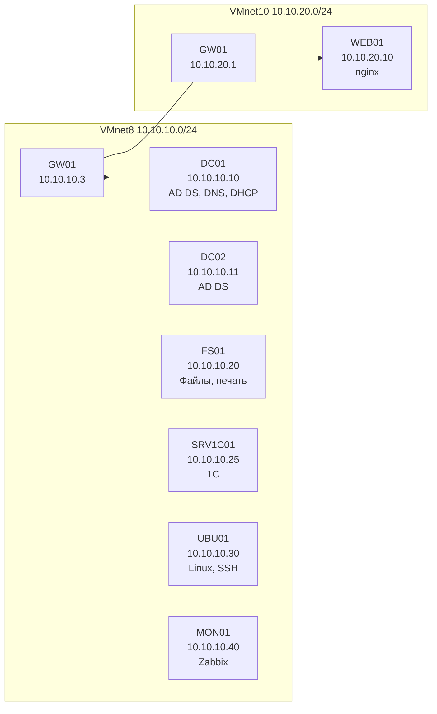
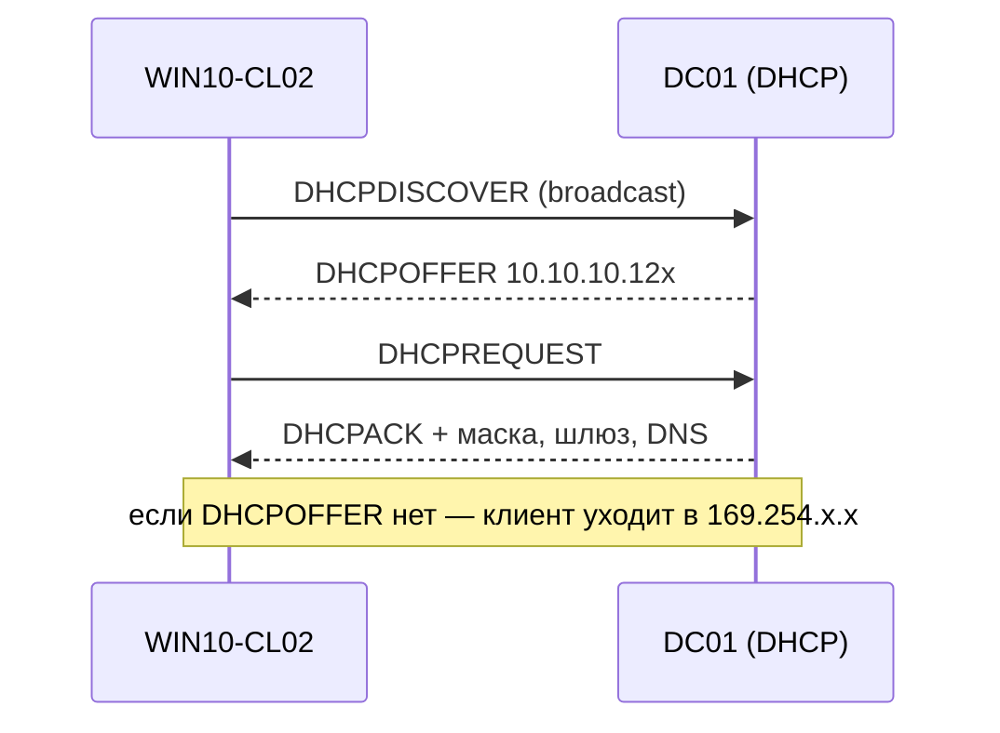

# Документирование решений: runbook'и, постмортемы, архитектурные схемы

## 1. Введение (зачем это нужно в реальной работе)

Тикет №4821. Мария Петрова, WIN10-CL02: «Не открывается папка HR, вчера всё работало, у нас отчёт, помогите до обеда». L1 посмотрел, пожал плечами и передал на L2. Ты открываешь базу знаний: там три статьи «про доступ к папкам», две из них — скриншоты из старой версии Windows Server, одна написана полгода назад неизвестно кем, и ни в одной нет ни проверки, ни того, что делать, если не помогло. Ты тратишь 40 минут, чтобы вспомнить, что месяц назад ровно этот же инцидент уже был и его чинили. Восстановить ход мыслей того инженера невозможно — он ничего не записал.

Через час ты уже знаешь: на FS01 у папки HR в правах NTFS стоит группа `GG-Buh` вместо `GG-HR` — кто-то копировал права с соседней папки. Чинится за две минуты. Но 40 минут уже потрачены, отчёт у Петровой стоит, а L1 в следующий раз снова придёт к тебе, потому что шага «проверь ACL» нет ни в одной инструкции.

Документирование — это не «бюрократия», а способ перестать решать одну и ту же задачу по десять раз. После главы ты будешь уметь: писать runbook, по которому L1 закроет инцидент без тебя; писать постмортем, который не превращается в поиск виноватого; рисовать схему стенда так, чтобы она жила в git и не устаревала за месяц. И главное — поймёшь, что документация пишется для человека, который в 3 часа ночи читает её с телефона и очень торопится.

## 2. Теория «под капотом» (как это работает: архитектура, протоколы)

Документация в эксплуатации — это не «папка с файлами», а система с иерархией. Хорошая модель такая: **инцидент → постмортем → runbook → автоматизация**. Каждый инцидент сначала объясняется, потом превращается в процедуру, потом процедуру съедает скрипт.

```text
   ИНЦИДЕНТ (что-то сломалось)
        │  разбор через 1–5 дней, без поиска виноватых
        ▼
   ПОСТМОРТЕМ (PM)  ──► action items: правки кода, мониторинга, процессов
        │  «почему сломалось и как это ловить»
        ▼
   RUNBOOK (RB)     ──► процедура «что делать руками», для L1/L2 под давлением
        │  «как починить за 10 минут, не думая»
        ▼
   АВТОМАТИЗАЦИЯ / АЛЕРТ ──► машина делает сама, человек только смотрит
        │
        ▼
   если автоматика не справилась → снова ИНЦИДЕНТ (цикл замыкается)

   АРХИТЕКТУРНАЯ СХЕМА — фон под всем этим: где что стоит и куда течёт трафик
```

**Runbook (регламент/процедура).** Короткий документ «что делать», а не «как это устроено». Обязательные поля: назначение и симптом («когда применять»), предусловия и доступы, шаги с точными командами, **ожидаемый результат каждого шага**, ветки «если не помогло → эскалация на L3», ответственный и дата последней проверки. Хороший runbook укладывается в одну-две страницы: если он длиннее, это уже не процедура, а статья.

**Постмортем (postmortem, разбор инцидента).** Документ «почему это произошло и что мы меняем». Ключевой принцип — **blameless** (безвинный): анализируем систему и процессы, а не личность. Поля: краткое описание и влияние на бизнес (сколько людей, сколько минут), таймлайн с точным временем (по логам и алертам, не по памяти), корневая причина и contributing factors (сопутствующие), что сработало хорошо, что сработало плохо, action items с владельцем и сроком. В SRE-культуре постмортем пишется почти на любой значимый инцидент, даже если «сам починился».

**Архитектурные схемы.** Рисуют на разных уровнях детализации; общепринятый стандарт — модель **C4** Саймона Брауна: Context (система и внешние пользователи) → Container (серверы, сервисы, БД) → Component (внутренности одного сервиса) → Code. Для L2 достаточно первых двух. Схема «всё на одном листе со всеми портами» бесполезна: её невозможно прочитать.

**Инструменты.** Mermaid — язык текстовых диаграмм (flowchart, sequenceDiagram, ER, C4 и др.): схема — это текст, поэтому она хранится в git, диффится построчно и рендерится в VS Code, GitLab/GitHub и MkDocs. draw.io (он же diagrams.net) — графический редактор, бесплатный, есть десктоп-версия и расширение для VS Code; файл `.drawio.svg` — это одновременно и картинка, и редактируемый исходник. Порты тут простые: git по SSH — 22, по HTTPS — 443; `mkdocs serve` локально поднимает сайт на 8000; mermaid.live — внешний сервис по 443 (см. раздел про безопасность).

| | Mermaid | draw.io |
|---|---|---|
| Формат | текст (`.mmd`, блок в `.md`) | XML (`.drawio`, `.drawio.svg`) |
| Diff в git | построчный, читаемый | почти нечитаемый |
| Скорость | высокая | ниже |
| Сложные схемы, иконки вендоров | ограниченно | да |
| Где живёт | git, wiki, MkDocs, GitLab | файл, Confluence |

## 3. Аналогия из жизни

Представь авиацию. Перед взлётом пилоты берут **чек-лист** и читают вслух по пунктам, даже если летают 20 лет: «закрылки — 5, топливо — проверить, давление — в норме». Это runbook: не «как устроен самолёт», а «что сделать по порядку и какой результат считается нормой». Если чек-лист соврёт, экипаж погибнет — поэтому его перепроверяют.

Когда что-то всё-таки случается, работает **комиссия по расследованию**. Она не ищет «кто виноват», она ищет, почему система допустила ошибку: устаревшая процедура, плохой прибор, усталость экипажа, невнятная маркировка. Отчёт комиссии — постмортем. Он публикуется, и по нему меняют конструкции, чек-листы и обучение во всей отрасли.

А **карта воздушных трасс** — это архитектурная схема: где аэропорты, где эшелоны, куда нельзя заходить. Диспетчер не летает по ней, но без неё не поймёт, почему борт просят подождать.

Где аналогия ломается: в авиации расследование обязательно по закону и есть независимый регулятор, а в ИТ разбор инцидента — добрая воля компании, и никто не оштрафует за то, что постмортема нет.

## 4. Практика и команды

Дальше все примеры — на стенде «Вектор». Документацию держим в git-репозитории на UBU01 (10.10.10.30), учётку подставь свою, созданную в главе про Linux.

**1. Инициализация репозитория документации (UBU01).**
```bash
sudo apt update && sudo apt install -y git
mkdir -p ~/docs/{runbooks,postmortems,diagrams,adr}
cd ~/docs && git init -b main
git config user.name "adm.student" && git config user.email "adm.student@corp.vektor.lab"
```
`init -b main` сразу создаёт ветку `main` (git ≥ 2.28). `user.name`/`user.email` — локальные для репозитория, чтобы коммиты были подписаны. Вывод: `Initialized empty Git repository in /home/.../docs/.git/`. Смотреть: четыре каталога под разные типы документов — не сваливай всё в кучу.

**2. Шаблон runbook (файл `runbooks/RB-001-dhcp-no-lease.md`).**
```markdown
# RB-001: клиент не получает IP-адрес по DHCP
Симптом: на ВМ адрес 169.254.x.x, `ipconfig /renew` не помогает.
Когда применять: жалоба «нет сети», адрес из APIPA.
Область: DC01 (10.10.10.10), DHCP-пул 10.10.10.100–10.10.10.150.
Владелец: L2. Проверено: 2026-XX-XX. Версия: 1.0
Шаги:
1. На DC01: `Get-Service DHCPServer` → Status = Running.
2. На DC01: `Get-DhcpServerv4Scope` → State = Active, пул не занят.
3. На клиенте: `ipconfig /release` затем `ipconfig /renew` → адрес из 10.10.10.x.
Если не помогло → эскалация на L3 + постмортем.
```
Ключевое здесь — строка «Проверено» и ожидаемый результат на каждом шаге. Без них runbook превращается в «попробуй вот это».

**3. Поиск устаревших упоминаний по всему репозиторию.**
```bash
grep -rn "10.10.10.3" ~/docs
```
`-r` рекурсивно, `-n` с номерами строк. Вывод — список `файл:строка:текст`. Смотреть: если в документации остался старый IP или имя `WIN7-CL03`, который вывели из эксплуатации, документ врёт.

**4. Кто и когда последний раз менял документ.**
```bash
git log --oneline -- runbooks/RB-001-dhcp-no-lease.md
git log -1 --format="%cs %an" -- runbooks/RB-001-dhcp-no-lease.md
```
`--` отделяет путь от прочих аргументов. `%cs` — дата коммита в формате YYYY-MM-DD. Смотреть: если runbook не менялся год, а инфраструктура менялась — он под подозрением.

**5. Схема сети стенда в Mermaid (`diagrams/stand-network.mmd`).**

`flowchart LR` — направление слева направо; `subgraph` группирует узлы в рамку; `["текст"]` — подпись узла, `<br/>` — перенос строки внутри неё; `---` — линия без стрелки, `-->` — со стрелкой. Смотреть: читается ли схема за 5 секунд и видно ли, что DMZ отделена маршрутизатором.

**6. Диаграмма последовательности для инцидента (DHCP DORA).**

`participant` задаёт псевдоним участника; `->>` сплошная стрелка; `-->>` пунктирная (ответ); `Note over` — комментарий поверх дорожки. Такая диаграмма в постмортеме объясняет таймлайн лучше абзаца текста.

**7. Рендер Mermaid в картинку (mmdc).**
```bash
sudo apt install -y nodejs npm          # версию node в 24.04 уточни: [ПРОВЕРИТЬ]
sudo npm install -g @mermaid-js/mermaid-cli
mmdc -i diagrams/stand-network.mmd -o diagrams/stand-network.svg -b transparent -w 1600
```
`-i` вход, `-o` выход (`.svg`, `.png`, `.pdf`), `-b` цвет фона, `-w` ширина, `-t` тема (`default`/`dark`). Вывод: `Generating single mermaid chart`. Если видишь ошибку парсинга — синтаксис сломан в конкретной строке; mmdc удобно ставить в CI, чтобы битая диаграмма не попадала в базу знаний.

**8. draw.io: схема, которая живёт в git.**
В VS Code поставь расширение **Draw.io Integration** (Henning Dieterichs) и создай файл `diagrams/dmz-flow.drawio.svg`. Внутри SVG лежит тот же XML, но git видит его как картинку и показывает в Markdown. Экспорт: `File → Export as → SVG/PNG/PDF`. Ключи здесь не нужны, важно правило: **исходник `.drawio.svg` коммитим, экспортированный PNG — нет**, иначе получишь два источника правды.

**9. Поиск по документации с Windows-клиента (WIN11-CL01).**
```powershell
Get-ChildItem -Path \\10.10.10.30\... -ErrorAction SilentlyContinue
```
Проще и надёжнее — искать на UBU01 через `git grep`:
```bash
git grep -n "FS01" -- "*.md"
```
`git grep` ищет только по отслеживаемым файлам (быстрее и не залезает в мусор). Смотреть: все места, где документ ссылается на сервер, — их и надо править при переезде.

**10. Экспорт для руководства и статический сайт.**
```bash
pandoc runbooks/RB-001-dhcp-no-lease.md -o RB-001.docx
pip install mkdocs-material && mkdocs new site && mkdocs serve
```
`pandoc` конвертирует Markdown в `.docx` (PDF потребует установленного LaTeX — не усложняй). `mkdocs serve` поднимает сайт с документацией на `http://127.0.0.1:8000`, `mkdocs build` собирает статику в `site/`. Для Mermaid в `mkdocs.yml` нужен блок:
```yaml
markdown_extensions:
  - pymdownx.superfences:
      custom_fences:
        - name: mermaid
          class: mermaid
          format: !!python/name:pymdownx.superfences.fence_code_format
```
Синтаксис этого блока зависит от версии Material — сверься с документацией `[ПРОВЕРИТЬ]`.

**11. Линтер Markdown.**
```bash
npx markdownlint-cli2 "**/*.md"
```
Ловит битые заголовки, разные уровни, мусорные пробелы. Вывод — список `файл:строка правило`. Смотреть: правила MD040 (нет языка у блока кода) и MD001 (прыжок уровня заголовка) — самые частые.

**12. Шаблон постмортема (`postmortems/PM-2026-01.md`).**
```markdown
# PM-2026-01: DHCP на DC01 не выдавал адреса
Влияние: 1 рабочее место (WIN10-CL02), 25 минут, отчёт HR остановлен.
Таймлайн (по логам): 09:05 служба остановлена, 09:12 жалоба,
09:20 L1 эскалация, 09:30 корневая причина, 09:32 восстановление.
Корневая причина: служба DHCPServer остановлена при обслуживании DC01.
Сопутствующие: нет мониторинга состояния службы; в runbook не было шага 1.
Что сработало: быстрая эскалация L1. Что нет: алерта не было.
Action items: (1) алерт Zabbix на DHCPServer — L2, 2 недели;
(2) RB-001 дополнен проверкой службы — L2, сделано; (3) автозапуск службы — L3.
```

## 5. Лабораторная работа (пошаговый сценарий на виртуалке)

### Предусловия
Нужны ВМ уровня L2: **DC01** (AD DS, DNS, DHCP с пулом 10.10.10.100–150, состояние Running), **FS01** (папки `\\FS01\Obshchee`, `Buh`, `HR`), **WIN10-CL02** (вход под `petrova`), **UBU01** (10.10.10.30, SSH, есть доступ в интернет через VMnet8). На хосте — VS Code. GW01, WEB01, MON01, DC02, SRV1C01 достаточно существовать, чтобы попасть на схему; включать их не обязательно, но схема должна быть честной — если MON01 ещё не развёрнут, не рисуй его.

### Снапшот
На DC01, FS01, WIN10-CL02, UBU01:
```text
VMware Workstation → правый клик по ВМ → Snapshot → Take Snapshot → имя: before-l2-105
```
Или из командной строки хоста:
```cmd
vmrun -T ws snapshot "C:\VMs\DC01\DC01.vmx" before-l2-105
```
Имя снапшота одинаковое на всех четырёх ВМ.

### Шаги

1. **UBU01.** Разверни репозиторий (команды из п. 1 и 2 раздела 4). Ожидаемо: `docs/` с четырьмя подкаталогами и `.git`.
2. **UBU01.** Создай `README.md` — паспорт стенда: таблица машин (имя, ОС, IP, роль), сети VMnet8/VMnet10, домен `corp.vektor.lab`, доменные группы `GG-Buh/GG-HR/GG-Sklad/GG-IT`, где лежат снапшоты. Пароли в файл **не пиши** — только пометку «учебный пароль стенда, см. описание стенда». Ожидаемо: новый инженер понимает стенд за 3 минуты.
3. **UBU01.** Напиши `runbooks/RB-001-dhcp-no-lease.md` по шаблону из п. 2. Ожидаемо: файл с симптомом, шагами и строкой «Проверено».
4. **DC01.** Проверь, что команды из runbook реальны: `Get-Service DHCPServer`, `Get-DhcpServerv4Scope`, `Get-DhcpServerv4Lease -ScopeId 10.10.10.0 | Select IPAddress,ClientId,AddressState`. Ожидаемо: служба Running, scope Active, в списке аренд — WIN10-CL02. Если команда не работает — исправь runbook, а не команду.
5. **UBU01.** Нарисуй `diagrams/stand-network.mmd` по образцу п. 5, включив только реально существующие машины. Ожидаемо: в VS Code (расширение Markdown Preview Mermaid Support) схема рендерится без ошибок.
6. **UBU01.** Добавь `diagrams/dhcp-dora.mmd` по образцу п. 6. Ожидаемо: две дорожки, четыре сообщения, заметка про APIPA.
7. **UBU01.** Отрендерь обе диаграммы через `mmdc` (п. 7). Ожидаемо: рядом появились `.svg`. Если `mmdc` не ставится из-за Puppeteer/Chromium — не мучайся, отрендери в VS Code или на mermaid.live (стенд учебный) и поставь пометку `[ПРОВЕРИТЬ установку mmdc на UBU01]`.
8. **DC01 + WIN10-CL02.** Проверь runbook «в бою», аккуратно: на DC01 `Stop-Service DHCPServer`; на WIN10-CL02 `ipconfig /release` и `ipconfig /renew`. Ожидаемо: адрес станет `169.254.x.x`, а `ipconfig /all` покажет «DHCP-сервер недоступен». Пройди по RB-001: шаг 1 сразу даёт ответ (служба Stopped).
9. **DC01 + WIN10-CL02.** Восстанови: `Start-Service DHCPServer`; на клиенте `ipconfig /renew`. Ожидаемо: снова адрес из 10.10.10.x, шлюз 10.10.10.2, DNS 10.10.10.10.
10. **UBU01.** Напиши `postmortems/PM-2026-01.md` про инцидент из шагов 8–9 по шаблону п. 12: таймлайн по часам, корневая причина, три action items с владельцем и сроком.
11. **UBU01.** Закоммить и проверь историю:
```bash
git add -A && git commit -m "docs: паспорт стенда, RB-001, схема сети, PM-2026-01"
git log --oneline
```
Ожидаемо: один коммит, в `git status` — `nothing to commit, working tree clean`.
12. **Хост.** Запиши в `stand-log.md`: «Создан git-репозиторий документации `~/docs` на UBU01; runbook RB-001; схема стенда; постмортем PM-2026-01; служба DHCPServer останавливалась и запускалась».

### Проверка
- [ ] На UBU01 существует `~/docs/.git`, в `git log --oneline` есть коммит.
- [ ] `README.md` содержит таблицу всех машин стенда и не содержит паролей.
- [ ] В `RB-001` есть поля «Симптом», «Когда применять», «Владелец», «Проверено» и ожидаемый результат у каждого шага.
- [ ] Обе диаграммы рендерятся без ошибок синтаксиса (в VS Code или через `mmdc`).
- [ ] На схеме DMZ 10.10.20.0/24 отделена от LAN 10.10.10.0/24 и видно GW01 как точку перехода.
- [ ] После шага 9 на WIN10-CL02 адрес 10.10.10.x, а не 169.254.x.x.
- [ ] В постмортеме нет слов «виноват», «опять», фамилий; есть три action items со сроками.

### Сломай и почини

```text
Пользователь / ВМ:  petrova / WIN10-CL02
Что написал:        «С утра не открывается \\FS01\HR — "Отказано в доступе".
                    Мне до обеда нужен отчёт, вчера всё работало.»
Срочность:          средняя, дедлайн — сегодня 13:00
```

**Как воспроизвести поломку.** На FS01 убери правильную группу из прав NTFS папки HR (снапшот `before-l2-105` уже есть):
```powershell
Get-SmbShare -Name HR | Select-Object Name,Path   # узнать локальный путь, например D:\Shares\HR
icacls "D:\Shares\HR" /remove:g "VEKTOR\GG-HR"
icacls "D:\Shares\HR" /grant "VEKTOR\GG-Buh:(OI)(CI)M"
```
`:(OI)(CI)M` — наследование объектам и контейнерам, право Modify. Теперь права как у папки Buh: сотрудник HR в чужой группе.

**Диагностика по порядку.**
1. С клиента: `ping FS01` — сеть и DNS живы (иначе проблема не в правах).
2. `net use \\FS01\HR` — ловим текст ошибки: «Отказано в доступе» = авторизация, а не сеть.
3. `whoami /groups | findstr /i "GG-"` — видит ли клиент себя в `GG-HR`. Если нет — вопрос членства в AD, а не прав на папке.
4. На FS01: `Get-SmbShareAccess -Name HR` — проверяем **share permissions** (они отдельный слой!).
5. На FS01: `Get-Acl "D:\Shares\HR" | Format-List` и `icacls "D:\Shares\HR"` — вот здесь всплывает `GG-Buh` вместо `GG-HR`. Сверяем с runbook: в нём написано «доступ через GG-HR», значит соврал не документ, а конфигурация. Если бы совпало наоборот — правим документ.
6. Открываем `git log -- postmortems/`, ищем похожий инцидент — если был, читаем action items.

**Решение.**
```powershell
icacls "D:\Shares\HR" /remove:g "VEKTOR\GG-Buh"
icacls "D:\Shares\HR" /grant "VEKTOR\GG-HR:(OI)(CI)M"
```
На WIN10-CL02 у petrova: `klist purge` (сбросить Kerberos-тикеты), выход и вход в систему, затем `net use \\FS01\HR` — проверка.

**Ответ пользователю:** «Мария, доступ восстановлен. Причина — сбой в правах на общую папку HR после вчерашних работ; ваши данные не пострадали. Пожалуйста, закройте все окна Проводника и войдите в систему заново, затем откройте `\\FS01\HR`. Если снова откажет — напишите мне напрямую, разберусь в приоритете. До 13:00 доступ будет».

**Закрытие заявки:** категория «Доступ к файловым ресурсам», решение — «скорректированы права NTFS, `GG-Buh` заменена на `GG-HR`», в постмортем PM-2026-02 добавлен action item «включить в RB-002 шаг проверки ACL и регламент ревью прав раз в квартал», в `stand-log.md` — строка про правку ACL.

### Что изменилось на стенде
- UBU01: создан git-репозиторий документации `~/docs` (README, `runbooks/RB-001-dhcp-no-lease.md`, `postmortems/PM-2026-01.md`, `diagrams/stand-network.mmd`+`.svg`, `diagrams/dhcp-dora.mmd`+`.svg`).
- DC01: служба `DHCPServer` останавливалась и запускалась, режим запуска не менялся.
- FS01: ACL папки, которую расшарили как `HR`, исправлен — `VEKTOR\GG-Buh` убрана, `VEKTOR\GG-HR` получила Modify с наследованием `(OI)(CI)`.
- WIN10-CL02: аренда DHCP перевыпущена, Kerberos-тикеты сброшены.
- Новые роли и ВМ не добавлялись; адреса, домен и учётки не менялись.

### Откат
Сначала сохрани документацию наружу, иначе откат её съест:
```bash
cd ~/docs && git bundle create ~/docs-backup.bundle --all
```
Скопируй `docs-backup.bundle` на хост (`scp`), затем в VMware Workstation: `VM → Snapshot Manager → before-l2-105 → Revert`. Откати все четыре ВМ (DC01, FS01, WIN10-CL02, UBU01). Развёртывание из бандла — `git clone docs-backup.bundle docs`. После отката проверь: на DC01 `Get-Service DHCPServer`, на WIN10-CL02 `ipconfig /all`, на FS01 `icacls` папки HR.

## 6. Ошибки новичков и безопасность

1. **Документация в голове, в личных заметках или в личке мессенджера** → знание уходит вместе с человеком в отпуск, L1 стоит на месте. → Пиши в общий репозиторий, даже если «пока сыро».
2. **Runbook без ожидаемого результата** («перезапусти службу») → непонятно, сработало или нет, и что делать дальше. → Каждый шаг: команда + «должно быть так» + «если иначе — эскалация».
3. **Документ без даты, версии и владельца** → невозможно понять, актуален ли он; устаревший runbook опаснее отсутствующего. → Шапка с «Проверено: дата», «Владелец», «Версия».
4. **Постмортем как поиск виноватого** («Иванов опять нажал не туда») → люди начинают скрывать причины, и настоящая корневая причина не всплывает никогда. → Описывай систему и процесс: «не было алерта», «в runbook отсутствовал шаг».
5. **Схема «нарисовали один раз на защите проекта»** → через месяц она врёт и ей перестают верить. → Правило: изменил инфраструктуру — в том же коммите обнови схему.
6. **Схема со всеми деталями сразу** (все порты, все VLAN, все ACL на одном листе) → читать невозможно. → Делай уровни: Context (кто и зачем) и Container (серверы и сети), детали — отдельным файлом.
7. **Копипаст конфигов без источника и версии** → «работает только на том сервере и только в марте». → Всегда: откуда взято, для какой ОС/версии, на каком стенде проверено.
8. **Дюжина runbook на одну и ту же беду** → расходятся, какой из них прав — неизвестно. → Один документ = один симптом; старое удаляй через `git rm`, история сохранится в git.

### Безопасность
В документации **нельзя** хранить пароли, ключи, токены, реальные персональные данные клиентов и полные схемы продовой сети, выложенные в публичный доступ. На нашем стенде пароль учебный — но привычку «пароль в заметку» не заводи: в боевой среде секреты живут в хранилище (Vault, «КриптоПро»/менеджер секретов компании), а в документации только ссылка на него. Отдельно про внешние сервисы: **mermaid.live и онлайн-версия draw.io рендерят и сохраняют твой текст у себя** — схему сети реальной компании туда заливать нельзя, используй десктопную версию draw.io и локальный mmdc/VS Code. Схемы инфраструктуры и IP-адреса — служебная информация, в РФ разумно сверяться с внутренним регламентом по коммерческой тайне и 152-ФЗ, если в документах мелькают персональные данные.

## 7. Вопросы на собеседовании

**1. Чем runbook отличается от статьи в базе знаний?**
Ответ: статья объясняет, как система устроена и почему работает именно так — её читают, чтобы понять. Runbook — процедура: конкретный симптом, пошаговые команды, ожидаемый результат шага и точка эскалации; его читают во время инцидента, под давлением, часто ночью. Отсюда требования: коротко (1–2 страницы), однозначно, без истории вопроса, с датой последней проверки.
*Что хочет услышать интервьюер:* что ты пишешь документы под конкретного читателя и ситуацию, а не «для галочки».
*Красный флаг:* «runbook — это и есть статья, просто пошагово» без понимания разницы в аудитории и контексте использования.

**2. Что такое blameless postmortem и зачем он, если виноват человек?**
Ответ: разбор, в котором не ищут виновного, потому что цель — найти системные причины и исправить их. Люди всё равно ошибаются; вопрос в том, почему система позволила одной ошибке привести к инциденту: не было ревью, не было алерта, процедура допускала двусмысленность. В безвинном разборе сотрудники честно рассказывают, что произошло, и статистика причин растёт; в «обвинительном» — скрывают.
*Что хочет услышать интервьюер:* понимание, что blameless — это про качество данных, а не про «пожалеть сотрудника».
*Красный флаг:* «мы просто не наказываем, но в отчёте пишем, кто ошибся» — это уже не blameless.

**3. Какие поля обязательны в постмортеме и как понять, что он сработал?**
Ответ: влияние на бизнес (кто и сколько страдал), таймлайн по логам, корневая причина, сопутствующие факторы, что сработало хорошо/плохо, action items с владельцем и сроком. Сработал — когда action items закрыты в срок, а повторный похожий инцидент не случился или прошёл незаметно (например, его поймал алерт). Формальный признак — метрики: MTTR, число повторов.
*Что хочет услышать интервьюер:* что отчёт — не документ, а вход в изменения.
*Красный флаг:* «постмортем пишем, чтобы руководство отчиталось» или отсутствие владельцев у задач.

**4. Как поддерживать документацию актуальной, когда на неё нет времени?**
Ответ: сделать её частью работы, а не отдельной задачей. Правила: документация в том же git, что и конфигурация/IaC; правка в том же коммите/тикете, что и изменение; ревью документа как часть code review; в runbook — поле «Проверено», просроченные всплывают на еженедельном разборе; владелец у каждого документа; на онбординге новый инженер проходит по runbook — если споткнулся, документ правят.
*Что хочет услышать интервьюер:* процесс и владельцы, а не «я обещаю обновлять».
*Красный флаг:* «заведу отдельный день на документацию раз в квартал» — на практике не работает.

**5. Почему Mermaid, а не Visio или draw.io? Когда выберешь draw.io?**
Ответ: Mermaid — текст, поэтому схема живёт в git, диффится построчно, рендерится в GitLab/GitHub/MkDocs и не превращается в бинарный файл, который никто не открывает. Минус — ограниченная вёрстка и иконки. draw.io беру, когда нужна сложная схема: расположение элементов, иконки вендоров, презентация руководству. Компромисс — `.drawio.svg`, редактируемый файл, который одновременно является картинкой для Markdown.
*Что хочет услышать интерфейер:* выбор инструмента под задачу и понимание «docs as code».
*Красный флаг:* «только Visio, у нас все схемы в нём» без понимания проблем бинарных файлов в git.

## 8. Источники (официальная документация)

- **Google SRE Book** (sre.google), раздел «Postmortem Culture: Learning from Failure» и глава «Managing Incidents». Поиск: `google sre book postmortem culture`.
- **Google SRE Workbook** (sre.google), главы про postmortem и incident response. Поиск: `google sre workbook postmortem`.
- **Microsoft Learn** (learn.microsoft.com), документация по Azure Automation Runbooks — хороший эталон структуры runbook. Поиск: `azure automation runbooks overview`. Плюс разделы по `Get-SmbShareAccess`, `Get-Acl`, `icacls`, модулю DhcpServer. Поиск: `Get-DhcpServerv4Scope powershell`.
- **Mermaid** (mermaid.js.org), разделы «Flowchart», «Sequence Diagram», «C4 diagrams» (C4 в Mermaid помечен как experimental — синтаксис проверяй на mermaid.live `[ПРОВЕРИТЬ]`). Поиск: `mermaid flowchart syntax`.
- **draw.io / diagrams.net** (draw.io), раздел Documentation, статья про экспорт и editable SVG. Поиск: `drawio editable svg export`.
- **C4 model** (c4model.com), разделы Context и Container. Поиск: `c4 model context container diagram`.
- **Write the Docs** (writethedocs.org), материалы про docs-as-code. Поиск: `write the docs docs as code`.
- **MkDocs Material** (squidfunk.github.io/mkdocs-material), раздел про Mermaid-диаграммы в Markdown. Поиск: `mkdocs material mermaid diagrams`.
- **Pandoc** (pandoc.org), User's Guide, конвертация Markdown → docx. Поиск: `pandoc markdown to docx`.
- **Etsy «Debriefing Facilitation Guide»** — практическое руководство по безвинному разбору инцидентов. Поиск: `etsy debriefing facilitation guide pdf` `[ПРОВЕРИТЬ актуальную ссылку]`.
- **Atlassian** (atlassian.com), раздел Incident Management, шаблоны постмортемов. Поиск: `atlassian incident postmortem template`.
