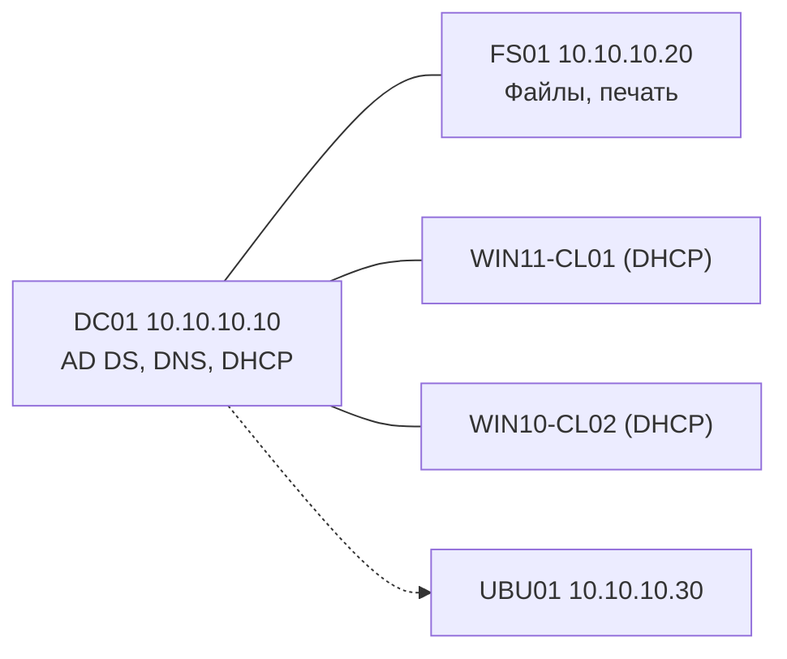

# Резюме инженера L2/сисадмина: как показать лабораторию, проекты, GitHub и результаты

## 1. Введение (зачем это нужно в реальной работе)

Тикет в корпоративном трекере «Вектора»:

> **От:** Петрова М. (HR, WIN10-CL02)
> **Тема:** Кадровый резерв IT — обновите профили до пятницы
> **Текст:** «Алексей, мы открываем вторую ставку инженера поддержки и параллельно собираем кадровый резерв. Пришли, пожалуйста, своё резюме в Word и ссылку на портфолио, если есть. Руководитель IT будет смотреть сам, ему важно понять, что ты уже умеешь руками».

И тут выясняется неприятное: стенд у вас есть, домен `corp.vektor.lab` поднят, FS01 раздаёт папки, в `stand-log.md` тридцать записей, а показать это некому — резюме написано в стиле «ответственный, коммуникабельный, знаю Windows и Linux», и ни одного подтверждения.

Резюме — это не формальность «на всякий случай». Это ваш единственный шанс пройти первый фильтр, который длится считанные секунды. В 2026 году на вакансию L1/L2 в Москве приходит 100–300 откликов; рекрутер смотрит на верхнюю треть первой страницы, техлид — на конкретику в опыте и на ссылку на GitHub. После главы вы будете уметь: собрать портфолио-репозиторий стенда, описать лабораторию так, чтобы её не путали с выдумкой, сформулировать результаты в измеримом виде, честно отделить учебный опыт от коммерческого и проверить, что все ваши ссылки открываются у чужого человека.

## 2. Теория «под капотом» (как это работает: архитектура, протоколы)

Резюме — это не документ, а **интерфейс к трём разным читателям**, у каждого свой таймаут и свой набор ожиданий:

| Читатель | Время | Что ищет | Где смотрит |
|---|---|---|---|
| Рекрутер / ATS | секунды | город, формат, грейд, стек, зарплата | заголовок, первые 5 строк, навыки |
| Техлид | 1–2 минуты | что реально делал руками, где доказательства | блок опыта/проектов, ссылки |
| Руководитель | 30 секунд | адекватность, рост, обучаемость | «Обо мне», последнее место |

ATS (Applicant Tracking System — система учёта кандидатов; в РФ распространены Huntflow, E-staff `[ПРОВЕРИТЬ актуальные названия]`, плюс собственный поиск hh.ru) выдёргивает из файла текст и раскладывает по полям: должность, компании, даты, навыки. Что ломает парсинг: резюме картинкой или сканом, текст в таблицах и колонках, даты вида «лето 2025», навыки, зашитые в абзац.

```text
ОТКЛИК (hh.ru / Telegram / реферал / сайт компании)
   │
   ▼
[1] Парсинг + поиск по ключевым словам
   │   отсев: нет ключей (AD, DNS, PowerShell, Zabbix), кривые даты,
   │          PDF-картинка, «з/п не указана» при фильтре
   ▼
[2] Скрин рекрутером — считанные секунды
   │   вопросы: кто, сколько опыта, стек, формат, деньги
   ▼
[3] Техлид — 1–2 минуты
   │   вопросы: что делал сам? где доказательства? что сломал и починил?
   ▼
[4] GitHub / портфолио — 3–5 минут, ЕСЛИ ссылка живая
   │   вопросы: доводит ли до конца? пишет ли документацию? не врёт ли?
   ▼
[5] Приглашение / тестовое задание
```

Ключевой момент для вашего случая: **у вас нет коммерческого опыта, но есть артефакты**. Портфолио закрывает именно тот вопрос, на который резюме ответить не может — «а он правда это делал?». Поэтому связка такая: резюме даёт тезис («администрирую Windows Server 2022 + AD + файловый сервер»), GitHub даёт доказательство (README со схемой, runbook'и, логи диагностики, `stand-log.md`).

Второй принцип — **честная маркировка**. Лаборатория пишется в разделе «Проекты» с явной пометкой «учебный стенд», а не в «Опыте работы» под видом ООО «Вектор». Техлид это проверяет за один вопрос на собеседовании и ловит ложь мгновенно — а ложь в резюме закрывает оффер навсегда.

Третий — **формула XYZ** (популяризована Ласло Боком, Google): «Достиг X, измеряемого Y, сделав Z». Не «занимался администрированием AD», а «развернул домен на 6 машин, сократил развёртывание стенда с нуля до 2 часов по README».

## 3. Аналогия из жизни

Резюме — это README вашего личного репозитория. Когда вы заходите на чужой GitHub и видите 40 файлов без README, вы не читаете код — вы закрываете вкладку. Даже если внутри отличный проект. Точно так же рекрутер не звонит, чтобы «разобраться, что вы имели в виду»: нет заголовка, нет структуры, нет быстрого входа — следующее резюме.

Отсюда всё остальное: заголовок = первая строка резюме («Инженер поддержки L2 / системный администратор, Москва»), оглавление = блок «Навыки», примеры = «Проекты», issues = ваши «Сломай и почини», а CHANGELOG = `stand-log.md`.

Где аналогия ломается: README никто не обязан читать, а рекрутер обязан — но ровно до тех пор, пока не решит, что вы ему не подходите.

## 4. Практика и команды

Портфолио собирается руками, поэтому практика здесь — git, markdown и несколько проверок. Все действия — на вашем ПК и на UBU01 (10.10.10.30) из стенда.

**1. Каркас репозитория**

```bash
mkdir -p ~/vektor-stand/{runbooks,cases,diagrams,screenshots}
cd ~/vektor-stand
git init -b main
tree -L 2
```

`git init -b main` — создаёт репозиторий с веткой `main` (по умолчанию раньше была `master`). `tree -L 2` — дерево на 2 уровня. Ожидаемый вывод:

```text
.
├── cases
├── diagrams
├── runbooks
└── screenshots
```

Смотреть: структура должна читаться как оглавление — `runbooks/`, `cases/`, `diagrams/`.

**2. `.gitignore` и защита секретов**

```bash
cat > .gitignore <<'EOF'
*.log
*.bak
secrets/
*.kdbx
EOF
git status --short
```

`git status --short` — компактный список файлов (`??` — не отслеживается, `A` — добавлен). Смотреть: в списке не должно быть файлов с паролями. Учебный пароль стенда `Lab#2026-vektor` в README писать не нужно — пишите `<пароль из stand-log>`. В реальной работе утечка секрета в публичный репозиторий = инцидент ИБ и ротация всех ключей.

**3. Атомарные коммиты**

```bash
git add README.md diagrams/
git commit -m "docs: схема сети стенда и README"
git log --oneline --graph --decorate --all
```

`--oneline` — одна строка на коммит, `--graph` — граф веток, `--decorate` — метки, `--all` — все ветки. Вывод:

```text
* a1b2c3d (HEAD -> main) docs: схема сети стенда и README
* 9f8e7d6 feat: runbook «не открывается папка на FS01»
```

Смотреть: история из 10–20 осмысленных коммитов за пару месяцев — сама по себе доказательство, что вы работаете регулярно, а не «нарисовали портфолио за вечер».

**4. SSH-ключ вместо пароля**

```bash
ssh-keygen -t ed25519 -C "adm.student@vektor-lab"
cat ~/.ssh/id_ed25519.pub
ssh -T git@github.com
```

`-t ed25519` — тип ключа, `-C` — комментарий-метка. `ssh -T` — проверка аутентификации без shell. Вывод:

```text
Hi <username>! You've successfully authenticated, but GitHub does not provide shell access.
```

Смотреть: если спросило пароль — ключ не добавлен в GitHub (Settings → SSH and GPG keys).

**5. Публикация репозитория через GitHub CLI**

```bash
gh auth login
gh repo create vektor-stand --public --source=. --push
```

`gh auth login` — вход, `gh repo create` — создание репозитория, `--source=.` — из текущей папки, `--push` — сразу запушить. `--public` осознанно: портфолио должно открываться без логина. Нет `gh` — создайте репозиторий через веб-интерфейс и сделайте `git remote add origin ...` + `git push -u origin main`.

**6. Проверка ссылок на живость**

```bash
for u in https://github.com/<username>/vektor-stand \
         https://github.com/<username>/vektor-stand/blob/main/README.md; do
  printf "%s -> " "$u"
  curl -s -o /dev/null -w "%{http_code}\n" "$u"
done
```

`-s` — тихо, `-o /dev/null` — выбросить тело, `-w` — формат вывода. Смотреть: `200` — ок, `404` — ссылка битая (частая причина отказа), `302` — редирект (обычно на логин = репозиторий приватный).

**7. Проверка воспроизводимости на другой машине**

```bash
git clone git@github.com:<username>/vektor-stand.git /tmp/check
ls -R /tmp/check | head -30
```

Смысл: если по вашему README человек с нуля не понимает, что где лежит, — README плохой. Клонируйте на UBU01, а не на ту же машину.

**8. Запись терминальной сессии (Linux)**

```bash
script -a ~/vektor-stand/cases/case-01/session.log
# ... здесь ваши команды диагностики ...
exit
```

`script` пишет всё в файл, `-a` — дописывать в конец, `exit` — завершить запись. Это сильнее скриншота: видно команду и её реальный вывод. Пароли в логе затирайте перед публикацией.

**9. Запись сессии PowerShell (Windows)**

```powershell
Start-Transcript -Path C:\Temp\diag-dns.txt -Append
Get-Service DNS, DHCPServer | Select-Object Name, Status
Stop-Transcript
```

`-Append` — дописывать, `Stop-Transcript` — закрыть файл. Аналог `script` для Windows-части стенда.

**10. Схема в README через Mermaid**

````text

````

Mermaid рендерится прямо в README на GitHub — схема появляется без картинок. Подробнее про диаграммы — урок 105.

**11. Экспорт резюме в PDF**

```bash
pandoc resume.md -o resume.pdf --pdf-engine=xelatex -V mainfont="DejaVu Sans"
```

`--pdf-engine=xelatex` нужен для кириллицы, `-V mainfont` задаёт шрифт с русскими глифами `[ПРОВЕРИТЬ набор флагов под вашу версию pandoc]`. Проверьте PDF глазами: если текст в нём не выделяется мышью — ATS его не прочитает.

**12. Скриншоты с предсказуемыми именами**

`Win+Shift+S` (на Windows) → сохранить в `screenshots/` с именем `01-dns-service-stopped.png`. Имя = номер шага + суть. В README — ссылка на файл. В GUI резюме на hh.ru: «Мои резюме» → «Создать резюме» → блок «Обо мне» → поле для ссылки на портфолио.

## 5. Лабораторная работа (пошаговый сценарий на виртуалке)

Тема не техническая, поэтому «лабораторная» — это сборка портфолио-репозитория и резюме. Стенд трогаем только для одного: чтобы сделать честные скриншоты и лог реальной диагностики.

### Предусловия

- Стенд L2 готов: DC01 (10.10.10.10), FS01 (10.10.10.20), WIN11-CL01, WIN10-CL02, UBU01 (10.10.10.30), домен `corp.vektor.lab`, учётка `adm.student`.
- Заполнен `stand-log.md` — без него портфолио не собрать.
- Есть аккаунт GitHub (бесплатный) и аккаунт на hh.ru.
- Прочитаны уроки 103 (объяснять простым языком) и 105 (runbook'и и схемы) — здесь мы их переиспользуем.

### Снапшот

На всех ВМ, которые будете показывать на скриншотах (DC01, FS01, WIN11-CL01, WIN10-CL02, UBU01) — снапшот **`before-l2-107`**. VMware Workstation: правый клик по ВМ → Snapshot → Take Snapshot → имя `before-l2-107`. Причина: в шаге 5 мы намеренно уроним службу DNS ради скриншота, и нужен гарантированный откат.

### Шаги

1. **Собрать каркас репозитория.** На своём ПК: команды 1–2 из раздела 4. Ожидаемо: папки `runbooks/`, `cases/`, `diagrams/`, `screenshots/`, файл `.gitignore`.
2. **Написать `README.md` по шаблону:** что это (учебный стенд компании «Вектор»), состав (таблица машин с адресами из описания стенда), что уже работает (AD DS, DNS, DHCP, файловые шары `\\FS01\Buh`, `\\FS01\HR`), что дальше, ссылка на `stand-log.md`. Ожидаемо: 40–60 строк, читается за минуту.
3. **Перенести `stand-log.md` в репозиторий** и оформить шапку: дата, что изменено, где. Ожидаемо: файл с историей изменений стенда вместо «просто записей».
4. **Добавить 3 runbook'а** из уроков 105 и «Сломай и почини» прошлых глав. Формат: симптом → 5–7 шагов проверки → причина → решение → как проверить. Ожидаемо: `runbooks/rb-01-dns.md`, `rb-02-fs01-access.md`, `rb-03-spooler.md`.
5. **Сделать честный скриншот инцидента.** На DC01: `Stop-Service DNS`, затем `Get-Service DNS` — снять экран (`Win+Shift+S`), сохранить как `screenshots/01-dns-stopped.png`, сразу вернуть службу: `Start-Service DNS`. Ожидаемо: статус `Stopped` на скриншоте и `Running` после. В реальной среде так не делают без окна обслуживания.
6. **Записать лог диагностики** через `Start-Transcript` (команда 9) на DC01 и через `script` (команда 8) на UBU01 — по одному короткому кейсу. Ожидаемо: два текстовых файла в `cases/`.
7. **Добавить Mermaid-схему сети** из команды 10 в README и проверить, что GitHub её отрисовал. Ожидаемо: картинка-схема в README, а не «битая вставка».
8. **Закоммитить и запушить** (команды 3, 5). Ожидаемо: репозиторий открывается в приватном окне браузера без авторизации.
9. **Написать резюме в Markdown** (`resume.md`): заголовок с должностью и городом, «Обо мне» 3–4 строки, «Навыки» списком ключевых слов (AD DS, DNS, DHCP, Windows Server 2022, PowerShell, Ubuntu, Zabbix `[если MON01 уже развёрнут]`, runbook'и), «Проекты» — лаборатория с пометкой «учебный стенд» и 4–5 пунктов по формуле XYZ, «Образование», ссылки. Ожидаемо: 1–2 страницы.
10. **Оформить то же самое на hh.ru** в блоке «Обо мне», ссылку на GitHub — первой строкой. Ожидаемо: ссылка кликабельна в опубликованном резюме.
11. **Прогнать проверку ссылок** (команда 6) и **клонировать репозиторий на UBU01** (команда 7). Ожидаемо: все `200`, клон разворачивается и читается.
12. **Записать в `stand-log.md`**: «создан репозиторий `vektor-stand`, добавлены README, 3 runbook'а, 2 кейса, схема сети, ссылка в резюме».

### Проверка

- [ ] Репозиторий `vektor-stand` открывается в приватном окне браузера без логина.
- [ ] В README есть таблица машин стенда с адресами из 10.10.10.0/24 и схема Mermaid.
- [ ] Все ссылки в резюме отдают `200` (проверено командой 6).
- [ ] В резюме лаборатория помечена как «учебный стенд», а не как место работы.
- [ ] В блоках «Проекты» минимум 4 пункта с числами (сколько машин, сколько времени, сколько шагов).
- [ ] В публичных файлах нет пароля стенда, приватных ключей и реальных персональных данных.
- [ ] `git log --oneline` показывает не меньше 8 осмысленных коммитов.
- [ ] Резюме на hh.ru читается на телефоне без горизонтальной прокрутки.
- [ ] В PDF-версии текст выделяется мышью (значит, ATS его распарсит).

### Сломай и почини

**Пользователь:** Петрова М. (HR, WIN10-CL02) / корпоративный портал «Вектора»
**Что написала:** «Алексей, отправила твоё резюме в агентство. Отказ через день: "опыт нерелевантен, портфолио не открывается, стек непонятен". Что правим?»
**Срочность:** Высокая (второй отклик подряд без ответа)

**Как воспроизвести поломку намеренно:**
1. Сделайте репозиторий приватным (Settings → Danger Zone → Change visibility → Private) — имитация «ссылка не открывается».
2. В резюме временно замените блок «Проекты» на «Занимался администрированием серверов и поддержкой пользователей» — имитация «стек непонятен».
3. Уберите пометку «учебный стенд» — имитация «опыт нерелевантен».

**Диагностика по шагам:**
1. Открыть ссылку из резюме в приватном окне и с телефона. Симптом «не открывается» в 90% случаев — приватный репозиторий или опечатка в URL.
2. Прогнать команду 6 (`curl -w "%{http_code}"`): `404` — URL битый, `302` — приватный.
3. Прочитать своё резюме по чек-листу «7 секунд»: кто вы, сколько опыта, стек, город, формат — всё в первых 5 строках? Если нет — переписать.
4. Проверить, есть ли в тексте ключевые слова, которые рекрутер вбивает в поиск: `Active Directory`, `DNS`, `DHCP`, `Windows Server`, `PowerShell`, `поддержка пользователей`, `1С` `[если релевантно вакансии]`.
5. Проверить наличие чисел и результатов. Формулировка «администрировал FS01» → «настроил файловые шары для 3 групп, разграничил доступ по `GG-Buh` / `GG-HR`».
6. Сверить даты и статусы: не выдаёт ли раздел «Опыт работы» лабораторию за трудовой стаж.

**Решение:** вернуть репозиторий в `--public`, вставить в резюме проверенную ссылку, переписать блок «Проекты» в формат XYZ, добавить строку «Учебный стенд компании "Вектор" (личный проект, VMware Workstation) — 6 ВМ, домен corp.vektor.lab».

**Ответ пользователю:** «Мария, спасибо, что принесла обратную связь. Причина была в трёх вещах: ссылка вела на приватный репозиторий, стек был описан общими словами и не было пометки, что это учебный стенд. Исправил: ссылка открывается без авторизации, добавил конкретику (AD DS, DNS, DHCP, файловый сервер, 6 машин) и измеримые результаты. Отправь, пожалуйста, ещё раз — вот текст для агентства».

**Закрытие заявки:** категория «Кадры / документы», резолюция «Резюме и портфолио исправлены, ссылка проверена, повторная отправка выполнена», в `stand-log.md` — запись о правках.

### Что изменилось на стенде

- На DC01, FS01, WIN11-CL01, WIN10-CL02, UBU01 сделаны снапшоты `before-l2-107`.
- DC01: служба DNS останавливалась и запускалась обратно (состояние — `Running`), добавлен `C:\Temp\diag-dns.txt`.
- UBU01: добавлен лог сессии в `cases/`.
- Появился внешний артефакт (не на ВМ): репозиторий `vektor-stand` на GitHub — `README.md`, `stand-log.md`, `runbooks/` (3 файла), `cases/` (2 файла), `diagrams/network.mmd`, `screenshots/` (1+ файл).
- На своём ПК: `resume.md`, `resume.pdf`; на hh.ru — обновлённое резюме со ссылкой на портфолио.
- Запись в `stand-log.md` о создании портфолио.

### Откат

VMware Workstation → правый клик по ВМ → Snapshot → Snapshot Manager → выбрать `before-l2-107` → Revert. Сделайте это на всех пяти ВМ, если скриншоты получились кривые или стенд остался в нерабочем состоянии (например, забыли поднять DNS на DC01).

Откат репозитория: `git revert <hash>` создаёт обратный коммит и сохраняет историю; `git reset --hard <hash>` переписывает историю — только для локальной копии, не для запушенной ветки. Если секрет уже улетел в публичный репозиторий — недостаточно удалить файл новым коммитом: он останется в истории, нужен `git filter-repo` и смена скомпрометированного пароля/ключа `[ПРОВЕРИТЬ сценарий под свою версию git]`.

## 6. Ошибки новичков и безопасность

1. **Лаборатория в разделе «Опыт работы»** → техлид ловит на первом вопросе «а кто был заказчиком?», оффер отменяется → указывайте в «Проектах» с явной пометкой «учебный стенд / личный проект».
2. **Список технологий без единого результата** → читатель не понимает, что вы умеете, а не «слышали» → на каждый ключевой навык один пункт с числом и действием.
3. **Публичный репозиторий с паролями и ключами** → инцидент ИБ, ротация всех секретов → `.gitignore`, плейсхолдеры вида `<пароль из stand-log>`, проверка `git status` перед каждым коммитом.
4. **Скриншоты с реальными данными работодателя** → нарушение NDA и 152-ФЗ о персональных данных → только стенд, только вымышленные ФИО, только адреса 10.10.10.0/24.
5. **Битая ссылка на портфолио** → отказ даже при хорошем опыте → проверяйте `curl`-ом в приватном окне перед каждой отправкой.
6. **Резюме на 5 страниц с «коммуникабельностью»** → не читают до конца → 1–2 страницы, верхняя треть — главное.
7. **PDF-скан вместо текста** → ATS не парсит, отклик уходит в никуда → отправляйте текстовый PDF/DOCX, проверяйте выделение текста мышью.
8. **Портфолио из чужих форков** → на вопрос «что вы тут делали?» ответа нет → лучше один маленький, но свой репозиторий.

### Безопасность

Здесь три вещи, которые в боевой среде заканчиваются увольнением, а не замечанием: **секреты в git** (пароль, приватный ключ, токен — попали в историю, считайте скомпрометированными), **внутренние данные работодателя** (схемы сети, IP, имена пользователей, конфиги) и **скриншоты с ПДн**. Правило простое: в портфолио попадает только то, что вы создали сами на своём стенде, и только после проверки на секреты и персональные данные.

## 7. Вопросы на собеседовании

**1. «Расскажите про ваш домашний стенд. Что там поднято и зачем?»**
Ответ: 6 виртуальных машин на VMware Workstation, домен `corp.vektor.lab`: DC01 (AD DS, DNS, DHCP), FS01 (файловые шары и печать), два клиента (Windows 11 и Windows 10 LTSC), UBU01 и ASTRA01 для Linux-практики. Стенд повторяет типовую офисную сеть на 10.10.10.0/24, задачи — от создания пользователя в OU до разбора инцидента с доступом к папке. Всё описано в репозитории: README, схема сети, runbook'и, журнал изменений.
*Что хочет услышать интервьюер:* что вы понимаете, зачем каждая машина, и что стенд — не свалка, а модель.
*Красный флаг:* «ну, там всё по мелочи, я уже не помню» — значит, делал по видеоуроку не думая.

**2. «Покажите пример вашей диагностики. Что вы сделали, когда что-то сломалось?»**
Ответ: конкретный кейс в формате «симптом → гипотезы → проверки → причина → решение → профилактика». Например: пользователь не открывает `\\FS01\Buh` → проверил группу `GG-Buh` в AD, затем эффективные разрешения на шаре, затем `Get-SmbShareAccess` / журнал безопасности на FS01 → причина: пользователь добавлен в `GG-HR`, а не в `GG-Buh`. Решение: корректная группа, запись в runbook, чтобы L1 закрывал такое за 5 минут.
*Что хочет услышать интервьюер:* системность, а не перебор команд наугад.
*Красный флаг:* «перезагрузил — заработало» без дальнейших шагов.

**3. «Почему вы оформили портфолио именно так? Кто это будет читать?»**
Ответ: три читателя — рекрутер (секунды), техлид (минуты), руководитель. README закрывает вопрос «что это», runbook'и — «умеет ли документировать», `stand-log.md` — «ведёт ли историю изменений», git-история — «работает ли регулярно». Поэтому структура плоская и без вложенности глубже двух уровней.
*Что хочет услышать интервьюер:* понимание, что документация — для человека, а не для галочки.
*Красный флаг:* «ну я просто складывал файлы».

**4. «У вас нет коммерческого опыта. Почему мы должны взять вас на L2?»**
Ответ: не спорю, коммерческого опыта нет — есть 6 машин, 10+ runbook'ов, разобранные инциденты с логами и повторяемая процедура восстановления стенда с нуля. На L2 критично не «сколько лет», а умение довести инцидент до корневой причины и не потерять информацию: это видно по репозиторию. Плюс я готов к L1-задачам с первого дня и быстро закрываю пробелы — в журнале стенда видно темп.
*Что хочет услышать интервьюер:* честность и доказательства вместо оправданий.
*Красный флаг:* «опыт не главное» без аргументов или, наоборот, выдуманный стаж.

**5. «Что вы будете делать в первые 30 дней, чтобы выйти на самостоятельную работу?»**
Ответ: первые дни — читать ваши runbook'и и схему сети, взять 5–10 заявок под наставничеством L1/L2, разобрать, что в документации отсутствует; к концу второй недели — закрывать типовые заявки сам, вести записи; к концу месяца — обновить 2–3 runbook'а и передать правки. Прошу обратную связь по каждой заявке, чтобы не закреплять ошибки.
*Что хочет услышать интервьюер:* что вы не сядете ждать, а вольётесь и будете улучшать документацию.
*Красный флаг:* «буду изучать всё по очереди» — нет плана и связи с задачами команды.

## 8. Источники (официальная документация)

- **GitHub Docs** — домен `docs.github.com`. Разделы: «About READMEs», «Connecting to GitHub with SSH», «About repositories» (видимость и безопасность). Поиск: `github docs about readmes`, `github docs connecting with ssh`.
- **Git SCM / Pro Git** — домен `git-scm.com`. Раздел «Pro Git book» (главы про основы, ветвление, `.gitignore`). Поиск: `pro git book gitignore`.
- **GitHub CLI** — домен `cli.github.com`. Раздел «Manual» (`gh repo create`, `gh auth login`). Поиск: `gh cli manual repo create`.
- **Mermaid** — домен `mermaid.js.org`. Раздел «Syntax / Flowchart». Поиск: `mermaid flowchart syntax`.
- **Pandoc** — домен `pandoc.org`. Раздел «Manual», параметры `--pdf-engine` и переменные шрифтов. Поиск: `pandoc manual pdf-engine xelatex cyrillic`. `[ПРОВЕРИТЬ набор флагов для кириллицы под вашу версию]`
- **hh.ru** — домен `hh.ru`. Раздел помощи соискателю: «Как составить резюме», «Видимость резюме». Поиск: `hh.ru помощь как составить резюме`. `[ПРОВЕРИТЬ актуальные названия блоков резюме]`
- **Microsoft Learn** — домен `learn.microsoft.com`. Разделы: «Start-Transcript», «Get-SmbShareAccess», «Active Directory Domain Services overview». Поиск: `start-transcript powershell docs`.
- **VMware** — домен `docs.vmware.com` (или `knowledge.broadcom.com` для продуктов Broadcom `[ПРОВЕРИТЬ текущий домен документации Workstation]`). Раздел про снапшоты Workstation. Поиск: `vmware workstation snapshots documentation`.

Если какой-то дистрибутив или сервис недоступен из РФ напрямую — ищите легальную альтернативу (зеркала, отечественные аналоги), а не обходные пути.
