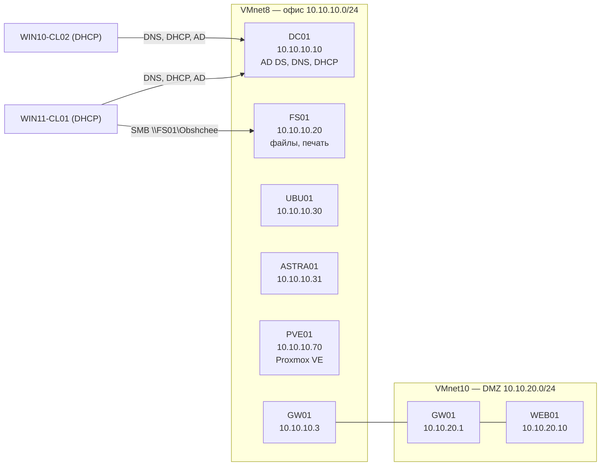

# Документирование инфраструктуры: схемы (draw.io, Mermaid), паспорта серверов, реестры, Wiki и Git

## 1. Введение (зачем это нужно в реальной работе)

**Заявка № 4127.** Пользователь: Петрова (HR), ВМ `WIN10-CL02`.
«Мне нужно ввести в дела нового сотрудника. В вашей вики на странице «Общие папки» написано `\\FS01\HR`, но у него не открывается — пишет «нет доступа». И коллега из бухгалтерии говорит, что на схеме сети у нас вообще нет DMZ. Где посмотреть актуальную информацию?»
Срочность: средняя.

Дальше вы открываете вики и обнаруживаете три разные «правды»: страница 2023 года, схема в PNG в почте и Excel-файл на FS01, который никто не обновлял с прошлого года. Знакомо? В работе это происходит постоянно: инфраструктура меняется каждый день, а документы — раз в полгода, и в итоге людям выгоднее спросить вас в чате, чем читать документацию. Значит, документация плохая, даже если её много.

После этой главы вы будете уметь: собрать паспорт сервера из живых данных, а не из головы; вести реестр всех машин стенда в машинночитаемом виде; нарисовать схему сети так, чтобы она хранилась текстом и диффилась; поднять Git-репозиторий документации с историей правок и публиковать из него вики. Это ровно тот навык, который отличает «человека, который всё знает» от инженера, чью инфраструктуру можно принять без него.

## 2. Теория «под капотом» (как это работает: архитектура, протоколы)

Документация инфраструктуры — это не «текстик в вики», а слоистая система, где у каждого слоя своя задача и свой срок жизни. Ключевая идея — **docs-as-code** (документация как код): текст, схемы и реестры лежат в тех же инструментах, что и код, с историей изменений, ревью и откатом.

```text
СЛОИ ДОКУМЕНТАЦИИ. Источник истины — внизу, а не наверху

  ┌──────────────────────────────────────────────────────────┐
  │ 4. РЕГЛАМЕНТЫ, RUNBOOK'и  «как чинить/делать»            │ Wiki (читают люди)
  ├──────────────────────────────────────────────────────────┤
  │ 3. СХЕМЫ  связи, сегменты, потоки, зависимости           │ Mermaid / draw.io
  ├──────────────────────────────────────────────────────────┤
  │ 2. РЕЕСТР (CMDB)  учёт объектов: что есть, чьё, где      │ CSV / YAML / NetBox
  ├──────────────────────────────────────────────────────────┤
  │ 1. ПАСПОРТ  один объект = один файл                      │ Markdown + YAML
  ├──────────────────────────────────────────────────────────┤
  │ 0. ЖИВАЯ СИСТЕМА (факт)                                  │ Get-CimInstance,
  │    hostname, IP, диск, версия ОС, серийник               │ hostnamectl, dmidecode
  └──────────────────────────────────────────────────────────┘
   Правило: слой N описывает слой N-1 и сверяется с ним. Не наоборот.
```

**Терминология.** *CMDB* (Configuration Management Database) — база конфигурационных единиц: серверы, сервисы, лицензии, их связи. В маленькой компании CMDB — это CSV в Git, и это нормально. *CI* (Configuration Item) — одна такая единица, например «FS01». *Runbook* — пошаговая инструкция на конкретный случай («не поднимается DHCP на DC01»). *Паспорт сервера* — карточка одной машины с постоянными и меняющимися параметрами.

**Почему текст, а не PNG.** Схема в формате `.drawio` — это XML (zXML-структура mxGraph), то есть **текст**. Mermaid — вообще текстовый DSL: строчки превращаются в SVG на клиенте (в GitLab/GitHub, в VS Code, в Obsidian) или в статическую картинку при сборке. Text-схемы можно `git diff`-ить и принимать по ревью; бинарный PNG — нельзя, видно только «файл заменён».

**Git «под капотом».** Git — контентно-адресуемое хранилище: каждый объект (файл, дерево каталогов, коммит) адресуется SHA-хешем своего содержимого. Коммит — узел направленного ациклического графа (DAG), ссылающийся на родителя и на снимок дерева. Отсюда два следствия для документации: (1) любое состояние можно достать навсегда, пока жив репозиторий; (2) любое изменение имеет автора, время и сообщение — это и есть аудит. Ветки — просто подвижные указатели на коммиты, поэтому «испортил документ» лечится одним `git revert`.

**Порты и протоколы** (по делу): Git по SSH — TCP/22, по HTTPS — TCP/443, по «родному» протоколу git:// — TCP/9418 (включать не надо, он без аутентификации); вики по HTTP/HTTPS — 80/443. Сама документация по сети не ходит — её читают люди, а права на репозиторий (`read`/`write`/`maintainer`) и есть модель доступа к документации.

## 3. Аналогия из жизни

Представьте паспортный стол. На человека заведён **паспорт** — карточка с постоянными данными (ФИО, год рождения, серия). Есть **домовая книга** — список всех, кто прописан в доме: она позволяет ответить «сколько нас» и «кто где». Есть **план эвакуации** на стене — та самая схема: смотреть на неё быстро, читать её целиком никто не будет. Есть **информационный стенд у лифта** — вики: объявления, регламенты, «куда идти с справкой». И есть **нотариальная книга**, где фиксируется каждая правка паспортных данных с датой и подписью — это Git: кто, когда и что изменил, и всегда можно поднять старую версию.

Аналогия ломается в одном: паспорт человека выдают один раз, и он не портится от времени. Паспорт сервера начинает врать в ту же секунду, когда вы поставили обновление или сменили IP, — и обновлять его обязан тот, кто изменил систему, а не «кто-нибудь потом».

## 4. Практика и команды

### 4.1. Сбор фактов о Windows-сервере

```powershell
# на DC01, PowerShell от администратора
systeminfo | Select-String -Pattern "Имя узла","Тип системы","Полный объём","Версия ОС"
```

`systeminfo` — сводка без установки чего-либо. `Select-String` фильтрует строки по шаблону (локализованные подписи зависят от языка ОС — если английская, шаблон `Host Name`, `OS Version`).

```text
Имя узла:                    DC01
Тип системы:                 x64-based PC
Версия ОС:                   10.0.20348 N/A Build 20348
Полный объём физической памяти: 4 095 МБ
```

Смотрим: имя узла (совпадает с DNS?), сборка ОС (20348 — это Server 2022), объём RAM (хватит ли для роли).

### 4.2. Паспортные данные одним объектом + выгрузка в реестр

```powershell
$cs  = Get-CimInstance Win32_ComputerSystem
$os  = Get-CimInstance Win32_OperatingSystem
$net = Get-CimInstance Win32_NetworkAdapterConfiguration -Filter "IPEnabled=TRUE"
[pscustomobject]@{
  Hostname = $cs.Name; Domain = $cs.Domain; Model = "$($cs.Manufacturer) $($cs.Model)"
  RAM_GB   = [math]::Round($cs.TotalPhysicalMemory/1GB,1)
  OS       = $os.Caption; Build = $os.BuildNumber
  IP       = ($net.IPAddress -join ';'); MAC = ($net.MACAddress -join ';')
} | Export-Csv C:\Temp\DC01.csv -NoTypeInformation -Encoding UTF8
```

`Get-CimInstance` — доступ к WMI/CIM-классам (не устаревший `Get-WmiObject`). `Win32_ComputerSystem` — железо и домен, `Win32_OperatingSystem` — ОС и дата установки, `Win32_NetworkAdapterConfiguration` с фильтром `IPEnabled=TRUE` — только активные адаптеры. `Export-Csv -NoTypeInformation` убирает служебную первую строку `#TYPE`.

### 4.3. Те же данные на Linux (UBU01)

```bash
hostnamectl; echo ---; lscpu | sed -n '1,12p'; echo ---; free -h; echo ---
lsblk -o NAME,SIZE,TYPE,FSTYPE,MOUNTPOINT; echo ---; ip -br a
```

```text
 Static hostname: UBU01
      Operating System: Ubuntu 24.04 LTS
CPU(s):               2
Model name:           Intel(R) Core(TM) i7-...
Mem:  3.8Gi  ...  Swap: 0B
NAME   SIZE TYPE FSTYPE MOUNTPOINT
sda     40G disk
└─sda1  40G part ext4   /
ens33    UP   10.10.10.30/24
```

Смотрим: имя хоста, ОС, число vCPU и RAM (для паспорта), разметку дисков (для бэкап-политики), IP и имя интерфейса. `ip -br a` — сокращённый (`brief`) вывод адресов.

### 4.4. Серийник и модель «железа»

```bash
sudo dmidecode -s system-serial-number
sudo dmidecode -s system-product-name
```

`dmidecode` читает SMBIOS/DMI-таблицы. В виртуалке серийник часто генерируется VMware — это нормально и как раз полезно: по нему различают клоны ВМ. На реальном железе серийник — ключ к гарантии и к учёту в 1С.

### 4.5. Схема сети на Mermaid (текстом, в Markdown)

Файл `docs/diagrams/network-lan.md`:

````text

````

Mermaid рендерит GitHub, GitLab, VS Code (расширение), Obsidian. В MkDocs нужен плагин `[ПРОВЕРИТЬ]`. Синтаксис: `flowchart LR` — направление слева направо, `subgraph` — группа, `-->|"подпись"|` — ребро с текстом.

### 4.6. draw.io: файл в Git + экспорт SVG

В приложении draw.io: **File → Save as** → `office-lan.drawio` (это XML, храните именно его), затем **File → Export as → SVG** (галочка «Include a copy of my diagram» — чтобы SVG был редактируемым). GUI-путь в VS Code: расширение «Draw.io Integration» открывает `.drawio` прямо в редакторе.

```bash
# CLI десктопного draw.io (AppImage/пакет), синтаксис проверить под свою версию
drawio --export --format svg --output diagrams/office-lan.svg diagrams/office-lan.drawio
```

Ключи: `--export` — пакетный режим без GUI, `--format` — целевой формат, `--output` — куда писать. `[ПРОВЕРИТЬ]` точные имена ключей в вашей сборке. В Git кладём **оба** файла: `.drawio` — источник, `.svg` — то, что быстро открывается в браузере и в вики.

### 4.7. Инициализация репозитория документации

```bash
mkdir -p ~/infra-docs/docs/{servers,diagrams,inventory}
cd ~/infra-docs && git init -b main
git config user.name "adm.student"
git config user.email "adm.student@corp.vektor.lab"
printf 'secrets/\n*.kdbx\n*.key\n.env\n' > .gitignore
git add . && git commit -m "docs: структура репозитория инфраструктуры"
```

`git init -b main` — сразу главная ветка `main`. `.gitignore` здесь — линия обороны: пароли и ключи в репозиторий документации не попадают **никогда**.

### 4.8. «Серверный» bare-репозиторий на UBU01

```bash
sudo mkdir -p /srv/git && sudo chown $USER:$USER /srv/git
git init --bare -b main /srv/git/infra.git
# на клиенте:
git remote add origin ssh://<ваша_учётка>@10.10.10.30/srv/git/infra.git
git push -u origin main
```

`--bare` — репозиторий без рабочей копии, только объекты и ссылки: так выглядит серверная сторона. `-u` связывает локальную ветку с удалённой, дальше хватит `git push`.

### 4.9. История как аудит

```bash
git log --oneline --graph --decorate --all
git show --stat HEAD
git diff HEAD~1 -- docs/servers/DC01.md
```

```text
* 3f2a1c9 (HEAD -> main, origin/main) docs: паспорт UBU01, MAC и диск
* b71e04d docs: реестр servers.csv, 6 машин
* 1a0c55f docs: структура репозитория инфраструктуры
```

`--graph` рисует DAG текстом, `--decorate` показывает ветки и remote-ссылки, `--stat` — какие файлы тронуты. `git diff HEAD~1 -- <файл>` показывает ровно то, что изменилось в конкретном паспорте на прошлом коммите.

### 4.10. Выборки из реестра

```powershell
Import-Csv .\docs\inventory\servers.csv |
  Where-Object { $_.Role -match 'DC|FS' } |
  Format-Table Hostname,IP,OS,Owner -AutoSize
```

```text
Hostname IP           OS                          Owner
-------- --           --                          -----
DC01     10.10.10.10  Windows Server 2022          IT
FS01     10.10.10.20  Windows Server 2022          IT
```

`Import-Csv` читает шапку как имена свойств; `Where-Object` фильтрует по регулярке; `-AutoSize` подгоняет ширину колонок. Именно так реестр превращается из «таблички» в инструмент: «покажи все серверы без бэкапа», «все машины на Evaluation».

### 4.11. Публикация вики из Markdown (опционально)

```bash
sudo apt install -y python3-venv
python3 -m venv ~/venv-mkdocs && source ~/venv-mkdocs/bin/activate
pip install mkdocs mkdocs-material      # точные имена пакетов [ПРОВЕРИТЬ]
cd ~/infra-docs && mkdocs new .         # создать mkdocs.yml и docs/index.md, если их нет
mkdocs serve -a 0.0.0.0:8000
```

`mkdocs serve` поднимает локальный сайт из Markdown с автопересборкой при сохранении; `-a 0.0.0.0:8000` — слушать на всех интерфейсах, чтобы открыть `http://10.10.10.30:8000` с WIN11-CL01. Так вики становится **сборкой из Git**, а не отдельной свалкой текста.

## 5. Лабораторная работа (пошаговый сценарий на виртуалке)

### Предусловия
Стенд уровня L2 готов: `DC01` (10.10.10.10, AD DS/DNS/DHCP), `FS01` (10.10.10.20), `UBU01` (10.10.10.30, SSH), `ASTRA01` (10.10.10.31), `WIN11-CL01`, `WIN10-CL02` (DHCP), `GW01` (10.10.10.3 / 10.10.20.1), `WEB01` (10.10.20.10), `MON01` (10.10.10.40), `PVE01` (10.10.10.70). Вы входите на `UBU01` по SSH под своей учётной записью и на `DC01` под `VEKTOR\adm.student`. Если Git на `UBU01` не установлен — `sudo apt install git`. На рабочем ПК удобно поставить Git for Windows (git-scm.com) и VS Code с расширениями Markdown/Mermaid/Draw.io.

### Снапшот
В VMware Workstation: правый клик по ВМ → **Snapshot → Take Snapshot**, имя `before-sysadmin-004`. Сделать на `UBU01` и `DC01` (их мы меняем), остальные не трогаем.

### Шаги

1. **UBU01.** Создать структуру и репозиторий (команды из 4.7). Ожидаемо: `git log --oneline` показывает один коммит `docs: структура репозитория инфраструктуры`.
2. **DC01.** Собрать паспортные данные (4.1–4.2). Ожидаемо: объект с `Hostname=DC01`, `Domain=corp.vektor.lab`, `Build=20348`.
3. **DC01.** Создать файл `C:\Temp\DC01.md` по шаблону паспорта (ниже), вписав собранные значения. Ожидаемо: файл сохранён, все поля заполнены, ни одного `TODO`.
4. **DC01 → UBU01.** Перекинуть паспорт: `scp C:\Temp\DC01.md <учётка>@10.10.10.30:~/infra-docs/docs/servers/`. Ожидаемо: файл появился на UBU01 (проверить `ls -l docs/servers/`).
5. **UBU01.** Собрать данные по самой машине (4.3–4.4) и создать `docs/servers/UBU01.md`. Ожидаемо: в паспорте `10.10.10.30`, Ubuntu 24.04, объём диска.
6. **UBU01.** Создать `docs/inventory/servers.csv` со всеми 10 машинами стенда (колонки: `Hostname,IP,Role,OS,Owner,Criticality,Backup,Monitoring`). Ожидаемо: 10 строк, у `WIN11-CL01`/`WIN10-CL02` в IP — `DHCP`.
7. **UBU01.** Создать `docs/diagrams/network-lan.md` со схемой Mermaid из 4.5. Ожидаемо: в VS Code/предпросмотре Markdown виден граф с двумя подсетями и DMZ.
8. **Рабочий ПК.** Нарисовать в draw.io схему офиса (LAN + DMZ + шлюз), сохранить как `office-lan.drawio`, экспортировать `office-lan.svg` и перенести оба файла на UBU01 в `docs/diagrams/`. Ожидаемо: SVG открывается в браузере.
9. **UBU01.** Первый содержательный коммит: `git add -A && git commit -m "docs: паспорта DC01/UBU01, реестр servers.csv, схема сети"`. Ожидаемо: `git show --stat HEAD` перечисляет 5 файлов.
10. **UBU01.** Поднять bare-репозиторий и запушить (4.8). Ожидаемо: `git push` завершается `branch 'main' set up to track ...`, `git ls-remote origin` показывает `refs/heads/main`.
11. **UBU01.** Сымитировать второго админа: `git clone /srv/git/infra.git ~/infra-docs-2`, изменить в `docs/inventory/servers.csv` строку FS01 (добавить в `Monitoring` значение `MON01`), закоммитить и запушить. Ожидаемо: `git pull` в основном клоне подтягивает изменение.
12. **UBU01.** Опционально — вики: `mkdocs serve -a 0.0.0.0:8000`, открыть с `WIN11-CL01` `http://10.10.10.30:8000`. Ожидаемо: сайт с разделами «Серверы», «Схемы», «Реестр».
13. **Рабочий ПК.** Записать изменения в `stand-log.md`.

**Шаблон паспорта `docs/servers/DC01.md`:**

```markdown
---
hostname: DC01
fqdn: dc01.corp.vektor.lab
ip: 10.10.10.10
mac: 00:50:56:xx:xx:xx
owner: IT
criticality: high          # high / medium / low
os: Windows Server 2022 Evaluation
build: "20348"
role: [AD DS, DNS, DHCP]
backup: "ежедневно, состояние системы"   # политика
monitoring: MON01
license: Evaluation (180 дней)
changelog:
  - 2026-02-10 создан паспорт
---

## Назначение
Основной контроллер домена corp.vektor.lab, DNS и DHCP для офиса.

## Зависимости
От DC01 зависят: вход всех пользователей, выдача адресов 10.10.10.100-150.

## Что делать при отказе
Runbook: docs/runbooks/dc01-down.md
```

### Проверка
- [ ] `git log --oneline --graph --all` на UBU01 показывает ≥3 коммита и `origin/main`.
- [ ] В `docs/servers/` лежат минимум `DC01.md` и `UBU01.md` с заполненным front-matter (нет пустых `ip`, `owner`, `role`).
- [ ] `Import-Csv docs/inventory/servers.csv` на DC01 отдаёт 10 строк без ошибок разбора.
- [ ] В `docs/diagrams/` есть `network-lan.md` (Mermaid) и пара `office-lan.drawio` + `office-lan.svg`.
- [ ] `git show HEAD --stat` — коммит содержит схему и реестр, а не только один файл.
- [ ] `git ls-remote origin` возвращает хеш `refs/heads/main`.
- [ ] В репозитории нет файлов с паролями (`git log -p | Select-String "Lab#2026"` — пусто).

### Сломай и почини
**Пользователь:** Петрова (HR) / ВМ `WIN10-CL02`.
**Что написала:** «Открываю вашу вики — на странице про общие папки адрес `\\FS01\HR`, а у нового сотрудника не работает. И на схеме сети нет DMZ. Какая информация актуальная?»
**Срочность:** средняя.

**Как воспроизвести поломку.** В клоне `~/infra-docs` отредактируйте в `docs/inventory/servers.csv` строку `DC01` (например, поменяйте `Backup` на `none`), закоммитьте. Параллельно в `~/infra-docs-2` измените **ту же строку** иначе (IP `10.10.10.11`) и запушьте. Теперь `git push` из первого клона выдаст:

```text
! [rejected]        main -> main (fetch first)
error: failed to push some refs to 'ssh://...10.10.10.30/srv/git/infra.git'
hint: Updates were rejected because the remote contains work that you do not have locally.
```

**Диагностика по порядку:**
1. `git status` — понять, что локально закоммичено, а что нет.
2. `git fetch origin` — забрать чужие коммиты, не сливая.
3. `git log --oneline --graph --all` — увидеть расхождение веток.
4. `git diff main origin/main` — увидеть **что именно** поменял «второй админ» (здесь и находится конфликтующая строка).
5. `git pull --rebase origin main` — перенести свои коммиты поверх чужих.
6. При конфликте Git пометит файл маркерами `<<<<<<<`, `=======`, `>>>>>>>` — открыть файл, оставить правильные значения (IP DC01 = `10.10.10.10`, остальное слить), затем `git add docs/inventory/servers.csv` и `git rebase --continue`.
7. `git push` — отправить результат.
8. `git log -p -- docs/inventory/servers.csv` — убедиться, что в истории нет потерянных правок.

**Решение по сути заявки:** обновить `docs/servers/FS01.md` (папки и группы доступа: `Obshchee` — все, `Buh` — `GG-Buh`, `HR` — `GG-HR`) и перерисовать Mermaid-схему, добавив подсеть DMZ `10.10.20.0/24` с `GW01` и `WEB01`. Закоммитить с сообщением `docs: актуализированы папки FS01 и схема с DMZ`, запушить.

**Что ответить пользователю:** «Спасибо, поправили. Актуальная информация — в вики на странице «Общие папки»: `\\FS01\HR`, доступ через группу `GG-HR`, заявку на добавление в группу оформляйте через IT. Схема сети обновлена, ревизия `a1b2c3d`. Если у нового сотрудника всё ещё нет доступа — напишите его логин, проверим членство в группе».

**Закрытие заявки:** тип «консультация/инцидент», в решении — ссылка на вики и хеш коммита; в заявке отметить, что документация обновлена. Запись в `stand-log.md` обязательна.

### Что изменилось на стенде
- `UBU01`: установлен `git`; создан bare-репозиторий `/srv/git/infra.git` (репозиторий документации); рабочие копии `~/infra-docs` и `~/infra-docs-2`; опционально — venv `~/venv-mkdocs` и локальная вики на порту 8000.
- `DC01`: папка `C:\Temp` с выгрузками `DC01.csv`/`DC01.md` (временная, в продакшене — не место для документов).
- Репозиторий документации содержит: `docs/servers/DC01.md`, `docs/servers/FS01.md`, `docs/servers/UBU01.md`, `docs/inventory/servers.csv` (10 машин), `docs/diagrams/network-lan.md`, `office-lan.drawio`, `office-lan.svg`, `.gitignore`, опционально `mkdocs.yml`.
- Никакие адреса, учётки и роли не менялись — менялись только документы.

### Откат
VMware Workstation: правый клик по `UBU01` → **Snapshot Manager** → выбрать `before-sysadmin-004` → **Go to**. То же для `DC01`. Если нужно откатить только содержимое репозитория, но оставить Git: `cd ~/infra-docs && git reset --hard <хеш_первого_коммита>` (уничтожит локальные правки) или `git revert HEAD` (создаст отменяющий коммит — безопаснее, история сохраняется).

## 6. Ошибки новичков и безопасность

1. **Документация в личных заметках и в голове** → уходит в отпуск/увольняется вместе с человеком, инфраструктура становится «чёрным ящиком» → храните только в общем репозитории/вики, личное — черновик на 2 дня.
2. **Схема нарисована один раз** → через месяц она врёт, и люди перестают ей доверять (документ-ложь хуже отсутствия документа) → правило: любое изменение сети/сервера закрывается коммитом в тот же день.
3. **Пароли, ключи и токены в вики или в Git** → утечка при первом же расширении доступа; из истории Git пароль удалить крайне тяжело → `.gitignore` + менеджер секретов (KeePassXC, Vault), а в документации только *ссылка* на место хранения секрета.
4. **Паспорт «текстом ради текста»** → не годится ни для аудита, ни для автоматизации → фиксированные поля (YAML front-matter), одинаковые для всех машин.
5. **Три источника истины** (Excel на FS01 + вики + Git) → расхождения и споры «кто прав» → один репозиторий, вики собирается из него, Excel не ведётся.
6. **Коммиты вида «fix», «update», раз в год** → по истории невозможно понять, что менялось → сообщение по схеме `docs: что и зачем`, атомарные коммиты.
7. **Схемы только в PNG/JPG** → нельзя отредактировать и нельзя сравнить версии → источник в `.drawio`/`.mmd`, картинка — производная.
8. **Нет ревью и нет бэкапа репозитория** → один человек с `git push --force` стирает историю → защита ветки `main` и зеркало репозитория на второй машине (`git clone --mirror`).

### Безопасность
Схема сети с адресацией, именами серверов и версиями ОС — это **карта для атакующего**. Не выкладывайте её в публичные репозитории и не рисуйте в бесплатных онлайн-редакторах с сохранением на чужом сервере: draw.io есть локальное приложение, Git — внутренний. Вики с документацией не должна смотреть в интернет без аутентификации и TLS. Персональные данные сотрудников (ФИО + логин + рабочее место) в реестре могут попадать под 152-ФЗ — ограничивайте доступ к реестру и не дублируйте лишнего. Если инфраструктура относится к ГИС или ИСПДн, состав и хранение документации регламентируются приказами ФСТЭК России № 17 и № 21 `[ПРОВЕРИТЬ актуальность редакций]` — там документация является объектом проверки, а не «пожеланием».

## 7. Вопросы на собеседовании

**1. «У вас нет документации по инфраструктуре. С чего начнёте?»**
Ответ: сначала факты, потом бумага. Собираю автоматически то, что можно собрать (`Get-CimInstance`, `hostnamectl`, опрос сети, сканирование портов, гипервизор — список ВМ), получаю черновой реестр. Параллельно рисую схему «как есть» по факту, а не по рассказам. Дальше фиксирую в Git один репозиторий-источник истины, завожу шаблон паспорта и правило: любое изменение закрывается коммитом. Отдельно — список расхождений «что рассказали vs что нашли»: это первые кандидаты на исправление.
*Что хочет услышать:* порядок «сбор фактов → реестр → схема → регламент», и что документация делается из данных, а не из памяти. *Красный флаг:* «попрошу всех рассказать, как устроено» и «сделаю красивую схему в Visio за неделю».

**2. «Почему вы храните схемы в Mermaid или в .drawio, а не в PNG?»**
Ответ: потому что `.drawio` — это XML, а Mermaid — текстовый DSL. Текст дифится, ревьюится и мержится: в пул-реквесте видно «добавлен WEB01 в DMZ», а не «картинка заменена». Плюс текстовые схемы не требуют установленного редактора у читателя и рендерятся в GitLab/GitHub/вики. PNG оставляю как производную для быстрого просмотра и презентаций.
*Что хочет услышать:* понимание docs-as-code и совместной работы. *Красный флаг:* «в PNG удобнее, все так делают».

**3. «Как вы гарантируете, что документация не устаревает?»**
Ответ: процессами и автоматизацией. Правило Definition of Done для любой работы: изменение системы = коммит в репозиторий документации в тот же день. Еженедельная сверка реестра с фактом скриптом (сравнение IP/ОС/версий из паспорта с реальным ответом машин) — расхождения в отчёт. Ревью изменений `main` хотя бы одним человеком, защита ветки. Плюс документация максимально генерируется: инвентарь — из фактов, схема — из шаблона, а руками пишется только то, что нельзя собрать (назначение, владелец, runbook).
*Что хочет услышать:* что документация поддерживается как код, а не «раз в год переписываем». *Красный флаг:* «назначу ответственного, он будет обновлять» — без привязки к изменениям это не работает.

**4. «Что вы положите в Git, а что в вики?»**
Ответ: Git — источник истины: паспорта, реестр, схемы, runbook'и в Markdown. Вики — витрина для читателя: она собирается из того же репозитория (MkDocs, Wiki.js) или как минимум ссылается на него. Не наоборот: если редактировать только в вики, теряется ревью и история. Пароли и ключи — ни там, ни там, только в менеджере секретов.
*Что хочет услышать:* «один источник истины, вики — представление». *Красный флаг:* «в вики всё удобнее, а Git только для программистов».

**5. «Как вы проверите, что паспорт сервера достоверен?»**
Ответ: сверкой с живой системой. Беру поля `ip`, `os`, `build`, `role`, `backup` из паспорта и сравниваю с `Get-CimInstance`/`hostnamectl`, с результатом `Resolve-DnsName`, с фактическим расписанием бэкапа и с мониторингом (есть ли хост в Zabbix). Любое расхождение — либо правка паспорта, либо инцидент. Отдельно проверяю, что паспорт не «сирота»: что машина с таким именем существует и что на неё кто-то ссылается.
*Что хочет услышать:* скептицизм к документам и привычку сверять с фактом. *Красный флаг:* «в паспорте же написано, значит так и есть».

## 8. Источники (официальная документация)

- **git-scm.com** — официальный сайт Git. Книга «Pro Git» (разделы «Git Basics», «Git Branching», «Distributed Git»); поиск: `pro git book git basics`.
- **learn.microsoft.com** — документация Microsoft. Разделы «PowerShell: Get-CimInstance», «PowerShell: Export-Csv», «PowerShell: Import-Csv», «Windows Server: systeminfo»; поиск: `Get-CimInstance Win32_ComputerSystem documentation`.
- **mermaid.js.org** — официальная документация Mermaid. Разделы «Flowchart», «Syntax Reference»; поиск: `mermaid flowchart syntax subgraph`.
- **drawio.com** и **github.com/jgraph/drawio** — документация и репозиторий draw.io (в т.ч. раздел про CLI-экспорт `[ПРОВЕРИТЬ]` в вашей версии); поиск: `drawio command line export svg`.
- **mkdocs.org** — документация MkDocs, раздел «Getting started»; тема — **squidfunk.github.io/mkdocs-material** `[ПРОВЕРИТЬ домен]`; поиск: `mkdocs material getting started`.
- **js.wiki** (Wiki.js) и **www.bookstackapp.com** — альтернативные вики с Markdown-редактором; поиск: `wikijs markdown git sync`.
- **docs.gitlab.com** — раздел о поддержке Mermaid в Markdown и о защищённых ветках; поиск: `gitlab markdown mermaid protected branches`.
- **docs.ubuntu.com** и справочные страницы `man` (`man hostnamectl`, `man dmidecode`, `man lsblk`, `man git-init`) — первичный источник по Linux-командам; поиск: `ubuntu server documentation hostnamectl`.
- **NetBox** (netbox.dev) — если реестр перерастает CSV и нужна настоящая CMDB/IPAM; поиск: `netbox documentation dcim ipam`.
- Нормативка РФ по документированию ИС: приказы ФСТЭК России № 17 и № 21 — сверять актуальные редакции на **fstec.ru** `[ПРОВЕРИТЬ]`; поиск: `ФСТЭК приказ 17 состав документации`.
