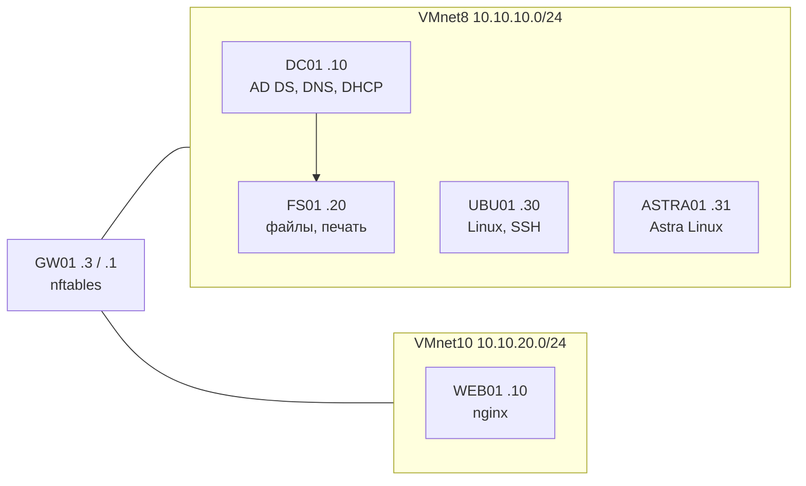

# Резюме и портфолио системного администратора: GitHub, схемы, кейсы, метрики результата

## 1. Введение (зачем это нужно в реальной работе)

Тикет в пятницу, 17:40:

> **Пользователь:** petrova (Мария Петрова, HR) / **ВМ:** WIN10-CL02
> **Что написала:** «Алексей, мы подаём заявку на тендер, в требованиях — резюме двух инженеров по форме и подтверждение опыта. Нужно до понедельника, 10:00. И заодно руководитель просил обновить твой профиль в реестре ИТ-компетенций. Скинь в Word, пожалуйста, чтобы я вставила в форму».
> **Срочность:** высокая, дедлайн 2 дня.

Знакомо? Резюме в жизни сисадмина нужно не только при поиске работы. Его просят для тендера, для гранта, для аккредитации, для подтверждения квалификации подрядчика, для внутреннего реестра компетенций, для перевода на другую должность, для визы/релокации, наконец — для собеседования. И почти всегда его просят «вчера» и «в Word».

Дальше — важнее. Рынок сисадминов в Москве устроен так, что на входе у вас нет коммерческого опыта, а на выходе спрашивают: «Покажите, что вы делали». Единственный способ закрыть этот разрыв — портфолио: публичный или условно-публичный набор артефактов, который доказывает, что вы не только читали про Active Directory, но и разворачивали её, ломали и починили. Ваш стенд «Вектор» — это идеальный полигон: он полностью ваш, там нет данных клиента, и его можно показывать.

После этой главы вы будете уметь: собирать метрики своей работы командами, а не «на глаз»; упаковывать проекты 101–104 в кейсы по формату STAR с цифрами; вести git-репозиторий портфолио с README, схемами и историей коммитов; делать из одного markdown-файла резюме в docx/pdf; и главное — не выложить в публичный доступ пароль от домена (это, к сожалению, самая частая история).

## 2. Теория «под капотом» (как это работает: архитектура, протоколы)

Резюме и портфолио — это не «документ» и «папка», а **система доказательств**. Разложим по слоям.

**Слой 1. Позиционирование.** Кто вы и на какую роль претендуете. «Системный администратор» — слишком широко; на московском рынке в вакансиях разделяют: инфраструктурный сисадмин (AD, файлы, печать, бэкапы), сетевой инженер, Linux-админ, DevOps-инженер. Ваш трек — инфраструктурный сисадмин с уклоном в Linux и автоматизацию, и это должно быть написано в первой строке резюме.

**Слой 2. Ключевые слова (ATS).** Крупные площадки и HR-системы (hh.ru, «Хабр Карьера», внутренние порталы) разбирают резюме парсером — **ATS**, Applicant Tracking System. Парсер ищет точные совпадения терминов из вакансии: «Active Directory», «VMware vSphere», «Proxmox», «Ansible», «Zabbix», «nftables», «КриптоПро», «Astra Linux». Если у вас написано «служба каталогов Microsoft», а в вакансии «Active Directory» — вас не найдут. Вывод: технические термины пишем канонично, как в вакансиях, а не «литературно».

**Слой 3. Артефакты.** То, что можно открыть и потрогать: репозиторий, схемы, playbook, скрипт, runbook, чек-лист аудита, вывод команд. Это слой, который отличает вас от 200 других резюме.

**Слой 4. Метрики.** Цифры «до/после». Именно они превращают «участвовал в миграции» в «мигрировали 12 ВМ с VMware на Proxmox без простоя, окно недоступности 0 минут, срок — 2 ночи по 4 часа».

**Слой 5. Воспроизводимость.** README, из которого другой человек может повторить вашу лабораторную. Это косвенное доказательство, что вы понимаете, что делаете: тот, кто не понимает, не может описать шаги.

**Лестница силы доказательств** (от слабого к сильному):

```text
сертификат  →  скриншот  →  конфиг/скрипт  →  работающий стенд + README
            →  публичный репозиторий с историей коммитов и issues
            →  + схема + метрики + отзыв/рекомендация
```

Сертификат — самый слабый элемент: он говорит «я сдал экзамен», а не «я умею». Историю коммитов подделать трудно, поэтому она ценится.

**Структура портфолио-репозитория** (то, что мы соберём в лабораторной):

```text
vektor-portfolio/
├── README.md              # кто я, что внутри, оглавление, схема стенда
├── 00-metrics/            # сырые выгрузки: сколько пользователей, хостов, ГБ
├── 01-resume/             # resume.md — единственный источник правды
├── 02-cases/              # кейсы в формате STAR: ad-deploy.md, migrate-pve.md, ...
├── 03-diagrams/           # схемы в Mermaid: сеть, домен, DMZ
├── 04-scripts/            # обезличенные скрипты и playbook'и
├── 05-runbooks/           # регламенты: «что делать, если упал DC01»
└── .gitignore             # чтобы секреты не улетели в публичный репозиторий
```

**Формат кейса — STAR** (Situation, Task, Action, Result) или его вариация CARL. Четыре блока: контекст → задача → что сделал именно я → результат с цифрой. Именно так отвечают на собеседовании, и именно так читается кейс в портфолио.

**Про метрики.** Хорошая метрика — измеримая и с базой сравнения. Плохо: «оптимизировал бэкапы». Хорошо: «время полного бэкапа FS01: 6 ч 40 мин → 1 ч 55 мин, окно бэкапа сокращено с ночи до 2 часов, RPO 24 ч → 4 ч». Метрики сисадмина обычно лежат в четырёх группах: **доступность** (uptime, MTTR, число инцидентов), **скорость** (время выполнения операций, RTO), **охват** (сколько пользователей/хостов/сервисов обслуживается) и **деньги/время** (сколько часов в месяц сэкономлено автоматизацией).

И отдельно — **юридическая гигиена**. Публикуя портфолио, вы работаете с NDA, персональными данными (152-ФЗ) и коммерческой тайной. Правило простое: в публичный доступ идёт **только ваш лабораторный стенд**, а рабочее — в обезличенном виде («крупный логистический оператор, 350 пользователей») без реальных IP, имён хостов, логинов и конфигов. Об этом же был урок 100 про этику и ответственность.

## 3. Аналогия из жизни

Представьте мастера по ремонту квартир. В объявлении он пишет: «плитка, электрика, сантехника, сроки от 2 недель, работаю с материалами заказчика» — это **резюме**: что умею и на каких условиях. Дальше он открывает альбом: фото «до/после» ванной, план квартиры с разводкой, смета на 180 тысяч, отзывы и сроки по прошлым объектам — это **портфолио**. Заказчик не верит словам «я аккуратный», он смотрит на шов между плитками на фото и на то, уложился ли мастер в срок.

Ровно так же работодатель не верит строчке «администрирую Active Directory», он хочет увидеть структуру OU, схему сайтов и репликации, вывод `dcdiag` и историю коммитов с датами. Разница только в том, что у сисадмина «шов между плитками» часто невидим: лучший результат нашей работы — авария, которая не случилась, поэтому фото не работают, а работают цифры и графики «до/после».

Где аналогия ломается: у отделочника результат статичен — объект сдан и больше не меняется, а ваша инфраструктура живая, и через полгода тот же стенд будет выглядеть иначе; поэтому портфолио нужно версионировать (git-теги), иначе через два года вы сами не вспомните, что именно показывали.

## 4. Практика и команды

Сначала — как собрать честные цифры о своей работе. Все команды ниже выполняются на стенде «Вектор» и читают данные, ничего не меняя.

**1. Сколько пользователей и групп вы обслуживаете (DC01, PowerShell от `adm.student`)**

```powershell
(Get-ADUser -Filter * -SearchBase "OU=Company,DC=corp,DC=vektor,DC=lab" -SearchScope Subtree).Count
Get-ADGroup -Filter * | Select-Object Name, GroupScope
```

Вывод:

```text
3
Name        GroupScope
----        ----------
GG-Buh      Global
GG-HR       Global
```

`-SearchBase` ограничивает поиск веткой OU, `-SearchScope Subtree` включает вложенные OU. Смотрим: это число и идёт в резюме как «обслуживание N учётных записей в AD». На реальной работе сюда же добавляют `-Filter {Enabled -eq $true}` — считают только активных.

**2. Сколько устройств реально в сети (DC01, DHCP-скоуп)**

```powershell
Get-DhcpServerv4Scope -ComputerName DC01 | Select-Object ScopeId, Name, StartRange, EndRange
(Get-DhcpServerv4Lease -ComputerName DC01 -ScopeId 10.10.10.0).Count
```

Вывод:

```text
ScopeId     Name          StartRange    EndRange
10.10.10.0  Office-LAN    10.10.10.100  10.10.10.150
2
```

Смотрим количество активных аренд — это фактическое число рабочих станций «под вами». Метрика для резюме: «пул DHCP на 51 адрес, N активных клиентов».

**3. Объём данных под ответственностью (FS01 или с клиента через UNC)**

```powershell
Get-ChildItem -Path "\\FS01\Buh" -Recurse -ErrorAction SilentlyContinue |
  Measure-Object -Property Length -Sum |
  Select-Object Count, @{n='GB';e={[math]::Round($_.Sum/1GB,2)}}
```

Вывод:

```text
Count   GB
  412 1.87
```

`-Recurse` обходит вложенные папки, `-ErrorAction SilentlyContinue` глушит ошибки доступа (нормально, если прав не на всё), хэш-таблица пересчитывает байты в гигабайты. Метрика: «1.9 ГБ корпоративных данных в трёх общих папках, права по группам доступа».

**4. Аптайм и патчи (любая Windows-ВМ)**

```powershell
Get-CimInstance Win32_OperatingSystem | Select-Object LastBootUpTime
Get-HotFix | Sort-Object InstalledOn -Descending | Select-Object -First 5 HotFixID, InstalledOn
```

Вывод:

```text
LastBootUpTime
10.02.2026 7:14:03

HotFixID  InstalledOn
KB5049983 09.02.2026
```

Смотрим дату загрузки (аптайм) и последние обновления — это аргумент «стенд обслуживается регулярно», а не «стоит с установки».

**5. То же на Linux (UBU01, bash)**

```bash
uptime -p
systemctl list-units --type=service --state=running | wc -l
ss -tulpn | wc -l
```

Вывод:

```text
up 3 weeks, 2 days, 4 hours
24
11
```

`-p` даёт человекочитаемый аптайм, `wc -l` считает строки, `ss -tulpn` показывает слушающие сокеты (`-t` TCP, `-u` UDP, `-l` listen, `-p` процесс, `-n` без DNS). В резюме это превращается в «Linux-сервер: 24 сервиса, 11 слушающих портов, аптайм 23 дня».

**6. Создание репозитория портфолио (UBU01)**

```bash
mkdir -p ~/portfolio && cd ~/portfolio
git init -b main
git config user.name "adm.student"
git config user.email "adm.student@corp.vektor.lab"
```

`-b main` задаёт основную ветку сразу (в git 2.28+), `git config` без `--global` пишет настройки только в этот репозиторий. Проверяем: `ls -a` должен показать `.git`.

**7. Проверка на секреты перед коммитом (обязательный приём)**

```bash
grep -rniE "password|passwd|secret|Lab#2026|adm\.student" . --exclude-dir=.git
```

Вывод:

```text
./04-scripts/fs01-backup.ps1:4:$cred = "VEKTOR\adm.student"
```

`-r` рекурсивно, `-n` с номерами строк, `-i` без учёта регистра, `-E` расширенные регулярки. Смотрим: каждая найденная строка — потенциальный инцидент. В нормальной среде это автоматизируют через pre-commit-хуки и secret scanning на стороне хостинга.

**8. Коммит и «график работы»**

```bash
git add -A
git commit -m "portfolio: README, 3 cases (STAR), network diagram, metrics"
git log --oneline --graph --decorate --all
git shortlog -sne
```

Вывод:

```text
* 4a1e0c2 (HEAD -> main, tag: v1.0) portfolio: README, 3 cases, diagram
* 91b7d55 resume: draft for tender form
    12  adm.student <adm.student@corp.vektor.lab>
```

`--oneline --graph --decorate` рисует историю компактно, `shortlog -sne` суммирует коммиты по авторам. Смотрим: регулярность и осмысленность сообщений коммитов — интервьюер это правда смотрит. «init», «update», «fix» × 40 — плохой сигнал.

**9. Публикация: SSH-ключ и remote (UBU01)**

```bash
ssh-keygen -t ed25519 -C "adm.student@corp.vektor.lab"
cat ~/.ssh/id_ed25519.pub
ssh -T git@github.com
git remote add origin git@github.com:<ваш-логин>/vektor-portfolio.git
git push -u origin main
```

Вывод `ssh -T`:

```text
Hi <login>! You've successfully authenticated, but GitHub does not provide shell access.
```

`-t ed25519` — современный тип ключа, `-C` — комментарий-метка. Публичный ключ добавляется в веб-интерфейсе: **Settings → SSH and GPG keys → New SSH key**. `-u` связывает локальную ветку с удалённой, дальше хватит `git push`. **Важно:** GitHub из РФ может работать нестабильно, легальные альтернативы — GitFlic и GitVerse `[ПРОВЕРИТЬ актуальный статус и условия бесплатных тарифов]`, синтаксис git одинаковый.

**10. Тег версии портфолио**

```bash
git tag -a v1.0 -m "portfolio for tender 2026-02"
git push origin v1.0
```

`-a` создаёт аннотированный тег (с автором и датой), `-m` — сообщение. Смысл: зафиксировать состояние «вот это я показывал в феврале 2026», чтобы потом честно сказать, что изменилось.

**11. Схема текстом — Mermaid прямо в README**

````text

````

GitHub/GitLab рендерят блок ```` ```mermaid ```` в картинку, а хранится он текстом — значит, схема диффится и не превращается в «схема_финал_новый2.png».

**12. Один источник → много форматов (UBU01, pandoc)**

```bash
pandoc 01-resume/resume.md -o 01-resume/resume.docx
pandoc 01-resume/resume.md -o 01-resume/resume.pdf --pdf-engine=xelatex -V mainfont="DejaVu Sans"
```

Вывод: команда молчит — значит, файл создан. `-o` задаёт выход, `--pdf-engine` выбирает движок (для PDF нужен установленный LaTeX и шрифт с кириллицей, иначе вылезут квадраты) `[ПРОВЕРИТЬ набор шрифтов в вашей установке]`. docx собирается «из коробки» и обычно именно его просит HR. Плюс подхода: правите один markdown — обновляются и docx, и PDF, и веб-версия.

## 5. Лабораторная работа (пошаговый сценарий на виртуалке)

### Предусловия

Стенд трека «Системный администратор» готов: DC01 (AD DS, DNS, DHCP), FS01 (файлы, печать), UBU01 (10.10.10.30, SSH), ASTRA01, домен `corp.vektor.lab`, учётка `adm.student`, OU и группы на месте. PVE01 (10.10.10.70) — если вы уже делали уроки 101–104, потому что один из кейсов будет про миграцию на него. Проекты 101–104 — ваш «сырой материал»: не проходили — используйте вместо них лабораторные из модулей AD, файлов и Linux, суть кейса не меняется.

Дополнительно нужно: аккаунт на хостинге git (GitHub / GitFlic / GitVerse `[ПРОВЕРИТЬ доступность и бесплатный тариф]`) и 40–60 минут. Всё делаем **на учебном стенде**, поэтому адреса 10.10.10.x публиковать безопасно — они не маршрутизируются в интернет и принадлежат нам.

### Снапшот

На UBU01 (единственная ВМ, которую мы меняем) в VMware Workstation: **ВМ → Snapshot → Take Snapshot**, имя `before-sysadmin-105`. DC01 и FS01 мы только читаем, но правило стенда — единое: если не уверены, что действие read-only, снимайте снапшот и с них тоже.

### Шаги

1. **DC01.** Соберите метрики по каталогу: `(Get-ADUser -Filter * -SearchBase "OU=Company,DC=corp,DC=vektor,DC=lab").Count`, список групп `Get-ADGroup -Filter * | Select Name`, скоуп DHCP. Ожидаемо: 3 пользователя в OU `Company`, 4 группы `GG-*`, скоуп `10.10.10.0` с пулом `.100–.150`.
2. **DC01.** Сохраните вывод в файл: `... | Out-File C:\metrics-dc01.txt`. Скопируйте содержимое — оно поедет в портфолио как сырые данные.
3. **FS01.** Соберите метрики по шарам и принтерам: `Get-SmbShare | Select Name, Path`, `Get-Printer | Select Name, DriverName`, объём папки `Buh` (команда №3 из раздела 4). Ожидаемо: шары `Obshchee`, `Buh`, `HR`.
4. **UBU01.** Соберите Linux-метрики: `uptime -p`, `systemctl list-units --type=service --state=running | wc -l`, `ss -tulpn`, `df -h /`. Ожидаемо: аптайм в днях, число сервисов и портов.
5. **UBU01.** Создайте скелет репозитория: `mkdir -p ~/portfolio/{00-metrics,01-resume,02-cases,03-diagrams,04-scripts,05-runbooks} && cd ~/portfolio && git init -b main`. Ожидаемо: пустой git-репозиторий с шестью папками.
6. **UBU01.** Положите собранные метрики: создайте `00-metrics/dc01.txt`, `fs01.txt`, `ubu01.txt` с выводом из шагов 1–4. Ожидаемо: три текстовых файла с реальными цифрами стенда.
7. **UBU01.** Нарисуйте схему в `03-diagrams/network.md` блоком ```mermaid (шаблон — команда №11). Ожидаемо: схема с DC01, FS01, UBU01, ASTRA01, GW01, WEB01 и двумя подсетями.
8. **UBU01.** Напишите `01-resume/resume.md`: шапка (ФИО, «системный администратор, инфраструктура Windows/Linux, Москва»), блок «Стек» с уровнями (Windows Server 2022 — уверенно; Proxmox — учебный проект; Ansible — базово), блок «Проекты с результатом» из 3–4 строк с цифрами, образование, план сертификаций. Ожидаемо: 1–1,5 страницы markdown.
9. **UBU01.** Напишите три кейса в `02-cases/` по STAR: `ad-deploy.md` (проект 101 — развёртывание AD и файлового сервера), `migrate-pve.md` (102 — миграция на Proxmox, окно простоя), `hardening.md` (103 — аудит и закрытие портов). В каждом — блок **Результат** с числом из `00-metrics/`. Ожидаемо: три файла по 200–400 слов.
10. **UBU01.** Скопируйте один обезличенный артефакт в `04-scripts/` (например, playbook из урока 104 или скрипт инвентаризации) и **прогоните проверку на секреты** (команда №7). Ожидаемо: пусто или только учебные пути; всё, что похоже на пароль, — вырезаем.
11. **UBU01.** Соберите `README.md`: 3 предложения о себе, оглавление, схема из шага 7, список кейсов со ссылками, раздел «Как воспроизвести стенд» на 5 пунктов. Ожидаемо: README читается человеком, который вас не знает.
12. **UBU01.** Коммит, ключ, публикация: `git add -A && git commit -m "portfolio v1.0: metrics, 3 STAR cases, diagram"`, затем `ssh-keygen -t ed25519`, добавление ключа на хостинге, `git remote add origin ...`, `git push -u origin main`, `git tag -a v1.0 -m "..."` и `git push origin v1.0`. Ожидаемо: репозиторий открывается в браузере, схема отрисована, тег виден в разделе Releases/Tags.
13. **UBU01.** Сделайте docx для HR: `pandoc 01-resume/resume.md -o 01-resume/resume.docx`. Ожидаемо: файл открывается в Word, кириллица на месте.
14. **Хост.** Допишите в `stand-log.md`: «UBU01: каталог ~/portfolio (git), ключ ~/.ssh/id_ed25519, внешний репозиторий v1.0; DC01/FS01 — read-only сбор метрик».

### Проверка

- [ ] В `00-metrics/` лежат три файла с реальными цифрами стенда, а не с потолка.
- [ ] `git status` в `~/portfolio` — рабочее дерево чистое, `git log --oneline` показывает осмысленные сообщения (не `update`).
- [ ] `git grep -niE "Lab#2026|password|secret"` не находит ничего.
- [ ] В `01-resume/resume.md` есть минимум три достижения с числами и ни одного «участвовал в…» без роли.
- [ ] README на хостинге рендерит Mermaid-схему картинкой.
- [ ] Три кейса содержат все четыре блока STAR и ссылку на метрику.
- [ ] `resume.docx` открывается, вёрстка не развалилась, кириллица читается.
- [ ] Тег `v1.0` виден на хостинге, ссылка на репозиторий есть в резюме.
- [ ] В `stand-log.md` появилась запись о новой машине/каталоге/ключе.

### Сломай и почини

> **Пользователь:** petrova (Мария Петрова, HR) / **ВМ:** WIN10-CL02
> **Что написала:** «Алексей, в резюме для тендера ссылка на ваш git. Я открыла — там в файле скрипта логин и пароль от нашего файлового сервера открытым текстом. Заявку отправляем через час, уберите, пожалуйста, срочно!»
> **Срочность:** критическая

**Как воспроизвести поломку (на стенде, осознанно).** На UBU01 в `04-scripts/` создайте `fs01-backup.ps1` с содержимым `$user = "VEKTOR\adm.student"; $pass = "Lab#2026-vektor"`, закоммитьте и запушьте. Откройте репозиторий в режиме инкогнито — файл виден всему интернету. В реальной среде это уже утечка: считайте, что пароль скомпрометирован.

**Диагностика по порядку.**

1. Найти все вхождения: `git grep -niE "Lab#2026|adm\.student" $(git rev-list --all)` — покажет файл **во всех коммитах**, включая старые.
2. Понять масштаб: `git log --oneline -- 04-scripts/fs01-backup.ps1` — когда файл попал в историю и был ли репозиторий публичным в этот момент. Если да — считаем пароль утёкшим.
3. Проверить, нет ли других секретов: `grep -rniE "password|passwd|secret|token|Lab#2026" . --exclude-dir=.git`.

**Решение.**

1. Сменить пароль `adm.student` (на стенде — формальность, в бою — обязательный шаг №1) и все пароли, которые были в файле.
2. Удалить файл из рабочего дерева и **из всей истории**: `pipx install git-filter-repo` `[ПРОВЕРИТЬ установку в вашей системе]`, затем `git filter-repo --path 04-scripts/fs01-backup.ps1 --invert-paths`. `--invert-paths` означает «удалить указанный путь из истории».
3. Добавить `.gitignore` (`*.env`, `*secret*`, `*.pfx`, `*.key`) и переписать скрипт на чтение креденшелов из хранилища, а не из литерала.
4. Зафорсить историю: `git push --force --all` и `git push --force --tags`; попросить коллег переклонировать.
5. Включить на хостинге secret scanning / push protection (`[ПРОВЕРИТЬ название функции в вашем хостинге]`) и поставить pre-commit-хук с тем же grep из шага 7 раздела 4.
6. Проверить из режима инкогнито: файла нет ни в текущей ветке, ни в истории (`git log --all --oneline -- 04-scripts/fs01-backup.ps1` пусто).

**Ответ пользователю:** «Мария, спасибо, что заметили. Файл удалён из репозитория и из всей истории, доступ к нему закрыт; пароль заменён. Ссылка для заявки: <URL>, там только учебный стенд, реальных данных компании нет. В форме резюме — во вложении, до 10:00 будет у вас».

**Закрытие заявки:** категория «инцидент ИБ», приоритет высокий, в описании — время обнаружения, время реакции, что сделано, корневая причина («секрет в открытом виде в публичном репозитории»), профилактика (хук + secret scanning + правило «секреты только в хранилище»). Отметить в `stand-log.md`.

### Что изменилось на стенде

- **UBU01:** новый каталог `/home/<user>/portfolio` — git-репозиторий портфолио (папки `00-metrics`, `01-resume`, `02-cases`, `03-diagrams`, `04-scripts`, `05-runbooks`), файлы метрик, резюме, три кейса, схема сети в Mermaid, README.
- **UBU01:** сгенерирован SSH-ключ `~/.ssh/id_ed25519` (публичная часть добавлена на хостинге).
- **Внешний ресурс:** репозиторий `<login>/vektor-portfolio` с тегом `v1.0` — не часть стенда, но ссылка на него теперь есть в резюме.
- **DC01 / FS01:** без изменений, только чтение данных (метрики в `00-metrics/`).
- **Хост:** обновлён `stand-log.md`, добавлены локальные копии `resume.docx` / `resume.pdf`.

### Откат

Если что-то пошло не так (например, случайно удалили папки или хотите начать портфолио заново): в VMware Workstation выберите UBU01 → **Snapshot Manager** → `before-sysadmin-105` → **Revert**. Учтите: снапшот вернёт ВМ, но **не удалит внешний репозиторий** на хостинге — его чистим отдельно (Settings → Delete repository) или оставляем как есть, если история уже исправлена. После откатa обязательно допишите в `stand-log.md` строку «откат к before-sysadmin-105, репозиторий пересоздаётся».

## 6. Ошибки новичков и безопасность

1. **Резюме-простыня «знаю всё».** 40 технологий в столбик без уровней → к вам не приходят ни на инфраструктуру, ни на DevOps, потому что непонятно, куда вы. *Правильно:* 3 уровня владения («уверенно / рабочий опыт / учебный проект») и по 1–2 технологии на уровень.
2. **Достижения без цифр и без роли.** «Участвовал в миграции» → читается как «носил кофе». *Правильно:* «мигрировал 12 ВМ на Proxmox, простой 0 минут, срок 2 ночи» — и слово «я», а не «мы».
3. **Свалка скриншотов вместо портфолио.** 60 картинок без подписей → никто не смотрит. *Правильно:* артефакт + 2–3 предложения контекста + ссылка на кейс.
4. **Мёртвый репозиторий.** Один коммит `init` год назад → хуже, чем отсутствие репозитория: видно, что начинали и бросили. *Правильно:* либо регулярные коммиты, либо не публикуйте.
5. **Метрики-пустышки.** «Ускорил работу на 30%» без базы → первый же вопрос «от чего считали?» вас роняет. *Правильно:* всегда «было → стало → как мерили».
6. **Резюме в формате картинки или .pages.** Парсер ATS не прочитает → вас нет в выдаче. *Правильно:* docx или текстовый PDF, один столбец, без таблиц-невидимок и фото на полстраницы.
7. **Ссылка на «портфолио» на диске.** «Могу показать при встрече» → не покажете. *Правильно:* публичная ссылка, которая открывается с телефона за 5 секунд.
8. **Выдуманный опыт.** Приписанный Kubernetes/Ansible вскрывается на первом техническом вопросе и закрывает вакансию навсегда. *Правильно:* пишите «учебный проект, кластер из 3 узлов на стенде, прошёл такие задачи» — это честно и проверяемо.

### Безопасность

В боевой среде **нельзя** публиковать: реальные IP-адреса и имена хостов, схемы сети с адресацией, конфиги с секретами, экспорты AD, скриншоты с ФИО сотрудников, номера договоров и названия клиентов без письменного разрешения. Это NDA и коммерческая тайна; персональные данные сотрудников — отдельная зона ответственности по 152-ФЗ. Пароли и ключи — только в хранилище секретов (KeePass/Vault/GPO-предпочтения), никогда в git; **удаление файла новым коммитом не удаляет его из истории**. Если секрет всё же утёк — сначала ротация пароля, потом чистка истории. И помните: у утёкшего секрета нет срока давности, считать «наверное, никто не видел» — профессиональная ошибка.

## 7. Вопросы на собеседовании

**1. «Расскажите про ваш самый заметный проект. Что именно делали вы?»**

Ответ: структура STAR + ваша роль + цифра. «Стенд на 6 серверов: разворачивал AD с нуля — ставил DC01, поднимал DNS и DHCP, проектировал OU под четыре отдела, настраивал права на файловых шарах через группы доступа. Отдельно сделал второй контроллер и проверил репликацию. Результат: 3 пользователя, 3 группы, вход в домен с двух рабочих мест, восстановление после сбоя укладывается в снапшот; всё описано в репозитории с runbook'ом».
*Что хочет услышать интервьюер:* что вы понимаете границы своей работы и умеете назвать результат измеримо.
*Красный флаг:* «Мы командой внедрили…» без единого «я» — значит, вы не сможете ответить на уточняющие вопросы.

**2. «Почему вы считаете себя сильным администратором? Приведите пример.»**

Ответ: через метрику и процесс, а не самооценку. «Я закрываю причины, а не симптомы: после третьего падения шары из-за переполнения диска настроил алерт в Zabbix на 80% и увеличил том; повторных инцидентов за квартал — ноль. Плюс автоматизировал то, что делал руками: инвентаризация из 6 команд — один скрипт, 20 минут в неделю превратились в 2».
*Что хочет услышать:* инженерное мышление и профилактику.
*Красный флаг:* «Я быстро всё чиню» без примера и без чисел.

**3. «В резюме у вас Ansible и Proxmox. Покажите, что делали руками.»**

Ответ: честно разграничить уровень. «Proxmox — учебный проект: поднял PVE01 во вложенной виртуализации, перенёс 12 ВМ, проверил снапшоты и бэкап на отдельный диск. Ansible — рабочий уровень в лаборатории: playbook на 8 задач, идемпотентность проверял повторным прогоном. В проде Ansible не катал — вот репозиторий, там видно, что сделано». Если опыта нет — так и говорите.
*Что хочет услышать:* соответствие резюме реальности и готовность признать границы.
*Красный флаг:* «Да, всё умею, делал в проде» — и потом не может ответить, что такое inventory и зачем `become`.

**4. «Что вы сделали за последний год, чтобы инфраструктура стала лучше?»**

Ответ: проактивные улучшения с эффектом. «Закрыл RDP наружу, вынес доступ через VPN; включил аудит и централизованный сбор логов; настроил бэкап по схеме 3-2-1 и раз в квартал делаю тестовое восстановление — последнее заняло 40 минут при RTO 4 часа. Всё оформлено регламентом, чтобы не зависеть от меня лично».
*Что хочет услышать:* инициатива, безопасность, документирование.
*Красный флаг:* «Работал по заявкам, всё как обычно» — сигнал исполнителя без развития.

**5. «Можно посмотреть ваш GitHub? Что там за проекты?»**

Ответ: открыть ссылку и за 30 секунд провести экскурсию. «Репозиторий `vektor-portfolio`: README с оглавлением, три кейса в STAR, схема сети в Mermaid, скрипты и runbook'и. Это мой учебный стенд по мотивам рабочих задач — реальных данных компании там нет по NDA. Ветка с тегом v1.0 — то, что показывал на тендере; дальше по истории видно, что добавилось».
*Что хочет услышать:* что портфолио поддерживается и вы осознаёте границы публикации.
*Красный флаг:* «Пока не выкладывал, но могу показать на словах» — либо ссылка на репозиторий с одним коммитом.

## 8. Источники (официальная документация)

- **hh.ru** — домен `hh.ru`, раздел «Как составить резюме» / «Правила оформления резюме». Поиск: `hh.ru как составить резюме советы`.
- **GitHub Docs** — домен `docs.github.com`, статьи «About READMEs», «Connecting to GitHub with SSH», «About secret scanning», «Creating a repository from a template». Поиск: `github docs about readmes ssh secret scanning`.
- **Mermaid** — домен `mermaid.js.org`, раздел «Flowchart» / «Syntax». Поиск: `mermaid flowchart syntax subgraph`.
- **Git** — домен `git-scm.com`, книга Pro Git, главы «Git Basics» и «Git Tools → Rewriting History», `git-filter-repo` в разделе документации `[ПРОВЕРИТЬ точное расположение страницы]`. Поиск: `pro git rewriting history git filter-repo`.
- **Pandoc** — домен `pandoc.org`, раздел «User's Guide» (опции `-o`, `--reference-doc`, `--pdf-engine`). Поиск: `pandoc user guide create docx pdf engine`.
- **Microsoft Learn** — домен `learn.microsoft.com`, разделы «Active Directory Domain Services», «DHCP Server Cmdlets», «SMB Share Cmdlets», «Get-CimInstance». Поиск: `learn.microsoft.com Get-ADUser Get-DhcpServerv4Lease`.
- **Профстандарты Минтруда РФ** — домен `mintrud.gov.ru` / реестр профстандартов, профстандарт системного администратора информационно-коммуникационных систем `[ПРОВЕРИТЬ номер и актуальную редакцию: встречается обозначение 06.026]`. Поиск: `профстандарт системный администратор информационно-коммуникационных систем mintrud`.
- **GitFlic / GitVerse** — домены `gitflic.ru`, `gitverse.ru`, разделы помощи по SSH-ключам и тарифам `[ПРОВЕРИТЬ актуальные условия]`. Поиск: `gitflic добавить ssh ключ инструкция`.

Всё, что помечено `[ПРОВЕРИТЬ]`, сверяйте по первоисточнику: версии, тарифы и профстандарты меняются чаще, чем выходят такие главы.
